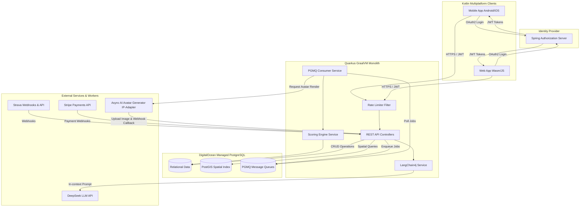
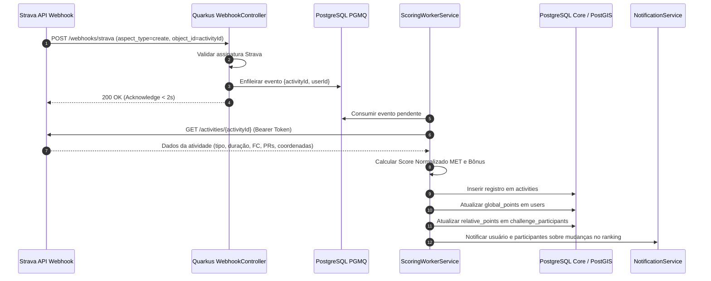
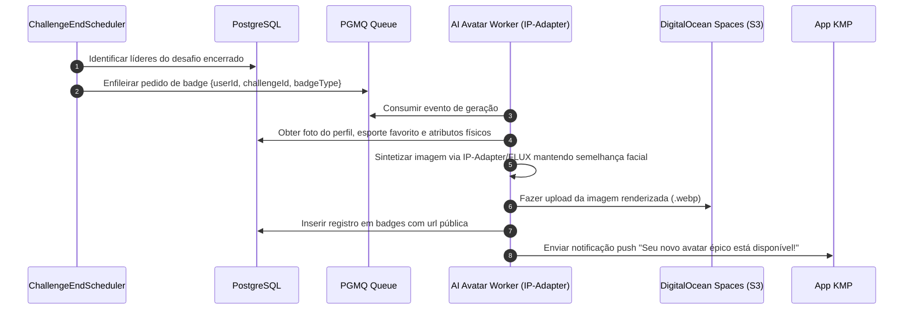

# Requirements

### Overview & Goals
O **FitFight** é uma plataforma de fitness gamificada e social que transforma a jornada de saúde e condicionamento físico em uma competição interativa, saudável e sustentável. Ao integrar dados do Strava, balanças de bioimpedância e dispositivos vestíveis, o sistema quantifica o esforço individual e a composição corporal real dos participantes por meio de um algoritmo que recompensa hábitos saudáveis, penaliza o sedentarismo e coíbe fraudes.

O objetivo desta documentação é prover uma base formal, completa e estruturada — com modelos de dados, contratos, fluxos e diagramas Mermaid — servindo de especificação canônica para desenvolvedores de software e agentes de IA implementarem o sistema de ponta a ponta.

### Scope

#### In Scope
- **Motor de Gamificação e Pontuação Normalizada**: Algoritmo baseado em MET (*Metabolic Equivalent of Task*) calibrado pelo baseline do usuário, bonificando atividades externas, troféus/PRs do Strava e melhoria real na bioimpedância (massa magra vs. gordura), com penalidade diária para inatividade.
- **Desafios e Competições em Grupo**: Criação de desafios com pontuação relativa zerada na largada, ranking dinâmico dia-a-dia, convites via link/e-mail e histórico de posições.
- **Insígnias e Avatares com IA Generativa**: Geração assíncrona de ilustrações épicas personalizadas (retenção facial e corporal via IP-Adapter/FLUX) para líderes semanais, mensais e campeões gerais (avatar no trono).
- **Busca Social e Geolocalização**: Busca de atletas e competições por proximidade geográfica via PostGIS priorizando usuários no raio local.
- **Monetização e Marketplace**: Feed de anúncios contextuais não invasivos, marketplace com abas de profissionais (personal trainers), produtos e eventos, além de painel de anunciantes com checkout via Stripe.
- **Assistente IA de Performance**: Seção de insights na tela de estatísticas utilizando LangChain4j e DeepSeek via RAG sobre o histórico do usuário.
- **Ecossistema Tecnológico**: Backend em Quarkus GraalVM (Kotlin), banco PostgreSQL com PostGIS e PGMQ, autenticação desacoplada em Spring Authorization Server e frontend Kotlin Multiplatform (Android, iOS e Web).

#### Out of Scope
- Criação de hardware próprio ou firmware proprietário para relógios esportivos.
- Processamento de pagamentos fora do gateway Stripe.
- Suporte a modelos de Machine Learning on-device nos clientes móveis (todo processamento de IA é centralizado no backend/workers).

### User Stories
- **US01 - Atleta Amador**: Como praticante de esportes, quero sincronizar minhas atividades do Strava para que meus treinos e recordes pessoais gerem pontos no FitFight e atualizem minha posição nos desafios.
- **US02 - Usuário em Reeducação Corporal**: Como usuário focado em perda de peso, quero registrar minha bioimpedância para que meu ganho de massa muscular seja recompensado e a perda prejudicial de massa magra seja devidamente sinalizada.
- **US03 - Líder de Desafio**: Como competidor em um grupo com amigos, quero acompanhar as variações diárias no ranking e desbloquear insígnias com minha imagem gerada por IA no topo do pódio ou no trono.
- **US04 - Atleta em Busca de Comunidade**: Como novo participante, quero encontrar outros atletas praticantes do mesmo esporte próximos da minha geolocalização para criar desafios locais.
- **US05 - Personal Trainer / Anunciante**: Como profissional de educação física ou empresa do setor esportivo, quero anunciar meus serviços e gerenciar campanhas segmentadas com pagamento seguro via Stripe.

### Functional Requirements

#### 1. Autenticação e Perfis
- Suporte a login social via Google e Strava OAuth2, além de autenticação clássica com e-mail e senha.
- Todo fluxo de autenticação e emissão de tokens JWT (Access Token de curta duração e Refresh Token) é provido por uma instância independente do **Spring Authorization Server**.
- Perfil do usuário contendo dados biométricos essenciais: idade, gênero, altura, peso, histórico de bioimpedância (massa gorda, massa magra, água corporal) e esporte favorito.

#### 2. Motor de Pontuação e Gamificação (MET-based)
- **Cálculo de Atividades**: A pontuação bruta é calculada por $Pontos = MET \times Duração(horas) \times FatorAmbiente \times FatorFrequenciaCardiaca$.
  - Atividades externas (corrida de rua, ciclismo outdoor, natação em águas abertas) possuem fator $FatorAmbiente = 1.3$, enquanto treinos internos possuem $FatorAmbiente = 1.0$.
  - Atividades longas possuem multiplicador progressivo de consistência.
- **Troféus e Recordes no Strava**: Bônus adicionais quando o webhook do Strava sinalizar `pr_count > 0`, melhora de PR em segmento, rota ou atividade inteira.
- **Bioimpedância e Peso**:
  - Perda de peso com redução de percentual de gordura e preservação de massa magra: pontuação máxima.
  - Perda de peso acompanhada de redução de massa magra: penalização de pontos para coibir dietas extremas prejudiciais à saúde.
  - Ganho de massa magra: bonificação proporcional ao delta de hipertrofia.
  - Atualização apenas de peso (sem balança de bioimpedância): pontuação conservadora baseada na média esperada de perda saudável (máx. 1kg/semana).
- **Penalidade de Inatividade**: Caso o usuário passe 24 horas consecutivas sem nenhuma atividade física registrada, uma penalidade fixa de inatividade é subtraída de sua pontuação global acumulada.
- **Pontuação Relativa em Desafios**: Ao iniciar um desafio, todos os participantes começam com 0 pontos relativos no grupo, crescendo estritamente durante o período de vigência da competição.

#### 3. Conquistas com Imagens Geradas por IA
- **Líder Semanal**: Ao manter a liderança de todos os desafios durante uma semana completa, o usuário recebe um badge gerado por IA com seu avatar caracterizado com traços físicos reais, vestindo roupas de seu esporte preferido, medalha no peito e cenário esportivo ao fundo.
- **Líder Mensal**: Badge gerado por IA com o avatar do usuário no topo do pódio recebendo aplausos de seus amigos participantes.
- **Vencedor Geral dos Desafios**: Badge épico do avatar do usuário coroado em um trono com cetro em mãos, e seus competidores ajoelhados em reverência esportiva.
- **Galeria Social**: Exibição dos badges no perfil público do usuário com capacidade de compartilhamento nativo para Instagram Stories, WhatsApp e Strava Feed.

#### 4. Busca, Geolocalização e Feed Social
- Busca de atletas com ordenação geográfica via PostGIS (`ST_DWithin` / `ST_Distance`), priorizando atletas em um raio configurável (ex: até 15 km) antes de expandir para o banco global.
- Cards de desafios na Home exibindo tabela de classificação e indicador direcional (setas para cima ou para baixo) comparando a posição atual com o dia anterior.

#### 5. Monetização, Marketplace e Pagamentos
- Exibição de anúncios discretos no feed da Home e telas de transição, segmentados pelo esporte praticado e localização do atleta.
- Marketplace com três abas navegáveis: **Profissionais** (Personal Trainers, Nutricionistas), **Produtos** (Suplementos, Equipamentos) e **Eventos** (Corridas, Torneios).
- Painel para anunciantes criarem campanhas, definirem orçamentos e acompanharem impressões/cliques.
- Pagamentos e subscrições cobrados via Stripe Checkout e Elements.

#### 6. Análise de Saúde com IA (LangChain4j + DeepSeek)
- Seção interativa na tela de estatísticas que consome os últimos registros biométricos e históricos de treinos.
- A IA gera diagnósticos preditivos (ex: risco de overtraining, taxa de retenção muscular, sugestão de descanso ativo).

### Non-Functional Requirements
- **Performance de Inicialização e Memória**: O backend Quarkus deve ser compilado nativamente via GraalVM, garantindo consumo de memória RAM inferior a 128 MB em repouso e startup time inferior a 50 ms no DigitalOcean App Platform.
- **Limitação de Linha de Código**: A base de código Kotlin deve adotar a convenção de largura de linha de até 180 caracteres para favorecer legibilidade e evitar quebras desnecessárias.
- **Segurança e Proteção de Dados**: Comunicação estritamente sobre HTTPS/TLS 1.3, senhas com hashing bcrypt ou argon2, tokens JWT assinados com RSA-256 e rate limiting via bucket token no Quarkus.
- **Disponibilidade e Resiliência**: Ingestão de webhooks assíncrona desacoplada via filas transacionais no PostgreSQL (PGMQ), assegurando perda zero de eventos mesmo sob picos de tráfego.

# Technical Design

### Current Implementation
O repositório atual possui a estrutura inicial de projeto com o documento de concepção `idea.md`. Não há código de backend ou frontend implementado, o que permite estabelecer uma arquitetura limpa, coesa e moderna desde a primeira linha de código, seguindo rigorosamente os requisitos alinhados.

### Key Decisions
1. **Monólito Reativo Modular (Quarkus + GraalVM)**: Concentração dos módulos no mesmo serviço Quarkus, empregando pacotes desacoplados (`controllers`, `services`, `repositories`, `models`, `ai`, `utils`). Essa abordagem otimiza o uso de recursos computacionais no DigitalOcean App Platform e elimina a complexidade de redes distribuídas.
2. **PostgreSQL com PostGIS e PGMQ**: Uso do PostgreSQL como banco relacional, motor geoespacial (PostGIS) e fila de mensagens transacionais ACID (PGMQ), mantendo conformidade com o princípio de infraestrutura enxuta e zero dependência de daemons externos como Redis ou RabbitMQ.
3. **Autenticação Desacoplada (Spring Authorization Server)**: O servidor de autorização OAuth2/OIDC reside em projeto separado, permitindo a reutilização centralizada de identidade para futuros ecossistemas do mesmo grupo empresarial.
4. **Motor de Pontuação Normalizada por MET**: O cálculo de pontuação utiliza o Equivalente Metabólico da Tarefa ajustado contra a taxa metabólica basal e o histórico individual do atleta, mitigando manipulações artificiais de GPS ou treinos fraudulentos.
5. **Geração Assíncrona de Avatares (Worker Desacoplado)**: Processamento de imagens com retenção facial e composição cênica (IP-Adapter sobre FLUX/Stable Diffusion) executado por worker assíncrono acionado por fila PGMQ, isolando a API Quarkus do consumo de GPU/tempo de render.
6. **IA de Insights com LangChain4j + DeepSeek via RAG**: Análise preditiva e diagnósticos de composição corporal integrados no Quarkus através da biblioteca LangChain4j chamando a API DeepSeek com histórico do atleta injetado contextualmente.

### Architecture Diagram



### Proposed Changes & Module Architecture

#### Backend Quarkus (Estrutura de Pacotes)
Seguindo as diretrizes do projeto, o código será organizado em diretórios bem definidos com linhas de até 180 caracteres:
- `com.fitfight.controllers`: Endpoints REST (`AuthController`, `UserController`, `ActivityController`, `ChallengeController`, `BadgeController`, `MarketplaceController`, `AdController`, `WebhookController`).
- `com.fitfight.services`: Regras de negócio (`ScoringService`, `BioimpedanceService`, `ChallengeService`, `GeoSearchService`, `StripeBillingService`, `AvatarGenerationService`).
- `com.fitfight.repositories`: Acesso a dados com Hibernate Panache ou JDBC reativo (`UserRepository`, `ActivityRepository`, `ChallengeRepository`, `BiometricsRepository`, `AdRepository`).
- `com.fitfight.models`: Entidades JPA e DTOs imutáveis (`User`, `Activity`, `Challenge`, `BiometricsRecord`, `Badge`, `AdCampaign`).
- `com.fitfight.ai`: Clientes e integrações LangChain4j para DeepSeek (`FitnessInsightAgent`, `BioimpedancePromptBuilder`).
- `com.fitfight.utils`: Funções utilitárias de data/hora, conversão de unidades esportivas, validação matemática e cálculo de distâncias esféricas.

#### Frontend Kotlin Multiplatform (KMP)
- `shared`: Lógica compartilhada, DTOs, clientes HTTP Ktor, repositórios em cache e ViewModels baseados em MVI (Model-View-Intent).
- `composeApp`: Interface declarativa com Jetpack Compose Multiplatform compartilhada entre Android, iOS e Web via WebAssembly (Wasm).

### Data Models / Contracts

#### Esquema Relacional Principal (PostgreSQL + PostGIS)
```sql
-- Extensões necessárias
CREATE EXTENSION IF NOT EXISTS postgis;
CREATE EXTENSION IF NOT EXISTS pgmq;

-- Usuários e dados de perfil
CREATE TABLE users (
    id UUID PRIMARY KEY DEFAULT gen_random_uuid(),
    auth_subject_id VARCHAR(100) UNIQUE NOT NULL,
    email VARCHAR(255) UNIQUE NOT NULL,
    name VARCHAR(255) NOT NULL,
    favorite_sport VARCHAR(50) NOT NULL,
    location GEOMETRY(Point, 4326),
    global_points NUMERIC(12, 2) DEFAULT 0.0,
    created_at TIMESTAMP WITH TIME ZONE DEFAULT CURRENT_TIMESTAMP,
    updated_at TIMESTAMP WITH TIME ZONE DEFAULT CURRENT_TIMESTAMP
);

-- Histórico de Biometria e Bioimpedância
CREATE TABLE user_biometrics (
    id UUID PRIMARY KEY DEFAULT gen_random_uuid(),
    user_id UUID NOT NULL REFERENCES users(id) ON DELETE CASCADE,
    weight_kg NUMERIC(5, 2) NOT NULL,
    muscle_mass_kg NUMERIC(5, 2),
    body_fat_percentage NUMERIC(4, 2),
    water_percentage NUMERIC(4, 2),
    recorded_at TIMESTAMP WITH TIME ZONE DEFAULT CURRENT_TIMESTAMP
);

-- Atividades físicas sincronizadas
CREATE TABLE activities (
    id UUID PRIMARY KEY DEFAULT gen_random_uuid(),
    user_id UUID NOT NULL REFERENCES users(id) ON DELETE CASCADE,
    external_provider VARCHAR(50) DEFAULT 'STRAVA',
    external_id VARCHAR(100) UNIQUE,
    activity_type VARCHAR(50) NOT NULL,
    is_external BOOLEAN DEFAULT TRUE,
    distance_meters NUMERIC(10, 2),
    duration_seconds INT NOT NULL,
    average_heartrate NUMERIC(5, 2),
    strava_pr_count INT DEFAULT 0,
    calculated_points NUMERIC(10, 2) NOT NULL,
    occurred_at TIMESTAMP WITH TIME ZONE NOT NULL
);

-- Desafios em Grupo
CREATE TABLE challenges (
    id UUID PRIMARY KEY DEFAULT gen_random_uuid(),
    creator_id UUID NOT NULL REFERENCES users(id),
    title VARCHAR(255) NOT NULL,
    description TEXT,
    start_date TIMESTAMP WITH TIME ZONE NOT NULL,
    end_date TIMESTAMP WITH TIME ZONE NOT NULL,
    is_public BOOLEAN DEFAULT FALSE,
    created_at TIMESTAMP WITH TIME ZONE DEFAULT CURRENT_TIMESTAMP
);

-- Participantes e Pontuação Relativa do Desafio
CREATE TABLE challenge_participants (
    challenge_id UUID NOT NULL REFERENCES challenges(id) ON DELETE CASCADE,
    user_id UUID NOT NULL REFERENCES users(id) ON DELETE CASCADE,
    relative_points NUMERIC(10, 2) DEFAULT 0.0,
    current_rank INT,
    previous_rank INT,
    joined_at TIMESTAMP WITH TIME ZONE DEFAULT CURRENT_TIMESTAMP,
    PRIMARY KEY (challenge_id, user_id)
);

-- Insígnias e Badges gerados por IA
CREATE TABLE badges (
    id UUID PRIMARY KEY DEFAULT gen_random_uuid(),
    user_id UUID NOT NULL REFERENCES users(id) ON DELETE CASCADE,
    challenge_id UUID REFERENCES challenges(id) ON DELETE SET NULL,
    badge_type VARCHAR(50) NOT NULL, -- 'WEEKLY_LEADER', 'MONTHLY_LEADER', 'CHAMPION_THRONE'
    image_url TEXT NOT NULL,
    generation_prompt TEXT,
    earned_at TIMESTAMP WITH TIME ZONE DEFAULT CURRENT_TIMESTAMP
);

-- Anunciantes e Campanhas
CREATE TABLE advertisers (
    id UUID PRIMARY KEY DEFAULT gen_random_uuid(),
    user_id UUID NOT NULL REFERENCES users(id),
    company_name VARCHAR(255) NOT NULL,
    tax_id VARCHAR(50),
    stripe_customer_id VARCHAR(100)
);

CREATE TABLE ad_campaigns (
    id UUID PRIMARY KEY DEFAULT gen_random_uuid(),
    advertiser_id UUID NOT NULL REFERENCES advertisers(id) ON DELETE CASCADE,
    category VARCHAR(50) NOT NULL, -- 'PROFESSIONAL', 'PRODUCT', 'EVENT'
    title VARCHAR(255) NOT NULL,
    description TEXT,
    target_sport VARCHAR(50),
    target_location GEOMETRY(Point, 4326),
    max_radius_km NUMERIC(5, 2),
    image_url TEXT NOT NULL,
    cta_url TEXT NOT NULL,
    active BOOLEAN DEFAULT TRUE,
    created_at TIMESTAMP WITH TIME ZONE DEFAULT CURRENT_TIMESTAMP
);
```

#### Fórmulas do Motor de Pontuação

1. **Pontuação Base por Atividade (MET)**:
   $$\text{Pontos}_{\text{atividade}} = \left( \text{MET}_{\text{tipo}} \times \frac{\text{Duração(min)}}{60} \times \text{Fator}_{\text{ambiente}} \times \text{Fator}_{\text{FC}} \right) + \text{Bônus}_{\text{PR}}$$
   - $\text{Fator}_{\text{ambiente}} = 1.3$ (Atividade externa) ou $1.0$ (Atividade interna).
   - $\text{Fator}_{\text{FC}} = 1.0 + \max\left(0, \frac{\text{FC}_{\text{média}} - \text{FC}_{\text{repouso}}}{\text{FC}_{\text{máx}} - \text{FC}_{\text{repouso}}}\right) \times 0.5$.
   - $\text{Bônus}_{\text{PR}} = \text{PRs}_{\text{strava}} \times 25.0$.

2. **Pontuação por Evolução Biométrica ($\Delta_{\text{bio}}$)**:
   $$\text{Pontos}_{\text{bio}} = (\Delta \text{MassaMagra}_{\text{kg}} \times 150) - (\Delta \text{MassaGorda}_{\text{kg}} \times 100)$$
   *Nota: Caso ocorra perda de peso com diminuição de massa magra ($\Delta \text{MassaMagra} < 0$), o termo resulta em subtração direta de pontos.*

3. **Penalidade Diária de Sedentarismo**:
   $$\text{Penalidade}_{\text{inatividade}} = -30.0 \quad (\text{se } \Delta t_{\text{última atividade}} > 24\text{h})$$

### Sequence Diagrams

#### Fluxo de Ingestão e Processamento Strava


#### Fluxo de Geração de Insígnia IA


### Infrastructure & DevOps
- **Provedor de Nuvem**: DigitalOcean (App Platform para execução do container Quarkus e Managed Database PostgreSQL 16 com extensões habilitadas).
- **Infraestrutura como Código (Terraform)**:
  - Módulos para banco de dados gerenciado, buckets Spaces para armazenar avatares gerados e especificações do App Platform.
- **GitHub Actions CI/CD**:
  - `backend-ci.yml`: Validação de build, formatação, testes unitários com Testcontainers e compilação de imagem GraalVM nativa.
  - `client-ci.yml`: Build e validação das distribuições Android (APK/AAB), iOS (XCFramework) e Web (Wasm).

# Testing

### Validation Approach
A estratégia de testes do FitFight visa garantir a integridade dos cálculos matemáticos de pontuação, a segurança financeira dos fluxos do Stripe, a resiliência da mensageria transacional e a corretude das consultas espaciais de geolocalização.

Como o sistema lida com competição entre usuários reais, a tolerância a fraudes de pontuação e condições de corrida em placares deve ser nula.

### Key Scenarios

#### 1. Cálculo de Pontuação e Integridade Biométrica
- **Cenário A - Treino Externo com Frequência Cardíaca e Recorde**:
  - *Dado*: Um treino de corrida externa de 60 minutos com FC média de 160 bpm e 2 PRs no Strava.
  - *Quando*: O `ScoringService` processa o payload.
  - *Então*: Deve aplicar o multiplicador ambiental de $1.3$, o fator cardíaco calibrado e o bônus exato de $50$ pontos de PR.
- **Cenário B - Bioimpedância com Perda de Gordura e Ganho Muscular**:
  - *Dado*: Novo registro com $-1.5$ kg de gordura e $+0.8$ kg de massa muscular.
  - *Quando*: O `BioimpedanceService` calcula a evolução.
  - *Então*: O usuário recebe bonificação proporcional positiva tanto pelo ganho muscular quanto pela perda de gordura.
- **Cenário C - Detecção de Perda Nociva de Massa Magra**:
  - *Dado*: Novo registro com $-2.0$ kg de peso, porém $-1.5$ kg de massa magra.
  - *Quando*: O cálculo de pontuação é disparado.
  - *Então*: O sistema subtrai pontos do usuário para desencorajar práticas nocivas e emite recomendação nutricional via IA.
- **Cenário D - Aplicação de Penalidade por Sedentarismo**:
  - *Dado*: Usuário sem atividades registradas nas últimas 24 horas.
  - *Quando*: O job noturno de integridade executa.
  - *Então*: Aplica a dedução de $-30.0$ pontos com registro auditável na tabela de histórico.

#### 2. Consultas Geoespaciais e Ranking
- **Cenário A - Busca por Raio Geográfico**:
  - *Dado*: Dez usuários cadastrados em diferentes coordenadas.
  - *Quando*: Um usuário em São Paulo busca atletas por nome ou esporte.
  - *Então*: O PostGIS (`ST_DWithin`) deve retornar primeiramente os atletas em um raio de 15 km, ordenados por proximidade métrica, antes de listar os demais.
- **Cenário B - Atualização Concorrente de Placar**:
  - *Dado*: Cinco participantes de um mesmo desafio submetem treinos simultâneos.
  - *Quando*: As filas do PGMQ processam os eventos concorrentemente.
  - *Então*: Transações com isolamento adequado garantem que o placar e as setas de subida/descida reflitam a classificação exata sem race conditions.

#### 3. Webhooks e Pagamentos
- **Cenário A - Idempotência do Strava**:
  - *Dado*: O Strava reenvia três vezes o mesmo webhook de atividade.
  - *Quando*: O `WebhookController` recebe as mensagens.
  - *Então*: Apenas o primeiro evento altera a pontuação do usuário; os eventos subsequentes são descartados por unicidade de `external_id`.
- **Cenário B - Confirmação de Assinatura do Stripe**:
  - *Dado*: Webhook `checkout.session.completed` assinado criptograficamente pelo Stripe.
  - *Quando*: Processado pelo backend.
  - *Então*: Ativa a campanha do anunciante e libera o espaço publicitário no feed.

### Edge Cases
- **Queda ou Latência na API DeepSeek / LangChain4j**: Se o modelo demorar mais de 3 segundos para responder na tela de estatísticas, o backend retorna um resumo heurístico baseado em regras preexistentes sem travar a interface do aplicativo.
- **Falta de Dados de Bioimpedância**: Usuários sem balança conectada têm a evolução calculada estritamente sobre a balança de peso comum, com teto diário de bonificação para evitar registros manuais fraudulentos.
- **Worker de Imagem IA Indisponível**: Caso a fila de geração de avatar acumule mensagens, o sistema exibe uma moldura com badge vetorial provisório até que a renderização hiper-realista seja concluída em background.

### Test Changes & Suites
- `ScoringEngineTest.kt`: Testes unitários com JUnit 5 validando todas as variações de fórmulas MET, deltas biométricos e penalidades.
- `PostGISRepositoryTest.kt`: Testes de integração utilizando **Testcontainers** com imagem oficial do PostgreSQL + PostGIS, validando consultas de raio e ordenação espacial.
- `StravaWebhookIntegrationTest.kt`: Teste de contrato garantindo processamento assíncrono via PGMQ e idempotência de eventos duplicados.
- `StripePaymentWebhookTest.kt`: Validação do ciclo de vida de campanhas publicitárias com simulação de assinaturas no Stripe.

# Delivery Steps

### ✓ Step 1: Especificação Funcional e Motor de Regras de Gamificação
Especificação detalhada das regras de negócio, motor matemático de pontuação e matriz de casos de uso documentados.

- Consolidar a fórmula matemática de pontuação normalizada por MET ponderada por baseline de condicionamento físico individual.
- Especificar as regras de bioimpedância: pontuação para perda de gordura e ganho de massa muscular, penalidade para perda isolada de massa magra e penalidade diária por inatividade física.
- Documentar regras de desafios de grupo: início com zero pontos relativos, duração parametrizada, placares comparativos dia-a-dia e convites por link/e-mail.
- Detalhar as regras de insígnias geradas por IA (semanal, mensal e campeão geral em trono) e catálogo social de compartilhamento.
- Especificar o modelo de monetização: anúncios contextuais no feed, marketplace de profissionais/produtos/eventos e fluxo de faturamento via Stripe.

### ✓ Step 2: Arquitetura de Backend e Modelagem de Dados PostgreSQL
Arquitetura do backend Quarkus GraalVM, esquemas relacionais do PostgreSQL (PostGIS/PGMQ) e contratos de API REST/OpenAPI documentados.

- Mapear a arquitetura do Monólito Reativo Modular no Quarkus (controllers, services, repositories, models, ai, utils) respeitando limite de 180 caracteres por linha.
- Projetar o schema do PostgreSQL com extensões espaciais (PostGIS) para geolocalização de usuários e busca por raio, e mensageria transacional (PGMQ).
- Modelar as entidades de domínio: `User`, `BiometricsHistory`, `Activity`, `Challenge`, `ChallengeParticipant`, `Badge`, `Advertiser`, `AdCampaign` e `PaymentTransaction`.
- Documentar os endpoints RESTful e contratos de webhook idempotentes para eventos do Strava e confirmação de pagamentos do Stripe.

### ✓ Step 3: Arquitetura Frontend Multiplataforma (KMP) e Autenticação OAuth2
Arquitetura do ecossistema cliente em Compose Multiplatform e servidor de identidade desacoplado documentados.

- Desenhar a arquitetura da aplicação KMP compartilhando lógica de negócios, repositórios de dados e ViewModels entre Android, iOS e Web.
- Especificar o fluxo de autenticação e delegação de tokens JWT (Access + Refresh Tokens com rate limiting) utilizando Spring Authorization Server independente.
- Detalhar os fluxos de navegação e componentes visuais das telas principais: Dashboard Home com gráficos de pontos, Perfil com evolução biométrica, Desafios com ranking comparativo, Marketplace e Painel do Anunciante.
- Documentar a integração nativa com sensores e bibliotecas de geolocalização no KMP para busca de atletas próximos.

### ✓ Step 4: Pipelines de IA, Infraestrutura DigitalOcean e CI/CD
Diagramas de sequência e fluxos técnicos de IA, mensageria e automação de infraestrutura documentados.

- Projetar o fluxo de RAG dinâmico com LangChain4j e modelos DeepSeek para geração de insights de saúde na tela de estatísticas.
- Estruturar a fila assíncrona de geração de imagens personalizadas (IP-Adapter/FLUX) para síntese dos avatares com fidelidade física e elementos esportivos.
- Mapear a infraestrutura em nuvem via código (Terraform) para implantação no DigitalOcean (App Platform e Managed PostgreSQL).
- Definir os pipelines de CI/CD no GitHub Actions com compilação nativa GraalVM, execução de testes automatizados e deploy contínuo.