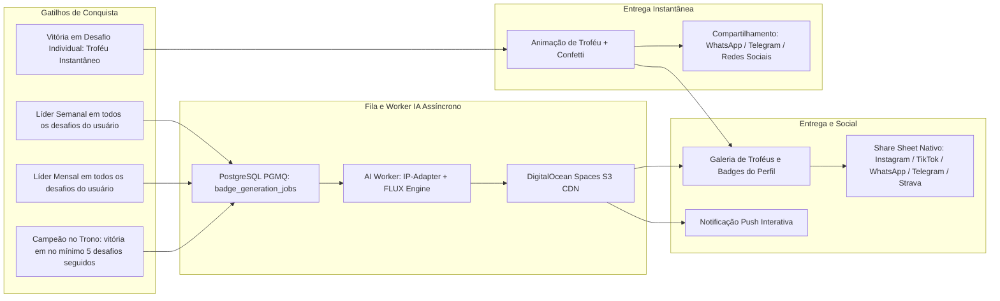
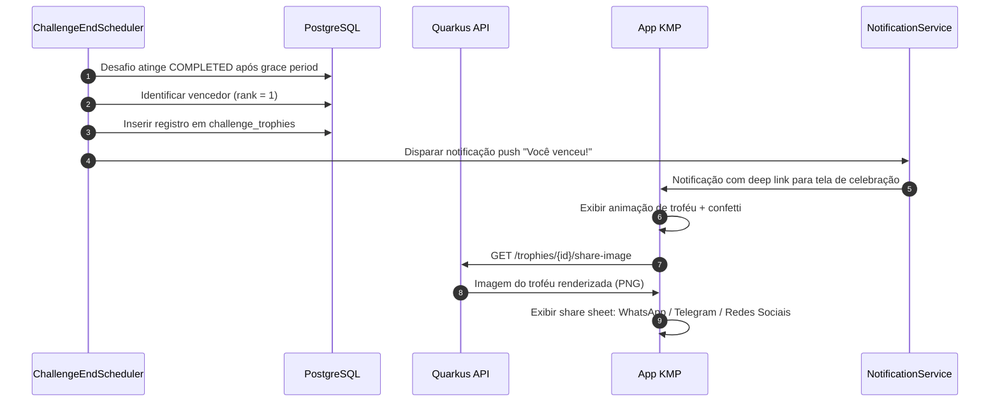

# Insígnias Épicas, Troféus de Vitória, Conquistas e Compartilhamento Social

[Voltar ao Índice Geral](index.md)

---

## 1. Visão Geral e Princípio de Conquista Épica

O FitFight revoluciona as tradicionais insígnias estáticas de gamificação através de dois pilares complementares:

1. **Troféus de Vitória Instantâneos**: Ao vencer um desafio individual, o usuário recebe imediatamente um troféu animado com celebração visual, que pode ser compartilhado via redes sociais, WhatsApp e Telegram.
2. **Geração Assíncrona de Avatares Hiper-Realistas com IA Generativa**: Quando um participante atinge marcos de liderança expressivos, o sistema sintetiza uma ilustração personalizada que preserva com alta fidelidade suas características fisionômicas reais (rosto, biotipo, tom de pele), caracterizado como herói esportivo vestindo o uniforme de seu esporte preferido.



---

## 2. Tipologia de Badges e Elegibilidade

`idea.md` define as três categorias visuais abaixo. Todas as regras de elegibilidade foram estabelecidas.

| Tipo de Badge (`badge_type`) | Regra de Elegibilidade [ESTABELECIDO] | Descrição Cênica da Imagem Sintetizada | Elementos Visuais da Concepção |
| :--- | :--- | :--- | :--- | 
| `WEEKLY_LEADER` (Líder Semanal) | Liderar todos os desafios ativos durante 7 snapshots diários consecutivos. Quórum mínimo de 3 participantes ativos. Cooldown de 7 dias entre concessões. | Avatar com traços físicos do atleta, vestindo uniforme do esporte preferido, medalha no peito e cenário desse esporte. | Rosto/corpo do atleta, roupa esportiva, medalha e cenário do esporte. |
| `MONTHLY_LEADER` (Líder Mensal) | Liderar todos os desafios ativos durante 30 snapshots diários consecutivos. Quórum mínimo de 3 participantes ativos. Cooldown de 30 dias entre concessões. | Avatar no topo do pódio com uniforme esportivo, medalha e amigos participantes aplaudindo. | Pódio, medalha, vestimenta esportiva e amigos aplaudindo. |
| `CHAMPION_THRONE` (Avatar no Trono) | Vencer **no mínimo 5 desafios seguidos**. Quórum mínimo de 3 participantes ativos por desafio. | Campeão no trono com cetro e coroa, medalha, vestimentas esportivas e competidores ajoelhados em reverência esportiva. | Trono, coroa, cetro, medalha, cenário esportivo e competidores de joelhos. |

### 2.1 Regras de Elegibilidade Consolidadas [ESTABELECIDO]
1. **Quórum**: é obrigatório no mínimo 3 participantes humanos ativos para qualificar a geração de badges épicos (antifraude).
2. **Medição da liderança**: 7 snapshots diários consecutivos às 23:59:59 UTC para `WEEKLY_LEADER` e 30 snapshots para `MONTHLY_LEADER`. Todos os desafios ativos em que o usuário participa entram no conjunto.
3. **Resolução de Empates**: aplica-se o desempate determinístico (§3.3 de Desafios) para definir um único líder.
4. **Cooldown e Repetição**: intervalo de 7 dias entre concessões de `WEEKLY_LEADER` e 30 dias entre concessões de `MONTHLY_LEADER`.

---

## 3. Troféus de Vitória Individual (Challenge Victory Trophies) [ESTABELECIDO]

Ao vencer um desafio individual, o usuário recebe **imediatamente** um troféu digital comemorativo, exibido com uma animação de celebração e pronto para compartilhamento social.

### 3.1 Gatilho de Concessão [ESTABELECIDO]

O troféu de vitória é concedido automaticamente quando:
1. O desafio atinge o status `COMPLETED` (após a janela de grace period de 3 horas).
2. O ranking final é congelado e o usuário ocupa a **posição 1** (`current_rank = 1`).
3. O quórum mínimo de **3 participantes ativos** é respeitado (mesma regra antifraude dos badges épicos).

**Fluxo de concessão**:


### 3.2 Modelo de Dados do Troféu [ESTABELECIDO]

Cada troféu de vitória é registrado na tabela `challenge_trophies`:

```sql
CREATE TABLE challenge_trophies (
    id UUID PRIMARY KEY DEFAULT gen_random_uuid(),
    user_id UUID NOT NULL REFERENCES users(id) ON DELETE CASCADE,
    challenge_id UUID NOT NULL REFERENCES challenges(id) ON DELETE CASCADE,
    trophy_type VARCHAR(50) NOT NULL DEFAULT 'CHALLENGE_WINNER',
    position INT NOT NULL DEFAULT 1,
    final_points NUMERIC(10, 2) NOT NULL,
    participants_count INT NOT NULL,
    share_image_url TEXT,
    earned_at TIMESTAMP WITH TIME ZONE DEFAULT CURRENT_TIMESTAMP,
    UNIQUE(user_id, challenge_id)
);
```

| Campo | Tipo | Descrição |
| :--- | :--- | :--- |
| `id` | `UUID` | Identificador único do troféu. |
| `user_id` | `UUID` | Vencedor do desafio. |
| `challenge_id` | `UUID` | Desafio vencido. |
| `trophy_type` | `VARCHAR(50)` | Tipo fixo: `CHALLENGE_WINNER`. |
| `position` | `INT` | Posição final (sempre 1 para troféu). |
| `final_points` | `NUMERIC(10,2)` | Pontuação relativa final do vencedor. |
| `participants_count` | `INT` | Quantidade de participantes ativos no desafio. |
| `share_image_url` | `TEXT` | URL da imagem renderizada para compartilhamento. |
| `earned_at` | `TIMESTAMP` | Data/hora da concessão. |

### 3.3 Animação de Celebração [ESTABELECIDO]

Ao abrir o app após vencer um desafio (via deep link da notificação push), o cliente exibe uma **tela de celebração fullscreen** com:

1. **Animação de Troféu 3D**: O troféu dourado aparece com uma animação de entrada (scale + rotation + bounce) no centro da tela.
2. **Efeito de Confetti**: Partículas coloridas (dourado, verde esportivo e laranja energético) caem da parte superior da tela por ~5 segundos.
3. **Texto Comemorativo**: Mensagem dinâmica como *"🏆 Parabéns! Você venceu o Desafio [Título]!"* com a pontuação final exibida.
4. **Botões de Ação**:
   - **"Compartilhar Vitória"**: Abre o share sheet nativo com a imagem do troféu.
   - **"Ver Galeria"**: Navega para a galeria de troféus e badges no perfil.
   - **"Fechar"**: Retorna à tela principal.

**Implementação no Compose Multiplatform**:
- A animação utiliza `AnimatedVisibility`, `updateTransition` e uma biblioteca de partículas (ex: `lottie-compose` para o confetti).
- O troféu é renderizado como um asset vetorial (SVG/VectorDrawable) com gradientes dourados.
- A imagem de compartilhamento é gerada server-side via endpoint dedicado (`GET /trophies/{id}/share-image`) que compõe uma imagem PNG com o troféu, nome do desafio, pontuação e logo do FitFight.

### 3.4 Formatos de Imagem para Compartilhamento [ESTABELECIDO]

O backend gera imagens otimizadas para cada canal de compartilhamento:

| Canal | Formato | Dimensões | Descrição Visual |
| :--- | :--- | :--- | :--- |
| **WhatsApp** | PNG quadrado | 1080 × 1080 px | Troféu dourado centralizado, nome do desafio, pontuação final, logo FitFight, metadados Open Graph (`og:image`, `og:title`, `og:description`). |
| **Telegram** | PNG quadrado | 1080 × 1080 px | Mesmo formato do WhatsApp, com link dinâmico para o perfil do vencedor. |
| **Instagram Stories / TikTok** | PNG vertical 9:16 | 1080 × 1920 px | Troféu centralizado, confetti no fundo, nome do desafio, pontuação, QR Code para adesão de novos amigos. |
| **Redes Sociais Genéricas** | PNG quadrado | 1080 × 1080 px | Mesmo formato do WhatsApp. |

### 3.5 Endpoint de Geração da Imagem de Compartilhamento [ESTABELECIDO]

```
GET /api/v1/trophies/{trophyId}/share-image?format=square
GET /api/v1/trophies/{trophyId}/share-image?format=story
```

| Parâmetro | Descrição |
| :--- | :--- |
| `trophyId` | UUID do troféu na URL. |
| `format` | `square` (1080×1080) ou `story` (1080×1920). Padrão: `square`. |

**Resposta**:
- `200 OK`: Imagem PNG binária com `Content-Type: image/png`.
- A imagem é gerada sob demanda e cacheada no DigitalOcean Spaces por 30 dias.
- O cliente armazena a URL em `challenge_trophies.share_image_url` para acesso rápido na galeria.

### 3.6 Compartilhamento Nativo no Cliente KMP [ESTABELECIDO]

```kotlin
class TrophyShareManager @Inject constructor(
    private val platformContext: PlatformContext
) {
    suspend fun shareTrophy(trophy: Trophy, format: ShareFormat = ShareFormat.SQUARE) {
        val imageUrl = trophy.shareImageUrl ?: fetchShareImage(trophy.id, format)
        val text = buildShareText(trophy)

        when (platformContext) {
            PlatformContext.ANDROID -> shareViaAndroidSharesheet(imageUrl, text)
            PlatformContext.IOS -> shareViaUIActivityViewController(imageUrl, text)
            PlatformContext.WEB -> shareViaWebShareAPI(imageUrl, text)
        }
    }

    private fun buildShareText(trophy: Trophy): String {
        return "🏆 Venci o desafio \"${trophy.challengeTitle}\" no FitFight com ${trophy.finalPoints} pontos contra ${trophy.participantsCount} competidores! Venha competir comigo!"
    }
}
```

**Canais de Compartilhamento Suportados**:
- **WhatsApp**: Via `Intent.ACTION_SEND` (Android) ou `UIActivityViewController` (iOS) com destino explícito para o WhatsApp.
- **Telegram**: Mesmo mecanismo do WhatsApp, com destino para o Telegram.
- **Instagram Stories**: Via Share Sheet nativo, o usuário seleciona o Instagram Stories manualmente.
- **TikTok**: Via Share Sheet nativo.
- **Redes Sociais Genéricas**: Share Sheet padrão do SO com todas as opções disponíveis.

---

## 4. Engenharia de Prompts e Pipeline de Síntese Facial

### 4.1 Modelo de Dados para Síntese
Para que o worker assíncrono consiga reproduzir com fidelidade a identidade do atleta, o backend compõe um payload estruturado:

```json
{
  "job_id": "8f8b3c10-9112-4c22-901c-6d9b01234567",
  "user_id": "a1b2c3d4-e5f6-7a8b-9c0d-1e2f3a4b5c6d",
  "badge_type": "CHAMPION_THRONE",
  "challenge_title": "Desafio Verão Sem Desculpas",
  "user_attributes": {
    "reference_face_url": "https://storage.fitfight.app/avatars/user123_face.jpg",
    "favorite_sport": "Cycling",
    "gender": "male",
    "skin_tone": "tan",
    "body_type": "athletic"
  },
  "participant_references": [
    {"user_id": "b2c3d4e5-...", "gender": "female", "consent_granted": true},
    {"user_id": "c3d4e5f6-...", "gender": "male", "consent_granted": false}
  ]
}
```

### 4.2 Templates Canônicos de Prompt [ESTABELECIDO]

#### A. Prompt para `WEEKLY_LEADER`
```text
masterpiece, raw photo, ultra-detailed athletic portrait of a {gender} athlete with face matching reference, skin tone {skin_tone}, athletic physique. The athlete is proudly wearing professional modern {favorite_sport} technical apparel, wearing a gleaming gold medal with custom FitFight ribbon around the neck. Background is an epic, cinematic outdoor {favorite_sport} stadium/arena with dramatic golden hour lighting, slight depth of field, 8k resolution, photorealistic, Unreal Engine 5 render style.
Negative prompt: blurry, deformed face, extra limbs, bad anatomy, cartoon, low quality, oversaturated.
```

#### B. Prompt para `MONTHLY_LEADER`
```text
epic victory ceremony, photorealistic wide shot of an athletic {gender} athlete (face exactly matching reference, skin tone {skin_tone}) standing proudly atop the 1st place champion podium step, wearing modern {favorite_sport} clothes, holding a prestigious gold trophy, wearing a gold medal around the neck. In the foreground and background, multiple diverse friendly athletic competitors are cheering and enthusiastically applauding. Festive confetti in the air, stadium floodlights, cinematic atmosphere, 8k resolution.
Negative prompt: sad expressions, distorted podium, extra fingers, cartoon, plastic skin.
```

#### C. Prompt para `CHAMPION_THRONE` (Atendendo integralmente a `idea.md`)
```text
majestic epic fantasy sports throne room, a triumphant {gender} athlete (face precisely retained via IP-Adapter, skin tone {skin_tone}) sitting resolutely on an ornate marble and forged steel throne. The character is proudly wearing stylized technical {favorite_sport} garments, a gleaming victory medal on the chest, an imperial gold crown on the head, and holding an ornate ceremonial sports scepter firmly in hand. In the background, iconic architecture of {favorite_sport} setting. Surrounding the base of the throne, athletic competitors are kneeling on one knee with respectful bows like reverent subjects, paying homage to the undisputed champion. Dramatic chiaroscuro lighting, regal sports banners, cinematic photorealism, legendary victory concept art, 8k resolution.
Negative prompt: disrespect, grotesque, bad hands, deformed anatomy, flat lighting, blurry background.
```

---

## 5. Privacidade, Consentimento LGPD/GDPR e Uso de Imagem

### 5.1 Consentimento e Uso de Imagem [ESTABELECIDO]
Em conformidade com a LGPD (Lei Geral de Proteção de Dados - Lei 13.709/2018) e GDPR:
1. **Consentimento Primário de Imagem**: O usuário deve autorizar expressamente nas configurações de perfil o uso de suas fotos faciais para geração de avatares sintéticos via IA generativa.
2. **Consentimento Secundário de Coadjuvante**: O atleta pode optar (`opt-in`) por permitir ou não que sua imagem fisionômica apareça como participante coadjuvante (aplaudindo no pódio ou ajoelhado no trono) nos badges conquistados por amigos de seus desafios.
3. **Mecanismo de Opt-Out e Anonimização**: Participantes sem consentimento são substituídos por silhueta genérica nos badges.

---

## 6. Resiliência, Fallback e Alta Disponibilidade

### 6.1 Janela de Processamento e Fallback [ESTABELECIDO]
A síntese de imagens em GPU via IP-Adapter e FLUX requer entre 15 e 45 segundos.
- Caso a fila PGMQ acumule mensagens e o tempo de espera exceda **3 minutos**:
  - O sistema exibe imediatamente na galeria do atleta uma moldura com **Badge Vetorial Provisório em Alta Resolução** contendo o selo oficial e o indicador: *"Seu Avatar Épico IA está sendo gerado... Pronto em breve!"*.
  - Ao término da renderização, a URL final é atualizada em `badges.image_url` e uma notificação push comemorativa é enviada.

---

## 7. Galeria de Troféus e Badges no Perfil [ESTABELECIDO]

O perfil do usuário exibe uma **galeria completa e navegável** contendo todos os troféus de vitória e badges conquistados, organizados por categorias.

### 7.1 Estrutura da Galeria [ESTABELECIDO]

A galeria possui **3 abas navegáveis**:

| Aba | Conteúdo | Descrição |
| :--- | :--- | :--- |
| **🏆 Troféus** | Troféus de vitória individual | Cada desafio vencido gera um troféu exibido nesta aba, ordenado do mais recente ao mais antigo. |
| **🎖️ Badges IA** | Badges épicos gerados por IA | `WEEKLY_LEADER`, `MONTHLY_LEADER` e `CHAMPION_THRONE` com imagens hiper-realistas. |
| **📊 Marcos** | Marcos de consistência e volume | Selos por sequências de treinos e marcas acumuladas. |

### 7.2 Aba de Troféus [ESTABELECIDO]

Cada troféu é exibido como um **card interativo** contendo:
- **Imagem do troféu dourado** com o nome do desafio e a pontuação final.
- **Data da conquista** e quantidade de competidores.
- **Botão de compartilhamento** para WhatsApp, Telegram e redes sociais.
- **Ação ao clicar**: Abre o detalhe do troféu com opção de re-compartilhar ou ver o desafio original.

**Layout**: Grid de 2 colunas (mobile) ou 4 colunas (tablet/web), com lazy loading.

### 7.3 Aba de Badges IA [ESTABELECIDO]

Exibe os badges épicos gerados por IA:
- **Imagem hiper-realista** do avatar do usuário no cenário correspondente (medalha, pódio, trono).
- **Tipo de badge** e data de conquista.
- **Botão de compartilhamento** para Instagram Stories, TikTok, WhatsApp, Telegram e Strava.
- **Fallback**: Se a imagem IA ainda estiver sendo processada, exibe o badge vetorial provisório com indicador de progresso.

### 7.4 Aba de Marcos [ESTABELECIDO]

Conforme `idea.md` (*"Unlock badges and rewards for reaching milestones, completing challenges, and maintaining consistency"*):

#### Marcos de Consistência
| Marco | Critério | Visual |
| :--- | :--- | :--- |
| **7 Dias** | 7 dias consecutivos de treino | Selo de bronze |
| **30 Dias** | 30 dias consecutivos de treino | Selo de prata |
| **100 Dias** | 100 dias consecutivos de treino | Selo de ouro |

#### Marcos de Volume
| Marco | Critério | Visual |
| :--- | :--- | :--- |
| **100 km Corridos** | 100 km acumulados em atividades do tipo Run | Selo temático de corrida |
| **500 km Pedalados** | 500 km acumulados em atividades do tipo Ride | Selo temático de ciclismo |
| **50 Atividades** | 50 atividades registradas no total | Selo genérico de volume |

**Layout**: Lista horizontal scrollável com cards quadrados, cada um mostrando o ícone do selo, título e data de desbloqueio. Selos não desbloqueados aparecem com opacidade reduzida (40%) e um cadeado.

### 7.5 Modelo de Dados Estendido [ESTABELECIDO]

A tabela `badges` existente é estendida para suportar todos os tipos:

```sql
-- Tabela existente, estendida
ALTER TABLE badges ADD COLUMN IF NOT EXISTS display_category VARCHAR(50) NOT NULL DEFAULT 'AI_BADGE';
-- display_category: 'AI_BADGE', 'CONSISTENCY', 'VOLUME'

-- Nova tabela para troféus de desafio
CREATE TABLE IF NOT EXISTS challenge_trophies (
    id UUID PRIMARY KEY DEFAULT gen_random_uuid(),
    user_id UUID NOT NULL REFERENCES users(id) ON DELETE CASCADE,
    challenge_id UUID NOT NULL REFERENCES challenges(id) ON DELETE CASCADE,
    trophy_type VARCHAR(50) NOT NULL DEFAULT 'CHALLENGE_WINNER',
    position INT NOT NULL DEFAULT 1,
    final_points NUMERIC(10, 2) NOT NULL,
    participants_count INT NOT NULL,
    share_image_url TEXT,
    earned_at TIMESTAMP WITH TIME ZONE DEFAULT CURRENT_TIMESTAMP,
    UNIQUE(user_id, challenge_id)
);
```

### 7.6 Endpoint da Galeria [ESTABELECIDO]

```
GET /api/v1/users/me/gallery?category=trophies
GET /api/v1/users/me/gallery?category=ai-badges
GET /api/v1/users/me/gallery?category=consistency
GET /api/v1/users/unlocked?category=volume
GET /api/v1/users/me/gallery  -- Retorna todas as categorias
```

| Parâmetro | Descrição |
| :--- | :--- |
| `category` | Filtro opcional: `trophies`, `ai-badges`, `consistency`, `volume`. Sem filtro, retorna tudo. |

**Resposta**:
```json
{
  "trophies": [
    {
      "id": "uuid",
      "challengeTitle": "Desafio Verão Sem Desculpas",
      "finalPoints": 1250.50,
      "participantsCount": 8,
      "shareImageUrl": "https://cdn.fitfight.app/trophies/uuid.png",
      "earnedAt": "2026-10-15T18:30:00Z"
    }
  ],
  "aiBadges": [
    {
      "id": "uuid",
      "badgeType": "WEEKLY_LEADER",
      "imageUrl": "https://cdn.fitfight.app/badges/uuid.webp",
      "earnedAt": "2026-10-20T00:00:00Z"
    }
  ],
  "milestones": [
    {
      "type": "CONSISTENCY",
      "name": "7 Dias Consecutivos",
      "unlocked": true,
      "unlockedAt": "2026-10-10T00:00:00Z",
      "iconUrl": "https://cdn.fitfight.app/milestones/consistency-7d.png"
    },
    {
      "type": "VOLUME",
      "name": "100 km Corridos",
      "unlocked": false,
      "progress": 75.5,
      "iconUrl": "https://cdn.fitfight.app/milestones/run-100km.png"
    }
  ]
}
```

---

## 8. Compartilhamento Social Nativo [ESTABELECIDO]

O compartilhamento é operacionalizado por integrações com as APIs nativas do sistema operacional (Android Sharesheet e iOS UIActivityViewController):

### 8.1 Canais de Compartilhamento [ESTABELECIDO]

| Canal | Troféus | Badges IA | Mecanismo |
| :--- | :--- | :--- | :--- |
| **WhatsApp** | ✅ | ✅ | Share Sheet nativo com destino explícito |
| **Telegram** | ✅ | ✅ | Share Sheet nativo com destino explícito |
| **Instagram Stories** | ✅ | ✅ | Share Sheet nativo, usuário seleciona manualmente |
| **TikTok** | ✅ | ✅ | Share Sheet nativo, usuário seleciona manualmente |
| **Strava Feed** | ❌ | ✅ (via link) | Share Sheet nativo ou link na descrição da atividade |

### 8.2 Formatos de Imagem por Canal [ESTABELECIDO]

| Canal | Formato | Dimensões | Descrição Visual |
| :--- | :--- | :--- | :--- |
| **WhatsApp / Telegram** | PNG quadrado | 1080 × 1080 px | Troféu ou badge centralizado, metadados Open Graph (`og:image`, `og:title`, `og:description`). |
| **Instagram Stories / TikTok** | PNG vertical 9:16 | 1080 × 1920 px | Imagem centralizada, moldura temática, resumo estatístico e QR Code para adesão. |
| **Redes Sociais Genéricas** | PNG quadrado | 1080 × 1080 px | Mesmo formato do WhatsApp. |

### 8.3 Strava Feed (Integração Viável) [ESTABELECIDO]
- *Resolução Técnica de Viabilidade*: Como a API pública do Strava (`POST /uploads`) **não** aceita upload de arquivos de imagem (aceitando exclusivamente arquivos de dados brutos `.fit`, `.gpx` e `.tcx`), o FitFight viabiliza a integração das seguintes formas:
  - Compartilhamento nativo pelo aplicativo móvel via Share Sheet para o app do Strava instalado no dispositivo.
  - Inclusão de link encurtado e resumo na descrição da atividade, somente se o atleta conceder acesso de escrita (`activity:write`) e consentir com a alteração; se o escopo não estiver concedido, usar o compartilhamento nativo sem modificar a atividade.
