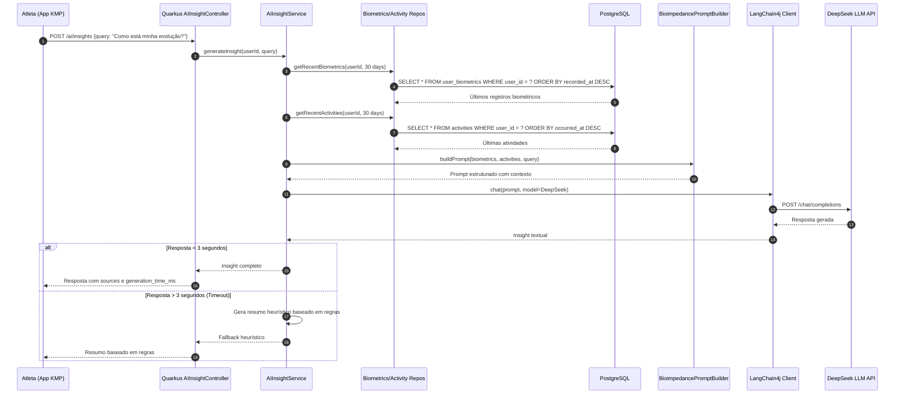
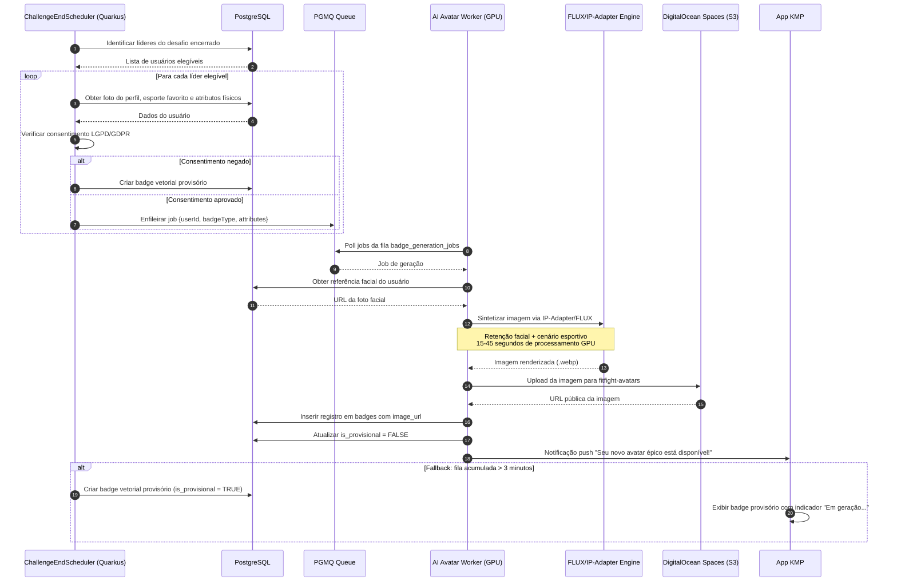
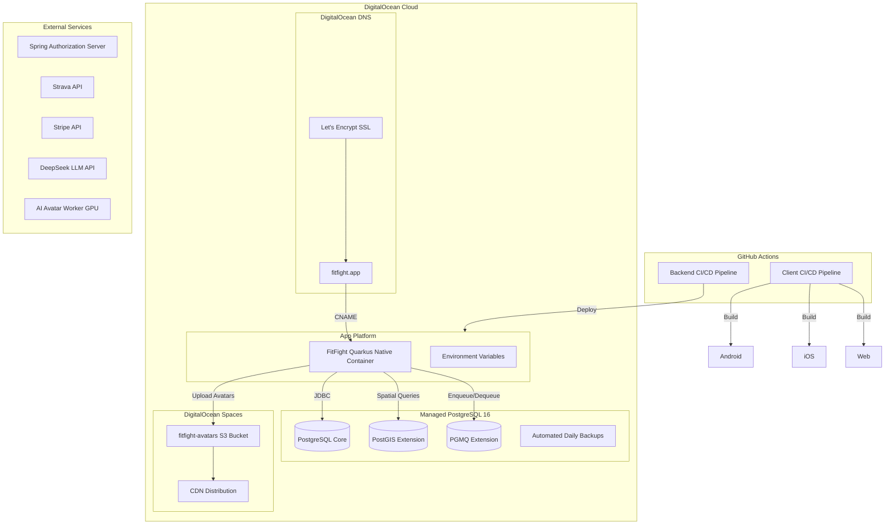

# Pipelines de IA, Infraestrutura DigitalOcean e CI/CD

[Voltar ao Índice Geral](index.md)

---

## 1. Fluxo de RAG Dinâmico com LangChain4j e DeepSeek

O Assistente IA de Performance utiliza **LangChain4j** integrado ao modelo **DeepSeek** via API, empregando **RAG (Retrieval-Augmented Generation)** sobre o histórico biométrico e de atividades do usuário para gerar diagnósticos preditivos e recomendações personalizadas.

### 1.1 Arquitetura do Pipeline RAG



### 1.2 Engenharia de Prompts com BioimpedancePromptBuilder

O `BioimpedancePromptBuilder` compõe prompts estruturados que injetam o contexto histórico do atleta:

```kotlin
class BioimpedancePromptBuilder {

    fun buildPrompt(
        biometrics: List<BiometricsRecord>,
        activities: List<Activity>,
        userQuery: String,
        userGender: String,
        userAge: Int,
        userFavoriteSport: String
    ): String {
        val biometricsSummary = buildBiometricsSummary(biometrics)
        val activitiesSummary = buildActivitiesSummary(activities)

        return """
        You are a fitness performance analyst AI assistant for FitFight, a gamified fitness platform.
        Your role is to provide actionable, data-driven insights based on the athlete's recent history.
        You MUST NOT provide medical diagnoses. Always recommend consulting a professional for health concerns.

        ## Athlete Profile
        - Gender: $userGender
        - Age: $userAge
        - Favorite Sport: $userFavoriteSport

        ## Recent Biometrics (Last 30 Days)
        $biometricsSummary

        ## Recent Activities (Last 30 Days)
        $activitiesSummary

        ## User Question
        $userQuery

        ## Response Guidelines
        1. Base your analysis strictly on the data provided above.
        2. Highlight trends: muscle gain/loss, fat loss/gain, activity consistency.
        3. Provide 1-2 actionable recommendations.
        4. If muscle mass loss is detected alongside weight loss, flag it as potentially harmful.
        5. If activity frequency dropped significantly, suggest recovery or motivation strategies.
        6. Keep the response concise (maximum 3 paragraphs).
        7. Use Portuguese language for the response.
        8. NEVER diagnose medical conditions; recommend professional consultation when appropriate.
        """.trimIndent()
    }

    private fun buildBiometricsSummary(records: List<BiometricsRecord>): String {
        if (records.isEmpty()) return "No biometric data available."

        val latest = records.first()
        val oldest = records.last()
        val weightDelta = latest.weightKg - oldest.weightKg
        val muscleDelta = (latest.muscleMassKg ?: 0.0) - (oldest.muscleMassKg ?: 0.0)
        val fatDelta = (latest.bodyFatPercentage ?: 0.0) - (oldest.bodyFatPercentage ?: 0.0)

        return """
        - Weight change: ${"%.2f".format(weightDelta)} kg (${if (weightDelta < 0) "loss" else "gain"})
        - Muscle mass change: ${"%.2f".format(muscleDelta)} kg
        - Body fat % change: ${"%.2f".format(fatDelta)} percentage points
        - Latest weight: ${"%.2f".format(latest.weightKg)} kg
        - Latest body fat: ${"%.2f".format(latest.bodyFatPercentage ?: 0.0)}%
        - Measurements count: ${records.size}
        """.trimIndent()
    }

    private fun buildActivitiesSummary(activities: List<Activity>): String {
        if (activities.isEmpty()) return "No activities recorded in the last 30 days."

        val totalDuration = activities.sumOf { it.durationSeconds } / 3600.0
        val externalCount = activities.count { it.isExternal }
        val internalCount = activities.size - externalCount
        val avgPoints = activities.map { it.calculatedPoints }.average()

        return """
        - Total activities: ${activities.size}
        - External (outdoor): $externalCount
        - Internal (indoor): $internalCount
        - Total duration: ${"%.1f".format(totalDuration)} hours
        - Average points per activity: ${"%.2f".format(avgPoints)}
        """.trimIndent()
    }
}
```

### 1.3 Configuração LangChain4j no Quarkus

```properties
# application.properties
quarkus.langchain4j.openai.api-key=${DEEPSEEK_API_KEY}
quarkus.langchain4j.openai.base-url=${DEEPSEEK_BASE_URL}
quarkus.langchain4j.openai.model=${DEEPSEEK_MODEL}
quarkus.langchain4j.openai.timeout=3s
quarkus.langchain4j.openai.max-tokens=1024
quarkus.langchain4j.openai.temperature=0.7
```

```kotlin
class AIInsightService @Inject constructor(
    private val biometricsRepository: BiometricsRepository,
    private val activityRepository: ActivityRepository,
    private val userRepository: UserRepository,
    private val chatLanguageModel: OllamaAiServices, // LangChain4j model
    private val promptBuilder: BioimpedancePromptBuilder
) {
    suspend fun generateInsight(userId: String, query: String): AIInsightResponse {
        val user = userRepository.findById(userId)
        val biometrics = biometricsRepository.getRecent(userId, days = 30)
        val activities = activityRepository.getRecent(userId, days = 30)

        val prompt = promptBuilder.buildPrompt(
            biometrics = biometrics,
            activities = activities,
            userQuery = query,
            userGender = user.gender,
            userAge = user.age,
            userFavoriteSport = user.favoriteSport
        )

        return try {
            val startTime = System.currentTimeMillis()
            val response = withTimeout(3000) {
                chatLanguageModel.chat(prompt)
            }
            val generationTime = System.currentTimeMillis() - startTime

            AIInsightResponse(
                insight = response,
                sources = listOf(
                    InsightSource("biometrics", "Últimos 30 dias"),
                    InsightSource("activities", "${activities.size} atividades")
                ),
                generationTimeMs = generationTime,
                isFallback = false
            )
        } catch (e: TimeoutCancellationException) {
            // Fallback heurístico
            AIInsightResponse(
                insight = generateHeuristicFallback(biometrics, activities),
                sources = emptyList(),
                generationTimeMs = 0,
                isFallback = true
            )
        }
    }

    private fun generateHeuristicFallback(
        biometrics: List<BiometricsRecord>,
        activities: List<Activity>
    ): String {
        val muscleGain = biometrics.isNotEmpty() &&
            (biometrics.first().muscleMassKg ?: 0.0) > (biometrics.last().muscleMassKg ?: 0.0)
        val fatLoss = biometrics.isNotEmpty() &&
            (biometrics.first().bodyFatPercentage ?: 0.0) < (biometrics.last().bodyFatPercentage ?: 0.0)

        return when {
            muscleGain && fatLoss ->
                "Sua recomposição corporal está excelente: ganho de massa muscular e perda de gordura simultâneos. Continue com a rotina atual!"
            muscleGain ->
                "Você está ganhando massa muscular. Considere ajustar a dieta para otimizar a queima de gordura."
            fatLoss ->
                "Boa perda de gordura! Monitore a massa muscular para garantir que não está sendo perdida."
            activities.size >= 10 ->
                "Sua consistência de treinos está ótima com ${activities.size} atividades nos últimos 30 dias. Mantenha o ritmo!"
            activities.size < 5 ->
                "Sua frequência de treinos está baixa. Tente estabelecer uma rotina de pelo menos 3 sessões por semana."
            else ->
                "Continue com seus treinos e registre sua bioimpedância regularmente para insights mais precisos."
        }
    }
}
```

---

## 2. Fila Assíncrona de Geração de Imagens IA (IP-Adapter/FLUX)

O pipeline de geração de avatares é totalmente desacoplado da API Quarkus, executado por um **worker assíncrono com GPU** que consome jobs da fila PGMQ.

### 2.1 Fluxo Completo de Geração de Avatar



### 2.2 Worker de IA com IP-Adapter/FLUX

O worker é um serviço independente (Python ou Kotlin com GPU) que:

1. **Consome jobs da fila PGMQ** com visibility timeout de 120 segundos.
2. **Baixa a foto facial de referência** do usuário a partir de `users.avatar_face_url`.
3. **Aplica IP-Adapter** para retenção facial e corporal no modelo FLUX.
4. **Renderiza a imagem** usando o prompt canônico correspondente ao `badge_type`.
5. **Faz upload para DigitalOcean Spaces** em formato WebP.
6. **Atualiza o registro em `badges`** com a URL pública.

#### Estrutura do Job PGMQ

```json
{
  "job_id": "8f8b3c10-9112-4c22-901c-6d9b01234567",
  "user_id": "a1b2c3d4-e5f6-7a8b-9c0d-1e2f3a4b5c6d",
  "badge_type": "CHAMPION_THRONE",
  "challenge_id": "b2c3d4e5-f6a7-8b9c-0d1e-2f3a4b5c6d7e",
  "user_attributes": {
    "reference_face_url": "https://storage.fitfight.app/avatars/user123_face.jpg",
    "favorite_sport": "Cycling",
    "gender": "male",
    "skin_tone": "tan",
    "body_type": "athletic"
  },
  "participant_references": [
    {"user_id": "c3d4e5f6-...", "gender": "female", "consent_granted": true},
    {"user_id": "d4e5f6a7-...", "gender": "male", "consent_granted": false}
  ]
}
```

#### Prompt Canônico para `CHAMPION_THRONE`

```text
majestic epic fantasy sports throne room, a triumphant {gender} athlete (face precisely retained via IP-Adapter, skin tone {skin_tone}) sitting resolutely on an ornate marble and forged steel throne. The character is proudly wearing stylized technical {favorite_sport} garments, a gleaming victory medal on the chest, an imperial gold crown on the head, and holding an ornate ceremonial sports scepter firmly in hand. In the background, iconic architecture of {favorite_sport} setting. Surrounding the base of the throne, athletic competitors are kneeling on one knee with respectful bows like reverent subjects, paying homage to the undisputed champion. Dramatic chiaroscuro lighting, regal sports banners, cinematic photorealism, legendary victory concept art, 8k resolution.
Negative prompt: disrespect, grotesque, bad hands, deformed anatomy, flat lighting, blurry background.
```

### 2.3 Fallback com Badge Vetorial Provisório

Se a fila PGMQ acumular mensagens e o tempo de espera exceder **3 minutos**:

1. O sistema cria imediatamente um registro em `badges` com `is_provisional = TRUE`.
2. A `image_url` aponta para um badge vetorial de alta resolução (SVG/PNG) com o selo oficial do tipo de insígnia.
3. O app exibe o badge provisório com o indicador: *"Seu Avatar Épico IA está sendo gerado... Pronto em breve!"*.
4. Ao término da renderização, o worker atualiza `image_url` e define `is_provisional = FALSE`.
5. Uma notificação push comemorativa é enviada ao usuário.

---

## 3. Infraestrutura em Nuvem via Terraform (DigitalOcean)

Toda a infraestrutura do FitFight é provisionada via **Terraform**, garantindo reprodutibilidade, versionamento e deploy automatizado.

### 3.1 Arquitetura de Infraestrutura



### 3.2 Módulos Terraform

#### 3.2.1 Banco de Dados Gerenciado

```hcl
# modules/database/main.tf
resource "digitalocean_database_cluster" "fitfight_pg" {
  name                  = "fitfight-postgres"
  engine                = "pg"
  version               = "16"
  region                = var.region
  size                  = var.db_size
  node_count            = var.db_node_count
  maintenance_window_dow = "sunday"
  maintenance_window_th  = "02:00"

  user_names          = [var.db_user]
  db_names            = [var.db_name]

  backup_restore_count = 7  # 7 dias de backups automáticos

  tags = ["fitfight", "production"]
}

# Extensões PostGIS e PGMQ são habilitadas via Liquibase no startup do Quarkus
resource "null_resource" "pg_extensions" {
  depends_on = [digitalocean_database_cluster.fitfight_pg]

  provisioner "local-exec" {
    command = <<-EOT
      PGPASSWORD=${digitalocean_database_cluster.fitfight_pg.password} \
      psql -h ${digitalocean_database_cluster.fitfight_pg.host} \
           -p ${digitalocean_database_cluster.fitfight_pg.port} \
           -U ${var.db_user} \
           -d ${var.db_name} \
           -c "CREATE EXTENSION IF NOT EXISTS postgis;" \
           -c "CREATE EXTENSION IF NOT EXISTS pgmq;"
    EOT
  }
}

output "database_url" {
  value = "postgresql://${var.db_user}:${digitalocean_database_cluster.fitfight_pg.password}@${digitalocean_database_cluster.fitfight_pg.host}:${digitalocean_database_cluster.fitfight_pg.port}/${var.db_name}"
}
```

#### 3.2.2 DigitalOcean Spaces (S3-compatible)

```hcl
# modules/spaces/main.tf
resource "digitalocean_spaces_bucket" "fitfight_avatars" {
  name   = "fitfight-avatars"
  region = var.region

  versioning {
    enabled = false
  }

  cors_rule {
    allowed_headers = ["*"]
    allowed_methods = ["GET"]
    allowed_origins = ["*"]
    expose_headers  = ["ETag"]
    max_age_seconds = 3600
  }
}

output "bucket_endpoint" {
  value = digitalocean_spaces_bucket.fitfight_avatars.endpoint
}
```

#### 3.2.3 App Platform (Quarkus Native)

```hcl
# modules/app-platform/main.tf
resource "digitalocean_app" "fitfight" {
  spec {
    name   = "fitfight-api"
    region = var.region

    service {
      name = "api"
      env {
        key   = "DB_HOST"
        value = digitalocean_database_cluster.fitfight_pg.host
        type  = "SECRET"
      }
      env {
        key   = "DB_PORT"
        value = digitalocean_database_cluster.fitfight_pg.port
        type  = "SECRET"
      }
      env {
        key   = "DB_USER"
        value = var.db_user
        type  = "SECRET"
      }
      env {
        key   = "DB_PASSWORD"
        value = digitalocean_database_cluster.fitfight_pg.password
        type  = "SECRET"
      }
      env {
        key   = "DB_NAME"
        value = var.db_name
        type  = "SECRET"
      }
      env {
        key   = "DEEPSEEK_API_KEY"
        value = var.deepseek_api_key
        type  = "SECRET"
      }
      env {
        key   = "STRIPE_SECRET_KEY"
        value = var.stripe_secret_key
        type  = "SECRET"
      }
      env {
        key   = "SPACES_ACCESS_KEY"
        value = var.spaces_access_key
        type  = "SECRET"
      }
      env {
        key   = "SPACES_SECRET_KEY"
        value = var.spaces_secret_key
        type  = "SECRET"
      }

      instance_count  = var.instance_count
      instance_size_slug = "basic-xxs"  # 512MB RAM, suficiente para GraalVM

      git {
        repo_clone_url = var.github_repo_url
        branch         = "main"
      }

      build_command = "./mvnw clean package -Pnative -Dquarkus.package.type=native"
      run_command   = "./target/fitfight-1.0.0-runner"

      http_port = 8080

      health_check {
        http_path              = "/q/health/ready"
        initial_delay_seconds  = 30
        period_seconds         = 10
        timeout_seconds        = 5
        success_threshold      = 1
        failure_threshold      = 3
      }
    }

    domain {
      name   = "api.fitfight.app"
      type   = "PRIMARY"
      zone   = "fitfight.app"
    }
  }
}
```

#### 3.2.4 DNS e SSL

```hcl
# modules/dns/main.tf
resource "digitalocean_domain" "fitfight" {
  name = "fitfight.app"
}

resource "digitalocean_domain_record" "api_cname" {
  domain = digitalocean_domain.fitfight.name
  type   = "CNAME"
  name   = "api"
  value  = digitalocean_app.fitfight.default_inbound_connection_addr
}
```

### 3.3 Variáveis de Ambiente

| Variável | Descrição | Origem |
| :--- | :--- | :--- |
| `DB_HOST` | Host do PostgreSQL | Terraform output |
| `DB_PORT` | Porta do PostgreSQL | Terraform output |
| `DB_USER` | Usuário do banco | Terraform variable |
| `DB_PASSWORD` | Senha do banco | Terraform output (secret) |
| `DB_NAME` | Nome do banco | Terraform variable |
| `DEEPSEEK_API_KEY` | Chave da API DeepSeek | GitHub Secrets |
| `DEEPSEEK_BASE_URL` | URL base da API DeepSeek | GitHub Secrets |
| `DEEPSEEK_MODEL` | Modelo DeepSeek | GitHub Secrets |
| `STRIPE_SECRET_KEY` | Chave secreta do Stripe | GitHub Secrets |
| `STRIPE_WEBHOOK_SECRET` | Segredo do webhook Stripe | GitHub Secrets |
| `SPACES_ACCESS_KEY` | Chave de acesso DigitalOcean Spaces | Terraform output |
| `SPACES_SECRET_KEY` | Chave secreta DigitalOcean Spaces | Terraform output |
| `SPACES_REGION` | Região do bucket Spaces | Terraform variable |
| `SPACES_ENDPOINT` | Endpoint do bucket Spaces | Terraform output |
| `AUTH_SERVER_ISSUER` | URL do Spring Auth Server | GitHub Secrets |

---

## 4. Pipelines CI/CD com GitHub Actions

### 4.1 Pipeline do Backend (`backend-ci.yml`)

```yaml
# .github/workflows/backend-ci.yml
name: Backend CI/CD

on:
  push:
    branches: [main, develop]
  pull_request:
    branches: [main]

env:
  REGISTRY: registry.digitalocean.com
  IMAGE_NAME: fitfight/fitfight-api

jobs:
  # Stage 1: Build, Format, Test
  build-and-test:
    runs-on: ubuntu-latest
    steps:
      - name: Checkout code
        uses: actions/checkout@v4

      - name: Set up JDK 21
        uses: actions/setup-java@v4
        with:
          java-version: '21'
          distribution: 'temurin'

      - name: Cache Maven packages
        uses: actions/cache@v4
        with:
          path: ~/.m2
          key: ${{ runner.os }}-maven-${{ hashFiles('**/pom.xml') }}
          restore-keys: |
            ${{ runner.os }}-maven-

      - name: Format check
        run: ./mvnw kompile:kotlinFormat --fail-on-warning

      - name: Build and test
        run: ./mvnw clean verify -B
        env:
          DEEPSEEK_API_KEY: ${{ secrets.DEEPSEEK_API_KEY }}

      - name: Run integration tests with Testcontainers
        run: ./mvnw verify -Pintegration-tests
        env:
          POSTGRES_IMAGE: postgres:16
          POSTGIS_IMAGE: postgis/postgis:16-3

  # Stage 2: Native Compilation (GraalVM)
  native-build:
    needs: build-and-test
    runs-on: ubuntu-latest
    if: github.ref == 'refs/heads/main'
    steps:
      - name: Checkout code
        uses: actions/checkout@v4

      - name: Set up JDK 21
        uses: actions/setup-java@v4
        with:
          java-version: '21'
          distribution: 'temurin'

      - name: Set up GraalVM
        uses: graalvm/setup-graalvm@v1
        with:
          java-version: '21'
          distribution: 'graalvm'
          components: 'native-image'

      - name: Build native image
        run: ./mvnw clean package -Pnative -Dquarkus.package.type=native

      - name: Upload native binary
        uses: actions/upload-artifact@v4
        with:
          name: fitfight-native
          path: target/fitfight-1.0.0-runner

  # Stage 3: Docker Build and Push
  docker-build:
    needs: native-build
    runs-on: ubuntu-latest
    if: github.ref == 'refs/heads/main'
    steps:
      - name: Checkout code
        uses: actions/checkout@v4

      - name: Download native binary
        uses: actions/download-artifact@v4
        with:
          name: fitfight-native

      - name: Login to DigitalOcean Container Registry
        uses: docker/login-action@v3
        with:
          registry: registry.digitalocean.com
          username: ${{ secrets.DOCR_USERNAME }}
          password: ${{ secrets.DOCR_PASSWORD }}

      - name: Build and push Docker image
        uses: docker/build-push-action@v5
        with:
          context: .
          file: Dockerfile.native
          push: true
          tags: |
            ${{ env.REGISTRY }}/${{ env.IMAGE_NAME }}:latest
            ${{ env.REGISTRY }}/${{ env.IMAGE_NAME }}:${{ github.sha }}

  # Stage 4: Deploy to DigitalOcean App Platform
  deploy:
    needs: docker-build
    runs-on: ubuntu-latest
    if: github.ref == 'refs/heads/main'
    steps:
      - name: Checkout code
        uses: actions/checkout@v4

      - name: Setup Terraform
        uses: hashicorp/setup-terraform@v3

      - name: Terraform Init
        working-directory: infrastructure
        run: terraform init
        env:
          DO_TOKEN: ${{ secrets.DO_TOKEN }}

      - name: Terraform Apply
        working-directory: infrastructure
        run: terraform apply -auto-approve
        env:
          DO_TOKEN: ${{ secrets.DO_TOKEN }}
          DEEPSEEK_API_KEY: ${{ secrets.DEEPSEEK_API_KEY }}
          STRIPE_SECRET_KEY: ${{ secrets.STRIPE_SECRET_KEY }}
          STRIPE_WEBHOOK_SECRET: ${{ secrets.STRIPE_WEBHOOK_SECRET }}
```

### 4.2 Pipeline do Cliente (`client-ci.yml`)

```yaml
# .github/workflows/client-ci.yml
name: Client CI/CD

on:
  push:
    branches: [main, develop]
  pull_request:
    branches: [main]

jobs:
  # Stage 1: Android Build
  android:
    runs-on: ubuntu-latest
    steps:
      - name: Checkout code
        uses: actions/checkout@v4

      - name: Set up JDK 17
        uses: actions/setup-java@v4
        with:
          java-version: '17'
          distribution: 'temurin'

      - name: Build Android APK
        run: ./gradlew :androidApp:assembleDebug

      - name: Build Android AAB
        run: ./gradlew :androidApp:bundleRelease

      - name: Upload APK
        uses: actions/upload-artifact@v4
        with:
          name: android-apk
          path: androidApp/build/outputs/apk/debug/

      - name: Upload AAB
        uses: actions/upload-artifact@v4
        with:
          name: android-aab
          path: androidApp/build/outputs/bundle/release/

  # Stage 2: iOS Build (XCFramework)
  ios:
    runs-on: macos-latest
    steps:
      - name: Checkout code
        uses: actions/checkout@v4

      - name: Build iOS XCFramework
        run: ./gradlew :iosApp:compileKotlinIosArm64

      - name: Build iOS Simulator
        run: ./gradlew :iosApp:compileKotlinIosSimulatorArm64

      - name: Upload XCFramework
        uses: actions/upload-artifact@v4
        with:
          name: ios-xcframework
          path: iosApp/build/

  # Stage 3: Web Build (Wasm)
  web:
    runs-on: ubuntu-latest
    steps:
      - name: Checkout code
        uses: actions/checkout@v4

      - name: Set up JDK 17
        uses: actions/setup-java@v4
        with:
          java-version: '17'
          distribution: 'temurin'

      - name: Build Web Wasm
        run: ./gradlew :composeApp:wasmJsBrowserDistribution

      - name: Upload Web Build
        uses: actions/upload-artifact@v4
        with:
          name: web-build
          path: composeApp/build/dist/wasmJs/productionExecutable/

  # Stage 4: Shared Module Tests
  shared-tests:
    runs-on: ubuntu-latest
    steps:
      - name: Checkout code
        uses: actions/checkout@v4

      - name: Set up JDK 17
        uses: actions/setup-java@v4
        with:
          java-version: '17'
          distribution: 'temurin'

      - name: Run shared module tests
        run: ./gradlew :shared:jvmTest
```

### 4.3 Dockerfile para Imagem Nativa GraalVM

```dockerfile
# Dockerfile.native
FROM eclipse-temurin:21-jdk AS builder
WORKDIR /app
COPY . .
RUN ./mvnw clean package -Pnative -Dquarkus.package.type=native

FROM gcr.io/distroless/base-debian12
WORKDIR /app
COPY --from=builder /app/target/fitfight-1.0.0-runner .
EXPOSE 8080
USER nonroot:nonroot
CMD ["./fitfight-1.0.0-runner"]
```

---

## 5. Estrutura de Diretórios do Repositório

```
fit-fight/
├── .github/
│   └── workflows/
│       ├── backend-ci.yml          # Pipeline do backend Quarkus
│       └── client-ci.yml           # Pipeline do cliente KMP
├── infrastructure/
│   ├── main.tf                     # Terraform root module
│   ├── variables.tf                # Variáveis Terraform
│   ├── outputs.tf                  # Outputs Terraform
│   └── modules/
│       ├── database/               # Módulo do banco PostgreSQL
│       │   ├── main.tf
│       │   ├── variables.tf
│       │   └── outputs.tf
│       ├── app-platform/           # Módulo do App Platform
│       │   ├── main.tf
│       │   ├── variables.tf
│       │   └── outputs.tf
│       ├── spaces/                 # Módulo do DigitalOcean Spaces
│       │   ├── main.tf
│       │   ├── variables.tf
│       │   └── outputs.tf
│       └── dns/                    # Módulo de DNS e SSL
│           ├── main.tf
│           ├── variables.tf
│           └── outputs.tf
├── backend/
│   ├── pom.xml                     # Maven POM do Quarkus
│   ├── Dockerfile.native           # Dockerfile para GraalVM
│   └── src/
│       ├── main/
│       │   ├── kotlin/
│       │   │   └── com/fitfight/
│       │   │       ├── controllers/
│       │   │       ├── services/
│       │   │       ├── repositories/
│       │   │       ├── models/
│       │   │       ├── ai/
│       │   │       └── utils/
│       │   └── resources/
│       │       ├── application.properties
│       │       └── db/changelog/   # Liquibase changelogs YAML
│       └── test/
│           └── kotlin/
│               └── com/fitfight/
│                   ├── ScoringEngineTest.kt
│                   ├── PostGISRepositoryTest.kt
│                   ├── StravaWebhookIntegrationTest.kt
│                   └── StripePaymentWebhookTest.kt
├── client/
│   ├── build.gradle.kts            # Gradle do projeto KMP
│   ├── shared/
│   │   └── src/
│   │       ├── commonMain/
│   │       │   ├── data/           # Repositórios, DTOs, Ktor
│   │       │   ├── domain/         # Use Cases, Models
│   │       │   └── ui/             # ViewModels MVI
│   │       └── commonTest/
│   │           └── ...             # Testes de ViewModel
│   ├── composeApp/
│   │   └── src/
│   │       ├── commonMain/         # UI Compose compartilhada
│   │       │   ├── screens/
│   │       │   ├── components/
│   │       │   ├── navigation/
│   │       │   └── theme/
│   │       └── commonTest/
│   ├── androidApp/
│   │   └── src/
│   │       └── main/
│   │           ├── AndroidManifest.xml
│   │           └── kotlin/
│   └── iosApp/
│       └── iosApp/
│           ├── Info.plist
│           └── ...
└── docs/                           # Documentação canônica
    ├── index.md
    ├── gamification-scoring-engine.md
    ├── challenges-and-competitions.md
    ├── ai-badges-and-social.md
    ├── monetization-and-marketplace.md
    ├── use-cases-and-decision-tables.md
    ├── backend-architecture-and-data-modeling.md
    ├── frontend-kmp-architecture-and-auth.md
    └── ai-pipelines-infrastructure-cicd.md
```

---

## 6. Migrações de Banco de Dados com Liquibase

As migrações do banco de dados são gerenciadas pelo **Liquibase** integrado ao Quarkus via extensão `quarkus-liquibase`. Todas as alterações de schema são versionadas em arquivos YAML organizados em `src/main/resources/db/changelog/`.

### 6.1 Estrutura de Changelogs

```
src/main/resources/
└── db/
    └── changelog/
        ├── changelog-master.yaml              # Changelog raiz
        ├── 001-create-extensions.yaml         # Extensões PostGIS, PGMQ e filas
        ├── 002-create-users.yaml              # Tabela users e índices
        ├── 003-create-user-biometrics.yaml    # Tabela user_biometrics
        ├── 004-create-activities.yaml         # Tabela activities
        ├── 005-create-challenges.yaml         # Tabela challenges
        ├── 006-create-challenge-participants.yaml
        ├── 007-create-badges.yaml
        ├── 008-create-points-history.yaml
        ├── 009-create-advertisers.yaml
        ├── 010-create-payment-transactions.yaml
        ├── 011-create-athlete-segment-records.yaml
        ├── 012-create-challenge-invites.yaml
        ├── 013-create-challenge-snapshots.yaml
        └── 014-create-indexes.yaml            # Índices complementares
```

### 6.2 Changelog Master

```yaml
# src/main/resources/db/changelog/changelog-master.yaml
databaseChangeLog:
  - include:
      file: db/changelog/001-create-extensions.yaml
  - include:
      file: db/changelog/002-create-users.yaml
  # ... demais changelogs
```

### 6.3 Exemplo: Extensões e Filas PGMQ

```yaml
# src/main/resources/db/changelog/001-create-extensions.yaml
databaseChangeLog:
  - changeSet:
      id: 001-extensions
      author: fitfight
      changes:
        - sql:
            sql: |
              CREATE EXTENSION IF NOT EXISTS postgis;
              CREATE EXTENSION IF NOT EXISTS pgmq;
  - changeSet:
      id: 002-pgmq-queues
      author: fitfight
      changes:
        - sql:
            sql: |
              SELECT pgmq.create_queue('strava_webhook_events');
              SELECT pgmq.create_queue('badge_generation_jobs');
              SELECT pgmq.create_queue('inactivity_audit_jobs');
              SELECT pgmq.create_queue('stripe_payment_events');
```

### 6.4 Configuração no Quarkus

```properties
# application.properties
quarkus.liquibase.migrate-at-start=true
quarkus.liquibase.change-log=classpath:db/changelog/changelog-master.yaml
quarkus.liquibase.drop-first=false
```

As migrações são aplicadas automaticamente na inicialização do container Quarkus, antes de qualquer requisição. Para detalhes completos sobre a estrutura dos changelogs, consulte `backend-architecture-and-data-modeling.md` (Seção 1.2).

---

## 7. Monitoramento e Observabilidade

### 7.1 Health Checks

O Quarkus expõe endpoints de saúde via Micrometer:

| Endpoint | Descrição |
| :--- | :--- |
| `/q/health/ready` | Readiness probe: verifica conexão com PostgreSQL |
| `/q/health/live` | Liveness probe: verifica se a aplicação está viva |
| `/q/metrics` | Métricas Prometheus: requisições, latência, erros |

### 7.2 Logs e Tracing

| Ferramenta | Propósito |
| :--- | :--- |
| **Quarkus Logging** | Logs estruturados em JSON no DigitalOcean App Platform |
| **Micrometer** | Métricas de performance e business metrics |
| **OpenTelemetry** (opcional) | Distributed tracing para rastrear requisições entre serviços |

---

## 8. Quadro Consolidado

| Elemento / Decisão | Classificação | Detalhe |
| :--- | :---: | :--- |
| **LangChain4j + DeepSeek via RAG** | [ESTABELECIDO] | Consulta dinâmica com timeout de 3s e fallback heurístico |
| **Geração Assíncrona de Avatares** | [ESTABELECIDO] | Fila PGMQ + worker GPU externo + DigitalOcean Spaces |
| **IP-Adapter/FLUX para retenção facial** | [ESTABELECIDO] | Modelo de síntese de imagem com fidelidade física |
| **Fallback com Badge Vetorial** | [ESTABELECIDO] | Provisório após 3 minutos de espera na fila |
| **DigitalOcean App Platform** | [ESTABELECIDO] | Deploy do container Quarkus GraalVM |
| **Managed PostgreSQL 16** | [ESTABELECIDO] | Banco gerenciado com PostGIS e PGMQ |
| **DigitalOcean Spaces** | [ESTABELECIDO] | Armazenamento S3-compatible para avatares |
| **Terraform para Infraestrutura** | [ESTABELECIDO] | Infraestrutura como código versionada |
| **GitHub Actions CI/CD** | [ESTABELECIDO] | Pipelines automatizados de build, teste e deploy |
| **Compilação Nativa GraalVM** | [ESTABELECIDO] | Imagem nativa para startup < 50ms e RAM < 128MB |
| **Liquibase para Migrações** | [ESTABELECIDO] | Versionamento de schema via changelogs YAML, aplicado no startup |
| **Testcontainers para Integração** | [ESTABELECIDO] | Testes com PostgreSQL + PostGIS real |
| **Modelo DeepSeek Específico** | [ESTABELECIDO] | `deepseek-chat` para insights de saúde via RAG |
| **Tamanho do Banco de Dados** | [ESTABELECIDO] | `db-s-1vcpu-1gb` para início, escalável conforme crescimento |
| **Número de Instâncias** | [ESTABELECIDO] | 1 instância básica no DigitalOcean App Platform para início, com auto-scaling futuro |
| **OpenTelemetry** | [ESTABELECIDO] | Distributed tracing incluído desde o início para debug e observabilidade |
| **Prometheus/Grafana** | [ESTABELECIDO] | Monitoramento avançado incluído desde o início para métricas de performance |
