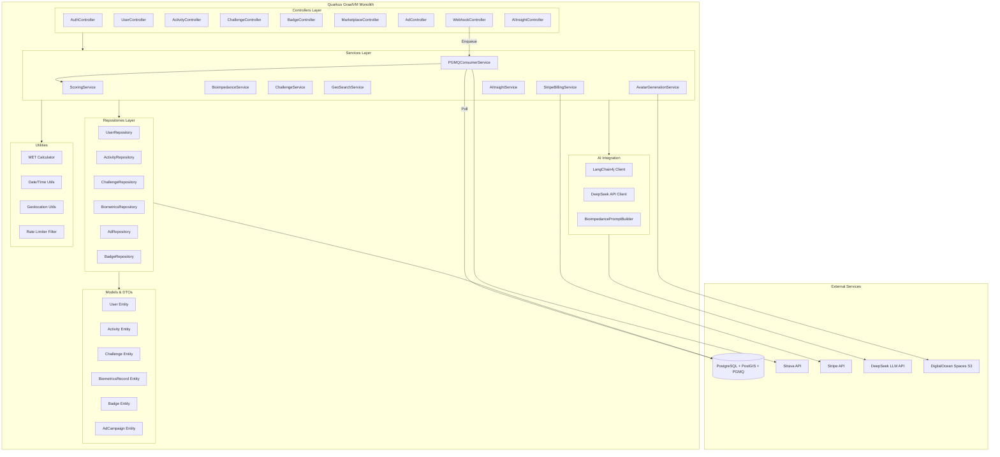
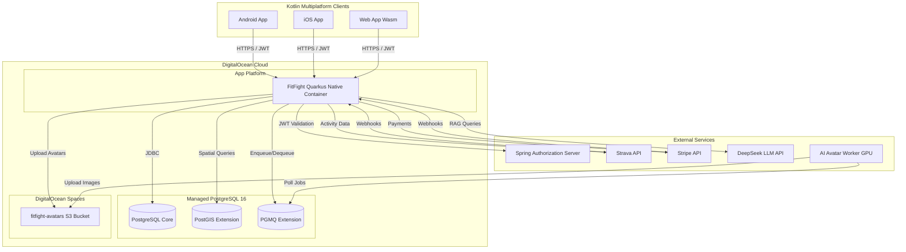

# Arquitetura de Backend Quarkus GraalVM e Modelagem de Dados PostgreSQL

[Voltar ao Índice Geral](index.md)

---

## 1. Visão Geral da Arquitetura do Monólito Reativo Modular

O backend do FitFight é implementado como um **Monólito Reativo Modular** baseado em **Quarkus** compilado nativamente via **GraalVM**. Esta topologia concentra todos os módulos de negócio em um único processo Java/Kotlin, eliminando a complexidade de redes distribuídas, reduzindo custos de infraestrutura no DigitalOcean App Platform e garantindo startup time inferior a 50 ms com consumo de memória RAM inferior a 128 MB em repouso.



### 1.1 Estrutura de Pacotes do Backend

O código Kotlin do backend segue a convenção de **180 caracteres por linha** e é organizado nos seguintes pacotes:

| Pacote | Responsabilidade | Exemplos de Classes |
| :--- | :--- | :--- |
| `com.fitfight.controllers` | Endpoints REST e validação de entrada | `AuthController`, `UserController`, `ActivityController`, `ChallengeController`, `BadgeController`, `MarketplaceController`, `AdController`, `WebhookController`, `AIInsightController` |
| `com.fitfight.services` | Regras de negócio e orquestração | `ScoringService`, `BioimpedanceService`, `ChallengeService`, `GeoSearchService`, `StripeBillingService`, `AvatarGenerationService`, `PGMQConsumerService`, `AIInsightService` |
| `com.fitfight.repositories` | Acesso a dados com Hibernate Panache | `UserRepository`, `ActivityRepository`, `ChallengeRepository`, `BiometricsRepository`, `AdRepository`, `BadgeRepository` |
| `com.fitfight.models` | Entidades JPA e DTOs imutáveis | `User`, `Activity`, `Challenge`, `BiometricsRecord`, `Badge`, `AdCampaign`, `PaymentTransaction` |
| `com.fitfight.ai` | Clientes e integrações LangChain4j | `FitnessInsightAgent`, `BioimpedancePromptBuilder`, `DeepSeekClient` |
| `com.fitfight.utils` | Funções utilitárias | `METCalculator`, `DateUtils`, `GeoUtils`, `RateLimiterFilter`, `UnitConverter` |

---

## 1.2 Migrações de Banco de Dados com Liquibase

O projeto utiliza **Liquibase** como ferramenta canônica de versionamento e aplicação de migrações do banco de dados. Todas as alterações de schema — criação de tabelas, índices, extensões, filas PGMQ e dados iniciais — são versionadas em arquivos XML ou SQL gerenciados pelo Liquibase, garantindo rastreabilidade, reprodutibilidade e deploy seguro em múltiplos ambientes (local, staging, produção).

### 1.2.1 Dependência Quarkus

A extensão oficial do Quarkus para Liquibase é incluída no projeto:

```xml
<!-- pom.xml -->
<dependency>
    <groupId>io.quarkus</groupId>
    <artifactId>quarkus-liquibase</artifactId>
</dependency>
```

### 1.2.2 Configuração no `application.properties`

```properties
# application.properties
quarkus.liquibase.migrate-at-start=true
quarkus.liquibase.change-log=classpath:db/changelog/changelog-master.yaml
quarkus.liquibase.drop-first=false
quarkus.liquibase.user=${DB_USER}
quarkus.liquibase.password=${DB_PASSWORD}
quarkus.liquibase.url=jdbc:postgresql://${DB_HOST:localhost}:${DB_PORT:5432}/${DB_NAME:fitfight}
```

- `migrate-at-start=true`: As migrações são aplicadas automaticamente na inicialização do container Quarkus, antes de qualquer requisição.
- `drop-first=false`: Em produção, nunca recriar o banco do zero. Em ambiente local de desenvolvimento, pode ser ativado via profile override.
- O changelog principal reside em `src/main/resources/db/changelog/changelog-master.yaml`.

### 1.2.3 Estrutura de Diretórios dos Changelogs

```
src/main/resources/
└── db/
    └── changelog/
        ├── changelog-master.yaml              # Changelog raiz, referencia todas as migrações
        ├── 001-create-extensions.yaml         # Extensões PostGIS, PGMQ e filas
        ├── 002-create-users.yaml              # Tabela users e índices
        ├── 003-create-user-biometrics.yaml    # Tabela user_biometrics
        ├── 004-create-activities.yaml         # Tabela activities
        ├── 005-create-challenges.yaml         # Tabela challenges
        ├── 006-create-challenge-participants.yaml # Tabela challenge_participants
        ├── 007-create-badges.yaml             # Tabela badges
        ├── 008-create-points-history.yaml     # Tabela points_history
        ├── 009-create-advertisers.yaml        # Tabelas advertisers e ad_campaigns
        ├── 010-create-payment-transactions.yaml # Tabela payment_transactions
        ├── 011-create-athlete-segment-records.yaml # Tabela opcional athlete_segment_records
        ├── 012-create-challenge-invites.yaml  # Tabela challenge_invites
        ├── 013-create-challenge-snapshots.yaml # Tabela challenge_daily_snapshots
        └── 014-create-indexes.yaml            # Índices complementares
```

Cada arquivo representa uma migração atômica e idempotenta, seguindo a convenção de numeração sequencial `NNN-description.yaml`.

### 1.2.4 Changelog Master

```yaml
# src/main/resources/db/changelog/changelog-master.yaml
databaseChangeLog:
  - include:
      file: db/changelog/001-create-extensions.yaml
  - include:
      file: db/changelog/002-create-users.yaml
  - include:
      file: db/changelog/003-create-user-biometrics.yaml
  - include:
      file: db/changelog/004-create-activities.yaml
  - include:
      file: db/changelog/005-create-challenges.yaml
  - include:
      file: db/changelog/006-create-challenge-participants.yaml
  - include:
      file: db/changelog/007-create-badges.yaml
  - include:
      file: db/changelog/008-create-points-history.yaml
  - include:
      file: db/changelog/009-create-advertisers.yaml
  - include:
      file: db/changelog/010-create-payment-transactions.yaml
  - include:
      file: db/changelog/011-create-athlete-segment-records.yaml
  - include:
      file: db/changelog/012-create-challenge-invites.yaml
  - include:
      file: db/changelog/013-create-challenge-snapshots.yaml
  - include:
      file: db/changelog/014-create-indexes.yaml
```

### 1.2.5 Exemplo de Migração: Extensões e Filas PGMQ

```yaml
# src/main/resources/db/changelog/001-create-extensions.yaml
databaseChangeLog:
  - changeSet:
      id: 001-create-extensions
      author: fitfight
      changes:
        - createDatabaseChangeLogTable:
            tableName: databasechangelog
        - createTable:
            tableName: databasechangeloglock
            columns:
              - column:
                  name: id
                  type: int
                  autoIncrement: false
                  constraints:
                    primaryKey: true
                    nullable: false
              - column:
                  name: locked
                  type: boolean
                  defaultValueBoolean: false
                  constraints:
                    nullable: false
              - column:
                  name: lock_granted
                  type: timestamp
              - column:
                  name: locked_by
                  type: varchar(255)
```

As extensões PostGIS e PGMQ, bem como a criação das filas PGMQ, são aplicadas via changelog SQL dedicado:

```yaml
# src/main/resources/db/changelog/001-extensions-sql.yaml
databaseChangeLog:
  - changeSet:
      id: 001-extensions
      author: fitfight
      changes:
        - sql:
            sql: |
              CREATE EXTENSION IF NOT EXISTS postgis;
              CREATE EXTENSION IF NOT EXISTS pgmq;
  - changeSet:
      id: 002-pgmq-queues
      author: fitfight
      changes:
        - sql:
            sql: |
              SELECT pgmq.create_queue('strava_webhook_events');
              SELECT pgmq.create_queue('badge_generation_jobs');
              SELECT pgmq.create_queue('inactivity_audit_jobs');
              SELECT pgmq.create_queue('stripe_payment_events');
```

### 1.2.6 Exemplo de Migração: Tabela `users`

```yaml
# src/main/resources/db/changelog/002-create-users.yaml
databaseChangeLog:
  - changeSet:
      id: 002-create-users
      author: fitfight
      changes:
        - createTable:
            tableName: users
            columns:
              - column:
                  name: id
                  type: UUID
                  defaultValueComputed: 'gen_random_uuid()'
                  constraints:
                    primaryKey: true
                    nullable: false
              - column:
                  name: auth_subject_id
                  type: VARCHAR(100)
                  constraints:
                    nullable: false
                    unique: true
              - column:
                  name: email
                  type: VARCHAR(255)
                  constraints:
                    nullable: false
                    unique: true
              - column:
                  name: password_hash
                  type: VARCHAR(255)
              - column:
                  name: name
                  type: VARCHAR(255)
                  constraints:
                    nullable: false
              - column:
                  name: gender
                  type: VARCHAR(10)
              - column:
                  name: birth_date
                  type: DATE
              - column:
                  name: height_cm
                  type: NUMERIC(5, 1)
              - column:
                  name: favorite_sport
                  type: VARCHAR(50)
                  constraints:
                    nullable: false
              - column:
                  name: location
                  type: GEOMETRY(Point, 4326)
              - column:
                  name: global_points
                  type: NUMERIC(12, 2)
                  defaultValueNumeric: 0.0
              - column:
                  name: fitness_baseline_factor
                  type: NUMERIC(5, 2)
                  defaultValueNumeric: 1.00
              - column:
                  name: rest_day_of_week
                  type: INT
              - column:
                  name: avatar_face_url
                  type: TEXT
              - column:
                  name: ai_consent
                  type: BOOLEAN
                  defaultValueBoolean: false
              - column:
                  name: coadjutor_consent
                  type: BOOLEAN
                  defaultValueBoolean: false
              - column:
                  name: created_at
                  type: TIMESTAMP WITH TIME ZONE
                  defaultValueComputed: CURRENT_TIMESTAMP
              - column:
                  name: updated_at
                  type: TIMESTAMP WITH TIME ZONE
                  defaultValueComputed: CURRENT_TIMESTAMP
        - createIndex:
            indexName: idx_users_location
            tableName: users
            unique: false
            columns:
              - column:
                  name: location
                  type: GEOMETRY(Point, 4326)
            indexType: GIST
        - createIndex:
            indexName: idx_users_favorite_sport
            tableName: users
            unique: false
            columns:
              - column:
                  name: favorite_sport
```

### 1.2.7 Regras de Versionamento de Migração

1. **Numeração Sequencial**: Cada changelog segue o padrão `NNN-description.yaml`, onde `NNN` é um número de três dígitos incrementado sequencialmente.
2. **Idempotência**: Cada `changeSet` possui `id` único e `author`, garantindo que o Liquibase rastreie o que já foi aplicado.
3. **Rollback**: Migrações críticas incluem bloco `rollback` para reverter alterações em caso de falha:
   ```yaml
   - changeSet:
       id: 005-add-column
       author: fitfight
       changes:
         - addColumn:
             tableName: users
             columns:
               - column:
                   name: new_field
                   type: VARCHAR(50)
       rollback:
         - dropColumn:
             tableName: users
             columnName: new_field
   ```
4. **Ambiente Local**: Em desenvolvimento local, o profile `dev` pode sobrescrever `quarkus.liquibase.drop-first=true` para recriar o banco do zero a cada restart.
5. **Produção**: Em produção, `drop-first=false` é obrigatório. Migrações são aplicadas automaticamente no deploy via GitHub Actions.

### 1.2.8 Integração com CI/CD

O pipeline de CI/CD valida as migrações do Liquibase antes do deploy:

```yaml
# .github/workflows/backend-ci.yml (trecho relevante)
- name: Validate Liquibase changelogs
  run: |
    mvn liquibase:validate
```

Além disso, o deploy no DigitalOcean App Platform executa as migrações automaticamente na inicialização do container Quarkus, antes de abrir o tráfego.

---

## 2. Schema Relacional PostgreSQL com PostGIS e PGMQ

O banco de dados PostgreSQL 16 no DigitalOcean Managed Database utiliza três extensões críticas:

- **PostGIS**: Indexação espacial para busca geográfica de atletas e segmentação de anúncios por raio.
- **PGMQ**: Filas de mensagens transacionais ACID para ingestão assíncrona de webhooks e geração de avatares IA.
- **pgcrypto** (opcional): Geração de UUIDs e hashing complementar.

### 2.1 Extensões e Configuração Inicial

```sql
-- Extensões obrigatórias
CREATE EXTENSION IF NOT EXISTS postgis;
CREATE EXTENSION IF NOT EXISTS pgmq;

-- Configuração de filas PGMQ
SELECT pgmq.create_queue('strava_webhook_events');
SELECT pgmq.create_queue('badge_generation_jobs');
SELECT pgmq.create_queue('inactivity_audit_jobs');
SELECT pgmq.create_queue('stripe_payment_events');
```

### 2.2 Tabela: `users` — Perfis e Dados Biométricos Essenciais

```sql
CREATE TABLE users (
    id UUID PRIMARY KEY DEFAULT gen_random_uuid(),
    auth_subject_id VARCHAR(100) UNIQUE NOT NULL,          -- Subject ID do Spring Authorization Server
    email VARCHAR(255) UNIQUE NOT NULL,
    password_hash VARCHAR(255),                            -- NULL se login social exclusivo
    name VARCHAR(255) NOT NULL,
    gender VARCHAR(10),                                    -- 'male', 'female', 'other'
    birth_date DATE,
    height_cm NUMERIC(5, 1),
    favorite_sport VARCHAR(50) NOT NULL,                   -- 'Run', 'Ride', 'Swim', etc.
    location GEOMETRY(Point, 4326),                        -- PostGIS para busca geográfica
    global_points NUMERIC(12, 2) DEFAULT 0.0,              -- Pontuação vitalícia acumulada
    fitness_baseline_factor NUMERIC(5, 2) DEFAULT 1.00,    -- Fbaseline de condicionamento
    rest_day_of_week INT,                                  -- 0=Dom, 1=Seg, ... (se Rest Day for adotado)
    avatar_face_url TEXT,                                  -- URL da foto facial para IA IP-Adapter
    ai_consent BOOLEAN DEFAULT FALSE,                      -- Consentimento LGPD/GDPR para avatar IA
    coadjutor_consent BOOLEAN DEFAULT FALSE,               -- Consentimento para aparecer em badges de amigos
    created_at TIMESTAMP WITH TIME ZONE DEFAULT CURRENT_TIMESTAMP,
    updated_at TIMESTAMP WITH TIME ZONE DEFAULT CURRENT_TIMESTAMP
);

-- Índice espacial GIST para busca por raio geográfico
CREATE INDEX idx_users_location ON users USING GIST (location);

-- Índice para busca por esporte favorito
CREATE INDEX idx_users_favorite_sport ON users (favorite_sport);
```

### 2.3 Tabela: `user_biometrics` — Histórico de Bioimpedância

```sql
CREATE TABLE user_biometrics (
    id UUID PRIMARY KEY DEFAULT gen_random_uuid(),
    user_id UUID NOT NULL REFERENCES users(id) ON DELETE CASCADE,
    weight_kg NUMERIC(5, 2) NOT NULL,
    muscle_mass_kg NUMERIC(5, 2),                         -- Massa muscular esquelética (se disponível)
    body_fat_percentage NUMERIC(4, 2),                     -- Percentual de gordura corporal
    water_percentage NUMERIC(4, 2),                        -- Percentual de água corporal
    has_bioimpedance BOOLEAN DEFAULT FALSE,                -- TRUE se balança de bioimpedância, FALSE se balança comum
    calculated_points NUMERIC(10, 2) DEFAULT 0.0,          -- Pontos biométricos gerados por esta medição
    recorded_at TIMESTAMP WITH TIME ZONE DEFAULT CURRENT_TIMESTAMP
);

CREATE INDEX idx_biometrics_user_id ON user_biometrics (user_id, recorded_at DESC);
```

### 2.4 Tabela: `activities` — Atividades Físicas Sincronizadas

```sql
CREATE TABLE activities (
    id UUID PRIMARY KEY DEFAULT gen_random_uuid(),
    user_id UUID NOT NULL REFERENCES users(id) ON DELETE CASCADE,
    external_provider VARCHAR(50) DEFAULT 'STRAVA',        -- 'STRAVA', 'MANUAL', etc.
    external_id VARCHAR(100) UNIQUE,                       -- Idempotência: evita processamento duplicado
    activity_type VARCHAR(50) NOT NULL,                    -- 'Run', 'Ride', 'Swim', etc.
    is_external BOOLEAN DEFAULT TRUE,                      -- TRUE = outdoor, FALSE = indoor
    distance_meters NUMERIC(10, 2),
    duration_seconds INT NOT NULL,                         -- moving_time em segundos
    elapsed_seconds INT,                                   -- tempo total decorrido (inclui pausas)
    average_heartrate NUMERIC(5, 2),
    max_heartrate NUMERIC(5, 2),
    strava_pr_count INT DEFAULT 0,                        -- Indicador resumido; não somado como bônus
    strava_best_efforts_pr JSONB,                         -- Detalhes de best_efforts com pr_rank=1
    strava_segment_efforts_pr JSONB,                      -- Detalhes de segmentos com pr_rank=1 ou kom_rank=1
    calculated_points NUMERIC(10, 2) NOT NULL,             -- Pontos MET calculados
    met_value NUMERIC(5, 2),                              -- MET tipo da atividade
    factor_ambiente NUMERIC(3, 2) DEFAULT 1.00,           -- 1.30 outdoor, 1.00 indoor
    factor_heartrate NUMERIC(3, 2) DEFAULT 1.00,          -- Fator cardíaco calculado
    factor_consistency NUMERIC(3, 2) DEFAULT 1.00,        -- Fator de duração longa
    factor_baseline NUMERIC(3, 2) DEFAULT 1.00,           -- Fator de baseline individual
    bonus_points NUMERIC(10, 2) DEFAULT 0.0,              -- Bônus de PRs/troféus
    occurred_at TIMESTAMP WITH TIME ZONE NOT NULL,        -- start_date UTC
    created_at TIMESTAMP WITH TIME ZONE DEFAULT CURRENT_TIMESTAMP,
    updated_at TIMESTAMP WITH TIME ZONE DEFAULT CURRENT_TIMESTAMP
);

CREATE INDEX idx_activities_user_id ON activities (user_id, occurred_at DESC);
CREATE INDEX idx_activities_external_id ON activities (external_id);
CREATE INDEX idx_activities_type ON activities (activity_type);
```

### 2.5 Tabela: `challenges` — Desafios em Grupo

```sql
CREATE TABLE challenges (
    id UUID PRIMARY KEY DEFAULT gen_random_uuid(),
    creator_id UUID NOT NULL REFERENCES users(id),
    title VARCHAR(255) NOT NULL,
    description TEXT,
    start_date TIMESTAMP WITH TIME ZONE NOT NULL,
    end_date TIMESTAMP WITH TIME ZONE NOT NULL,
    status VARCHAR(20) NOT NULL DEFAULT 'PENDING_START',  -- PENDING_START, ACTIVE, AUDIT_GRACE, COMPLETED, ARCHIVED
    is_public BOOLEAN DEFAULT FALSE,
    max_participants INT DEFAULT 50,
    sport_filter VARCHAR(50) DEFAULT 'ALL',               -- 'ALL' ou tipo específico ('Run', 'Ride', etc.)
    apply_inactivity_penalty BOOLEAN DEFAULT FALSE,        -- Modo Hardcore opcional
    created_at TIMESTAMP WITH TIME ZONE DEFAULT CURRENT_TIMESTAMP,
    updated_at TIMESTAMP WITH TIME ZONE DEFAULT CURRENT_TIMESTAMP
);

CREATE INDEX idx_challenges_status ON challenges (status, start_date, end_date);
CREATE INDEX idx_challenges_creator ON challenges (creator_id);
```

### 2.6 Tabela: `challenge_participants` — Participantes e Pontuação Relativa

```sql
CREATE TABLE challenge_participants (
    challenge_id UUID NOT NULL REFERENCES challenges(id) ON DELETE CASCADE,
    user_id UUID NOT NULL REFERENCES users(id) ON DELETE CASCADE,
    relative_points NUMERIC(10, 2) DEFAULT 0.0,           -- Pontuação relativa no desafio
    current_rank INT,                                     -- Posição atual no ranking
    previous_rank INT,                                    -- Posição no snapshot diário anterior
    joined_at TIMESTAMP WITH TIME ZONE DEFAULT CURRENT_TIMESTAMP,
    PRIMARY KEY (challenge_id, user_id)
);

CREATE INDEX idx_participants_rank ON challenge_participants (challenge_id, current_rank ASC);
CREATE INDEX idx_participants_user ON challenge_participants (user_id);
```

### 2.7 Tabela: `challenge_invites` — Convites para Desafios

```sql
CREATE TABLE challenge_invites (
    id UUID PRIMARY KEY DEFAULT gen_random_uuid(),
    challenge_id UUID NOT NULL REFERENCES challenges(id) ON DELETE CASCADE,
    inviter_id UUID NOT NULL REFERENCES users(id),
    invitee_user_id UUID REFERENCES users(id),            -- NULL se convite por link/e-mail para não cadastrado
    invitee_email VARCHAR(255),                           -- E-mail do convidado não cadastrado
    invite_token VARCHAR(255) UNIQUE,                     -- Token HMAC assinado
    status VARCHAR(20) DEFAULT 'PENDING',                 -- PENDING, ACCEPTED, DECLINED, EXPIRED
    expires_at TIMESTAMP WITH TIME ZONE,
    created_at TIMESTAMP WITH TIME ZONE DEFAULT CURRENT_TIMESTAMP
);

CREATE INDEX idx_invites_challenge ON challenge_invites (challenge_id, status);
CREATE INDEX idx_invites_token ON challenge_invites (invite_token);
```

### 2.8 Tabela: `badges` — Insígnias Geradas por IA e Marcos

```sql
CREATE TABLE badges (
    id UUID PRIMARY KEY DEFAULT gen_random_uuid(),
    user_id UUID NOT NULL REFERENCES users(id) ON DELETE CASCADE,
    challenge_id UUID REFERENCES challenges(id) ON DELETE SET NULL,
    badge_type VARCHAR(50) NOT NULL,                      -- 'WEEKLY_LEADER', 'MONTHLY_LEADER', 'CHAMPION_THRONE', 'CONSISTENCY_7D', 'CONSISTENCY_30D', 'CONSISTENCY_100D', 'VOLUME_RUN_100KM', 'VOLUME_RIDE_500KM', 'VOLUME_50_ACTIVITIES'
    display_category VARCHAR(50) NOT NULL DEFAULT 'AI_BADGE', -- 'AI_BADGE', 'CONSISTENCY', 'VOLUME'
    image_url TEXT NOT NULL,                              -- URL da imagem renderizada no DigitalOcean Spaces
    generation_prompt TEXT,                               -- Prompt canônico usado na geração (apenas para AI_BADGE)
    is_provisional BOOLEAN DEFAULT FALSE,                 -- TRUE se badge vetorial provisório, FALSE se IA concluída
    earned_at TIMESTAMP WITH TIME ZONE DEFAULT CURRENT_TIMESTAMP
);

CREATE INDEX idx_badges_user ON badges (user_id, earned_at DESC);
CREATE INDEX idx_badges_type ON badges (badge_type);
CREATE INDEX idx_badges_category ON badges (display_category);
```

### 2.8.1 Tabela: `challenge_trophies` — Troféus de Vitória Individual

Ao vencer um desafio, o usuário recebe um troféu digital comemorativo registrado nesta tabela:

```sql
CREATE TABLE challenge_trophies (
    id UUID PRIMARY KEY DEFAULT gen_random_uuid(),
    user_id UUID NOT NULL REFERENCES users(id) ON DELETE CASCADE,
    challenge_id UUID NOT NULL REFERENCES challenges(id) ON DELETE CASCADE,
    trophy_type VARCHAR(50) NOT NULL DEFAULT 'CHALLENGE_WINNER',
    position INT NOT NULL DEFAULT 1,
    final_points NUMERIC(10, 2) NOT NULL,
    participants_count INT NOT NULL,
    share_image_url TEXT,                                 -- URL da imagem renderizada para compartilhamento
    earned_at TIMESTAMP WITH TIME ZONE DEFAULT CURRENT_TIMESTAMP,
    UNIQUE(user_id, challenge_id)
);

CREATE INDEX idx_trophies_user ON challenge_trophies (user_id, earned_at DESC);
CREATE INDEX idx_trophies_challenge ON challenge_trophies (challenge_id);
```

### 2.9 Tabela: `points_history` — Histórico Auditável de Pontos

```sql
CREATE TABLE points_history (
    id UUID PRIMARY KEY DEFAULT gen_random_uuid(),
    user_id UUID NOT NULL REFERENCES users(id) ON DELETE CASCADE,
    challenge_id UUID REFERENCES challenges(id) ON DELETE SET NULL,
    activity_id UUID REFERENCES activities(id) ON DELETE SET NULL,
    biometrics_id UUID REFERENCES user_biometrics(id) ON DELETE SET NULL,
    points_delta NUMERIC(10, 2) NOT NULL,                 -- Positivo ou negativo
    points_category VARCHAR(50) NOT NULL,                 -- 'ACTIVITY', 'BIOIMPEDANCE', 'INACTIVITY_PENALTY', 'PR_BONUS', 'REVERSAL'
    idempotency_key VARCHAR(255) UNIQUE,                  -- Garante processamento único
    description TEXT,
    created_at TIMESTAMP WITH TIME ZONE DEFAULT CURRENT_TIMESTAMP
);

CREATE INDEX idx_points_history_user ON points_history (user_id, created_at DESC);
CREATE INDEX idx_points_history_challenge ON points_history (challenge_id, created_at DESC);
```

### 2.10 Tabela: `advertisers` — Anunciantes e Profissionais

```sql
CREATE TABLE advertisers (
    id UUID PRIMARY KEY DEFAULT gen_random_uuid(),
    user_id UUID NOT NULL REFERENCES users(id),
    company_name VARCHAR(255) NOT NULL,
    tax_id VARCHAR(50),                                   -- CNPJ ou CPF
    stripe_customer_id VARCHAR(100),
    category VARCHAR(50) NOT NULL,                        -- 'PROFESSIONAL', 'PRODUCT', 'EVENT'
    description TEXT,
    website_url TEXT,
    verified BOOLEAN DEFAULT FALSE,                       -- Selo de verificação
    created_at TIMESTAMP WITH TIME ZONE DEFAULT CURRENT_TIMESTAMP
);

CREATE INDEX idx_advertisers_category ON advertisers (category);
```

### 2.11 Tabela: `ad_campaigns` — Campanhas Publicitárias

```sql
CREATE TABLE ad_campaigns (
    id UUID PRIMARY KEY DEFAULT gen_random_uuid(),
    advertiser_id UUID NOT NULL REFERENCES advertisers(id) ON DELETE CASCADE,
    category VARCHAR(50) NOT NULL,                        -- 'PROFESSIONAL', 'PRODUCT', 'EVENT'
    title VARCHAR(255) NOT NULL,
    description TEXT,
    target_sport VARCHAR(50),                             -- NULL = todas as modalidades
    target_location GEOMETRY(Point, 4326),                -- Centro do raio geográfico
    max_radius_km NUMERIC(5, 2),                          -- Raio máximo em km
    image_url TEXT NOT NULL,
    cta_url TEXT NOT NULL,                                -- Call-to-Action link
    active BOOLEAN DEFAULT FALSE,
    impressions_count BIGINT DEFAULT 0,
    clicks_count BIGINT DEFAULT 0,
    budget_amount NUMERIC(10, 2),
    created_at TIMESTAMP WITH TIME ZONE DEFAULT CURRENT_TIMESTAMP,
    updated_at TIMESTAMP WITH TIME ZONE DEFAULT CURRENT_TIMESTAMP
);

-- Índice espacial para segmentação geográfica de anúncios
CREATE INDEX idx_ad_campaigns_location ON ad_campaigns USING GIST (target_location);
CREATE INDEX idx_ad_campaigns_active ON ad_campaigns (active, target_sport);
```

### 2.12 Tabela: `ad_impressions` — Rastreamento de Impressões e Cliques

```sql
CREATE TABLE ad_impressions (
    id UUID PRIMARY KEY DEFAULT gen_random_uuid(),
    campaign_id UUID NOT NULL REFERENCES ad_campaigns(id) ON DELETE CASCADE,
    user_id UUID NOT NULL REFERENCES users(id),
    impression_type VARCHAR(20) NOT NULL,                 -- 'IMPRESSION', 'CLICK'
    created_at TIMESTAMP WITH TIME ZONE DEFAULT CURRENT_TIMESTAMP
);

CREATE INDEX idx_ad_impressions_campaign ON ad_impressions (campaign_id, created_at DESC);
CREATE INDEX idx_ad_impressions_user ON ad_impressions (user_id, created_at DESC);
```

### 2.13 Tabela: `payment_transactions` — Transações de Pagamento Stripe

```sql
CREATE TABLE payment_transactions (
    id UUID PRIMARY KEY DEFAULT gen_random_uuid(),
    advertiser_id UUID NOT NULL REFERENCES advertisers(id) ON DELETE CASCADE,
    campaign_id UUID REFERENCES ad_campaigns(id) ON DELETE SET NULL,
    stripe_payment_intent_id VARCHAR(100) UNIQUE NOT NULL,
    stripe_event_id VARCHAR(100) UNIQUE NOT NULL,         -- Idempotência do webhook
    amount NUMERIC(10, 2) NOT NULL,
    currency VARCHAR(3) DEFAULT 'BRL',
    status VARCHAR(20) NOT NULL,                          -- 'PENDING', 'COMPLETED', 'FAILED', 'REFUNDED'
    created_at TIMESTAMP WITH TIME ZONE DEFAULT CURRENT_TIMESTAMP
);

CREATE INDEX idx_payment_transactions_advertiser ON payment_transactions (advertiser_id, created_at DESC);
```

### 2.14 Tabela: `athlete_segment_records` — Histórico de Recordes por Segmento (Opcional)

```sql
-- Tabela opcional para rastrear recordes anteriores por segmento e calcular melhoria percentual
CREATE TABLE athlete_segment_records (
    id UUID PRIMARY KEY DEFAULT gen_random_uuid(),
    user_id UUID NOT NULL REFERENCES users(id) ON DELETE CASCADE,
    segment_id VARCHAR(100) NOT NULL,                     -- ID do segmento Strava
    effort_type VARCHAR(20) NOT NULL,                     -- 'SEGMENT', 'BEST_EFFORT', 'KOM_CR'
    best_time_seconds INT NOT NULL,
    activity_id UUID REFERENCES activities(id) ON DELETE SET NULL,
    updated_at TIMESTAMP WITH TIME ZONE DEFAULT CURRENT_TIMESTAMP,
    UNIQUE (user_id, segment_id, effort_type)
);

CREATE INDEX idx_segment_records_user ON athlete_segment_records (user_id);
```

---

## 3. Validação de Entrada, Tratamento de Exceções e Mensagens Externalizadas

O projeto adota **Jakarta Bean Validation** (JSR 380, implementada pelo **Hibernate Validator**) para validação declarativa dos campos obrigatórios e regras de negócio nos DTOs de entrada dos REST Controllers. O tratamento de erros utiliza a extensão **quarkus-http-problem** que mapeia exceções automaticamente para respostas **RFC 9457 / RFC 7807 (ProblemDetails)**. Todas as mensagens de erro e validação são externalizadas em arquivos `.properties` para permitir futura internacionalização (i18n).

### 3.1 Dependências Quarkus

```xml
<!-- pom.xml -->
<dependency>
    <groupId>io.quarkus</groupId>
    <artifactId>quarkus-hibernate-validator</artifactId>
</dependency>
<dependency>
    <groupId>io.quarkiverse.httpproblem</groupId>
    <artifactId>quarkus-http-problem</artifactId>
</dependency>
<dependency>
    <groupId>io.quarkus</groupId>
    <artifactId>quarkus-resteasy-reactive-jackson</artifactId>
</dependency>
```

O `quarkus-hibernate-validator` fornece suporte nativo para anotações `@Valid`, `@NotNull`, `@Size`, `@Email`, `@Min`, `@Max`, `@Pattern`, `@Positive`, `@Future`, entre outras, além de validação em cascata via `@Valid` em objetos aninhados.

A extensão `quarkus-http-problem` substitui a necessidade de um `GlobalExceptionHandler` manual, mapeando automaticamente exceções para `application/problem+json` com suporte a campos customizados via `ProblemPostProcessor`.

### 3.2 Validação nos DTOs de Entrada

Cada operação `POST`/`PUT` recebe um DTO dedicado anotado com restrições de validação Jakarta Bean Validation. As mensagens usam chaves de `messages.properties`:

```kotlin
package com.fitfight.models.dto

import com.fitfight.models.dto.validation.FutureDate
import jakarta.validation.constraints.*
import java.time.OffsetDateTime

data class CreateChallengeRequest(
    @field:NotBlank(message = "{challenge.title.not-blank}")
    @field:Size(min = 3, max = 255, message = "{challenge.title.size}")
    val title: String,

    @field:Size(max = 2000, message = "{challenge.description.size}")
    val description: String?,

    @field:NotNull(message = "{challenge.start-date.not-null}")
    @field:FutureDate(message = "{challenge.start-date.future}")
    val startDate: OffsetDateTime,

    @field:NotNull(message = "{challenge.end-date.not-null}")
    @field:FutureDate(message = "{challenge.end-date.future}")
    val endDate: OffsetDateTime,

    @field:NotNull(message = "{challenge.invitee-emails.not-null}")
    @field:Size(min = 1, message = "{challenge.invitee-emails.min}")
    @field:Email.List(message = "{challenge.invitee-emails.format}")
    val inviteeEmails: List<String>
)
```

```kotlin
package com.fitfight.models.dto

import jakarta.validation.constraints.*

data class RegisterBiometricsRequest(
    @field:NotNull(message = "{biometrics.weight.not-null}")
    @field:Positive(message = "{biometrics.weight.positive}")
    @field:Max(value = 500, message = "{biometrics.weight.max}")
    val weightKg: Double,

    @field:Positive(message = "{biometrics.muscle-mass.positive}")
    @field:Max(value = 200, message = "{biometrics.muscle-mass.max}")
    val muscleMassKg: Double?,

    @field:Positive(message = "{biometrics.body-fat.positive}")
    @field:Max(value = 100, message = "{biometrics.body-fat.max}")
    val bodyFatPercentage: Double?,

    @field:Positive(message = "{biometrics.water.positive}")
    @field:Max(value = 100, message = "{biometrics.water.max}")
    val waterPercentage: Double?
)
```

### 3.3 Validação Customizada via ConstraintValidator

Para regras de negócio que exigem lógica além das anotações padrão, o projeto define constraints customizadas:

```kotlin
package com.fitfight.models.dto.validation

import jakarta.validation.Constraint
import jakarta.validation.ConstraintValidator
import jakarta.validation.ConstraintValidatorContext
import java.lang.annotation.Retention
import java.lang.annotation.Target
import java.time.OffsetDateTime
import kotlin.annotation.AnnotationTarget.*

@Retention(AnnotationRetention.RUNTIME)
@Target(FUNCTION, PROPERTY_GETTER, FIELD, ANNOTATION_TYPE)
@Constraint(validatedBy = [FutureDateValidator::class])
annotation class FutureDate(
    val message: String = "{future-date.default-message}",
    val groups: Array<KClass<*>?> = [],
    val payload: Array<KClass<out Any>> = []
)

class FutureDateValidator : ConstraintValidator<FutureDate, OffsetDateTime> {
    override fun isValid(value: OffsetDateTime?, context: ConstraintValidatorContext): Boolean {
        if (value == null) return true
        return value.isAfter(OffsetDateTime.now())
    }
}
```

```kotlin
package com.fitfight.models.dto.validation

import com.fitfight.models.dto.CreateChallengeRequest
import jakarta.validation.Constraint
import jakarta.validation.ConstraintValidator
import jakarta.validation.ConstraintValidatorContext
import java.lang.annotation.Retention
import java.lang.annotation.Target
import kotlin.annotation.AnnotationTarget.*

@Retention(AnnotationRetention.RUNTIME)
@Target(CLASS, ANNOTATION_TYPE)
@Constraint(validatedBy = [EndDateAfterStartDateValidator::class])
annotation class EndDateAfterStartDate(
    val message: String = "{challenge.end-date.after-start}",
    val groups: Array<KClass<*>?> = [],
    val payload: Array<KClass<out Any>> = []
)

class EndDateAfterStartDateValidator : ConstraintValidator<EndDateAfterStartDate, CreateChallengeRequest> {
    override fun isValid(value: CreateChallengeRequest?, context: ConstraintValidatorContext): Boolean {
        if (value == null) return true
        return value.endDate.isAfter(value.startDate)
    }
}
```

### 3.4 Validação nos REST Controllers

A anotação `@Valid` no parâmetro do método do controller dispara automaticamente a validação do DTO. Violações são mapeadas para ProblemDetails pela extensão quarkus-http-problem:

```kotlin
package com.fitfight.controllers

import com.fitfight.models.dto.CreateChallengeRequest
import com.fitfight.services.ChallengeService
import jakarta.inject.Inject
import jakarta.validation.Valid
import jakarta.ws.rs.*
import jakarta.ws.rs.core.MediaType
import jakarta.ws.rs.core.Response

@Path("/challenges")
@Produces(MediaType.APPLICATION_JSON)
@Consumes(MediaType.APPLICATION_JSON)
class ChallengeController {

    @Inject lateinit var challengeService: ChallengeService

    @POST
    fun createChallenge(@Valid request: CreateChallengeRequest): Response {
        val challenge = challengeService.createChallenge(request)
        return Response.status(Response.Status.CREATED).entity(challenge).build()
    }
}
```

### 3.5 Exceções Customizadas com HttpProblem

Em vez de uma hierarquia de exceções customizadas, o projeto utiliza `HttpProblem` da extensão quarkus-http-problem. Cada exceção de negócio é lançada diretamente como um `HttpProblem` com status, tipo e campos customizados:

```kotlin
package com.fitfight.exceptions

import io.quarkiverse.httpproblem.HttpProblem
import jakarta.ws.rs.core.Response

object FitFightExceptions {

    fun resourceNotFound(resourceType: String, resourceId: String): Nothing =
        throw HttpProblem.builder()
            .withStatus(Response.Status.NOT_FOUND)
            .withTitle("RESOURCE_NOT_FOUND")
            .with("resourceType", resourceType)
            .with("resourceId", resourceId)
            .build()

    fun businessRuleViolation(message: String, vararg params: String): Nothing =
        throw HttpProblem.builder()
            .withStatus(Response.Status.CONFLICT)
            .withTitle("BUSINESS_RULE_VIOLATION")
            .withDetail(message.format(*params))
            .build()

    fun concurrentUpdate(): Nothing =
        throw HttpProblem.builder()
            .withStatus(Response.Status.CONFLICT)
            .withTitle("CONCURRENT_UPDATE")
            .withDetail("O recurso foi modificado por outro usuário. Tente novamente.")
            .build()

    fun externalServiceError(serviceName: String): Nothing =
        throw HttpProblem.builder()
            .withStatus(Response.Status.BAD_GATEWAY)
            .withTitle("EXTERNAL_SERVICE_ERROR")
            .with("service", serviceName)
            .withDetail("Serviço '$serviceName' indisponível no momento.")
            .build()
}
```

Uso nos services:

```kotlin
package com.fitfight.services

import com.fitfight.exceptions.FitFightExceptions
import jakarta.inject.Inject

class ChallengeService {

    @Inject lateinit var challengeRepository: ChallengeRepository

    fun getChallengeById(id: String) =
        challengeRepository.findById(id)
            ?: FitFightExceptions.resourceNotFound("Challenge", id)

    fun joinChallenge(challengeId: String, userId: String) {
        val challenge = getChallengeById(challengeId)
        if (challenge.hasParticipant(userId)) {
            FitFightExceptions.businessRuleViolation("O usuário já participa deste desafio.")
        }
        // ... lógica de participação
    }
}
```

### 3.6 ProblemPostProcessor para Campos Customizados

A extensão quarkus-http-problem suporta `ProblemPostProcessor` para adicionar campos globais como `timestamp` e `supportId` em todas as respostas de erro:

```kotlin
package com.fitfight.exceptions

import io.quarkiverse.httpproblem.HttpProblem
import io.quarkiverse.httpproblem.postprocessing.ProblemContext
import io.quarkiverse.httpproblem.postprocessing.ProblemPostProcessor
import jakarta.enterprise.context.ApplicationScoped
import java.time.OffsetDateTime

@ApplicationScoped
class TimestampPostProcessor : ProblemPostProcessor {

    override fun priority(): Int = 50

    override fun apply(problem: HttpProblem, context: ProblemContext): HttpProblem =
        HttpProblem.builder(problem)
            .with("timestamp", OffsetDateTime.now().toString())
            .build()
}
```

### 3.7 Configuração da Extensão em application.properties

```properties
# src/main/resources/application.properties

# Status e título para violações de validação (ConstraintViolationException)
quarkus.http-problem.constraint-violation.status=400
quarkus.http-problem.constraint-violation.title=Validation Error

# Não incluir detalhes da exceção em produção
quarkus.http-problem.include-details=false

# Nível de log para erros 4xx e 5xx
quarkus.http-problem.logging.level.4xx=INFO
quarkus.http-problem.logging.level.5xx=ERROR
quarkus.http-problem.logging.include-stack-trace=5xx
```

### 3.8 Exemplos de Respostas ProblemDetails

#### 3.8.1 Erro de Validação (400 Bad Request)

```json
{
  "type": "https://fitfight.app/errors/validation-error",
  "title": "VALIDATION_ERROR",
  "status": 400,
  "detail": "Uma ou mais validações falharam.",
  "timestamp": "2026-10-31T19:45:00Z",
  "violations": [
    {
      "field": "title",
      "value": "",
      "message": "O título do desafio não pode estar vazio."
    },
    {
      "field": "startDate",
      "value": "2020-01-01T00:00:00Z",
      "message": "A data de início deve ser posterior à data atual."
    }
  ]
}
```

#### 3.8.2 Recurso Não Encontrado (404 Not Found)

```json
{
  "type": "https://fitfight.app/errors/resource-not-found",
  "title": "RESOURCE_NOT_FOUND",
  "status": 404,
  "detail": "Desafio com ID 'abc-123' não encontrado.",
  "instance": "/challenges/abc-123",
  "timestamp": "2026-10-31T19:45:00Z"
}
```

#### 3.8.3 Violação de Regra de Negócio (409 Conflict)

```json
{
  "type": "https://fitfight.app/errors/business-rule-violation",
  "title": "BUSINESS_RULE_VIOLATION",
  "status": 409,
  "detail": "O usuário já participa deste desafio.",
  "timestamp": "2026-10-31T19:45:00Z"
}
```

#### 3.8.4 Erro de Serviço Externo (502 Bad Gateway)

```json
{
  "type": "https://fitfight.app/errors/external-service-error",
  "title": "EXTERNAL_SERVICE_ERROR",
  "status": 502,
  "detail": "Serviço 'Strava API' indisponível no momento. Tente novamente mais tarde.",
  "timestamp": "2026-10-31T19:45:00Z"
}
```

#### 3.8.5 Erro Interno (500 Internal Server Error)

```json
{
  "type": "https://fitfight.app/errors/internal-error",
  "title": "INTERNAL_SERVER_ERROR",
  "status": 500,
  "detail": "Ocorreu um erro interno. Entre em contato com o suporte.",
  "timestamp": "2026-10-31T19:45:00Z"
}
```

### 3.9 Mensagens Externalizadas em `.properties`

Todas as mensagens de validação usam chaves de `messages.properties`. O Hibernate Validator resolve automaticamente essas chaves via `ResourceBundle`. Para mensagens de negócio lançadas via `FitFightExceptions`, as mensagens podem ser lidas do mesmo arquivo:

```kotlin
package com.fitfight.utils

import jakarta.enterprise.context.ApplicationScoped
import java.util.*

@ApplicationScoped
class MessagesBundle {
    private val bundle = ResourceBundle.getBundle("messages", Locale("pt", "BR"))

    fun get(key: String, vararg params: String): String {
        val message = bundle.getString(key)
        return if (params.isEmpty()) message else message.format(*params)
    }
}
```

### 3.10 Arquivo `messages.properties` (Padrão pt-BR)

```properties
# src/main/resources/messages.properties

# ============================================================
# Challenge
# ============================================================
challenge.title.not-blank=O título do desafio não pode estar vazio.
challenge.title.size=O título do desafio deve ter entre {min} e {max} caracteres.
challenge.description.size=A descrição do desafio não pode exceder {max} caracteres.
challenge.start-date.not-null=A data de início do desafio é obrigatória.
challenge.start-date.future=A data de início deve ser posterior à data atual.
challenge.end-date.not-null=A data de término do desafio é obrigatória.
challenge.end-date.future=A data de término deve ser posterior à data atual.
challenge.end-date.after-start=A data de término deve ser posterior à data de início.
challenge.invitee-emails.not-null=A lista de e-mails de convite não pode estar vazia.
challenge.invitee-emails.min=É necessário convidar pelo menos um participante.
challenge.invitee-emails.format=Um ou mais e-mails possuem formato inválido.

# ============================================================
# Biometrics
# ============================================================
biometrics.weight.not-null=O peso é obrigatório.
biometrics.weight.positive=O peso deve ser um valor positivo.
biometrics.weight.max=O peso não pode exceder {max} kg.
biometrics.muscle-mass.positive=A massa muscular deve ser um valor positivo.
biometrics.muscle-mass.max=A massa muscular não pode exceder {max} kg.
biometrics.body-fat.positive=A porcentagem de gordura deve ser um valor positivo.
biometrics.body-fat.max=A porcentagem de gordura não pode exceder {max}%.
biometrics.water.positive=A porcentagem de água deve ser um valor positivo.
biometrics.water.max=A porcentagem de água não pode exceder {max}%.

# ============================================================
# User
# ============================================================
user.email.not-blank=O e-mail não pode estar vazio.
user.email.invalid=O e-mail possui formato inválido.
user.name.not-blank=O nome não pode estar vazio.
user.name.size=O nome deve ter entre {min} e {max} caracteres.
user.favorite-sport.not-blank=O esporte favorito é obrigatório.

# ============================================================
# Activity
# ============================================================
activity.duration.not-null=A duração da atividade é obrigatória.
activity.duration.positive=A duração deve ser um valor positivo.
activity.duration.max=A duração não pode exceder {max} segundos.
activity.heartrate.positive=A frequência cardíaca deve ser um valor positivo.
activity.heartrate.max=A frequência cardíaca não pode exceder {max} bpm.

# ============================================================
# Resource
# ============================================================
resource.not-found={type} com ID '{id}' não encontrado.

# ============================================================
# Business Rules
# ============================================================
business-rule.already-participant=O usuário já participa deste desafio.
business-rule.challenge-ended=O desafio já encerrou e não aceita mais participantes.
business-rule.challenge-not-started=O desafio ainda não começou.
business-rule.self-invite=Você não pode se convidar para o próprio desafio.
business-rule.insufficient-balance=Saldo insuficiente para criar a campanha.

# ============================================================
# Concurrent Update
# ============================================================
concurrent-update.default=O recurso foi modificado por outro usuário. Tente novamente.

# ============================================================
# External Services
# ============================================================
external-service.error=Serviço '{service}' indisponível no momento. Tente novamente mais tarde.

# ============================================================
# Validation
# ============================================================
future-date.default-message=A data deve ser posterior à data atual.
validation.not-blank=O campo não pode estar vazio.
validation.not-null=O campo é obrigatório.
validation.positive=O campo deve ser um valor positivo.
validation.email=O campo deve conter um e-mail válido.
```

### 3.11 Estrutura de Arquivos de Mensagens para i18n

Para suportar múltiplos idiomas, os arquivos seguem a convenção `messages_{locale}.properties`:

```
src/main/resources/
├── messages.properties                  # Padrão pt-BR
├── messages_en.properties               # Inglês
├── messages_es.properties               # Espanhol
└── messages_pt_BR.properties            # pt-BR explícito (se diferir do padrão)
```

O `MessagesBundle` pode ser estendido para detectar o `Accept-Language` do header HTTP e carregar o `ResourceBundle` correspondente.

### 3.12 Regras de Boas Práticas

1. **Nunca use mensagens hardcoded nos controllers ou services**: Toda mensagem de erro deve residir em `messages.properties`.
2. **Use chaves estruturadas**: O padrão `{modulo}.{campo}.{regra}` facilita a localização e manutenção.
3. **Lance `HttpProblem` diretamente via `FitFightExceptions`**: A extensão quarkus-http-problem mapeia automaticamente para ProblemDetails.
4. **Em produção, nunca exponha stack traces**: Configure `quarkus.http-problem.include-details=false` e `quarkus.http-problem.logging.include-stack-trace=5xx`.
5. **Validação em cascata**: Use `@Valid` em campos aninhados para garantir que DTOs compostos sejam validados recursivamente.
6. **Limite de 180 caracteres por linha**: Todo código Kotlin respeita 180 caracteres por linha, evitando quebras desnecessárias.

---

## 4. Filas PGMQ e Mensageria Transacional

O PostgreSQL PGMQ substitui filas externas (RabbitMQ, Redis Streams) proporcionando durabilidade ACID nativa. Cada fila é uma tabela gerenciada pelo PGMQ com visibilidade de mensagens via VT (Visibility Timeout).

### 4.1 Fila: `strava_webhook_events`

| Campo | Tipo | Descrição |
| :--- | :--- | :--- |
| `aspect_type` | `VARCHAR(20)` | `'create'`, `'update'`, `'delete'` |
| `object_type` | `VARCHAR(20)` | `'activity'`, `'athlete'` |
| `object_id` | `VARCHAR(100)` | ID da atividade ou atleta no Strava |
| `owner_id` | `VARCHAR(100)` | ID do atleta proprietário no Strava |
| `subscription_id` | `VARCHAR(100)` | ID da inscrição do webhook |
| `updates` | `JSONB` | Payload adicional do evento |

**Consumidor**: `PGMQConsumerService` no Quarkus, com VT de 30 segundos e polling contínuo.

### 4.2 Fila: `badge_generation_jobs`

| Campo | Tipo | Descrição |
| :--- | :--- | :--- |
| `user_id` | `UUID` | Atleta elegível para o badge |
| `challenge_id` | `UUID` | Desafio associado (se aplicável) |
| `badge_type` | `VARCHAR(50)` | `'WEEKLY_LEADER'`, `'MONTHLY_LEADER'`, `'CHAMPION_THRONE'` |
| `user_attributes` | `JSONB` | Dados para síntese facial (esporte, gênero, tom de pele, etc.) |
| `participant_references` | `JSONB` | Lista de coadjuvantes com status de consentimento |

**Consumidor**: Worker assíncrono externo (GPU-enabled) que consome via PGMQ, renderiza imagem via IP-Adapter/FLUX e faz upload para DigitalOcean Spaces.

### 4.3 Fila: `inactivity_audit_jobs`

| Campo | Tipo | Descrição |
| :--- | :--- | :--- |
| `user_id` | `UUID` | Atleta a ser auditado |
| `last_activity_end` | `TIMESTAMP` | Término da última atividade qualificada |
| `audit_window_start` | `TIMESTAMP` | Início da janela de 24h |
| `audit_window_end` | `TIMESTAMP` | Fim da janela de 24h |

**Consumidor**: Job noturno no Quarkus que audita inatividade e aplica penalidades.

### 4.4 Fila: `stripe_payment_events`

| Campo | Tipo | Descrição |
| :--- | :--- | :--- |
| `stripe_event_id` | `VARCHAR(100)` | ID único do evento Stripe |
| `event_type` | `VARCHAR(100)` | `'checkout.session.completed'`, `'invoice.payment_failed'`, etc. |
| `payload` | `JSONB` | Payload completo do webhook Stripe |

**Consumidor**: `StripeBillingService` no Quarkus, processa idempotentemente via `stripe_event_id`.

---

## 5. Contratos de API REST

Todos os endpoints seguem as convenções RESTful, utilizam autenticação JWT via Bearer Token e retornam respostas JSON padronizadas.

### 5.1 Padrão de Resposta

As respostas de sucesso seguem o formato JSON padrão do recurso retornado. As respostas de erro utilizam **RFC 9457 / RFC 7807 (ProblemDetails)** via extensão quarkus-http-problem, conforme documentado na [Seção 3](#3-validação-de-entrada-tratamento-de-exceções-e-mensagens-externalizadas).

#### Resposta de Sucesso (Exemplo)

```json
{
  "id": "uuid",
  "title": "Desafio Verão 2026",
  "status": "ACTIVE",
  "createdAt": "2026-10-31T19:36:00Z"
}
```

#### Resposta de Erro (ProblemDetails)

```json
{
  "type": "https://fitfight.app/errors/validation-error",
  "title": "VALIDATION_ERROR",
  "status": 400,
  "detail": "Uma ou mais validações falharam.",
  "timestamp": "2026-10-31T19:45:00Z",
  "violations": [
    {
      "field": "startDate",
      "value": "2020-01-01T00:00:00Z",
      "message": "A data de início deve ser posterior à data atual."
    }
  ]
}
```

Para todos os exemplos de ProblemDetails por tipo de erro, consulte a [Seção 3.9](#39-exemplos-de-respostas-problemdetails).

### 5.2 Autenticação e Autorização

| Endpoint | Método | Autenticação | Descrição |
| :--- | :--- | :--- | :--- |
| `/auth/callback/google` | `GET` | Não | Callback OAuth2 Google |
| `/auth/callback/strava` | `GET` | Não | Callback OAuth2 Strava |
| `/auth/token/refresh` | `POST` | Refresh Token | Renova access token expirado |
| `/auth/logout` | `POST` | Bearer Token | Invalida refresh token |

**Nota**: A emissão de tokens JWT (Access + Refresh) é delegada ao **Spring Authorization Server** independente. O Quarkus valida os tokens JWT via RS256 e extrai o `sub` (subject ID) para mapear ao usuário local.

### 5.3 Usuários e Perfil

| Endpoint | Método | Autenticação | Descrição |
| :--- | :--- | :--- | :--- |
| `/users/me` | `GET` | Bearer Token | Perfil do usuário autenticado |
| `/users/me` | `PUT` | Bearer Token | Atualizar dados biométricos e preferências |
| `/users/me/biometrics` | `POST` | Bearer Token | Registrar nova medição de bioimpedância |
| `/users/me/biometrics/history` | `GET` | Bearer Token | Histórico de medições biométricas |
| `/users/me/points-history` | `GET` | Bearer Token | Histórico auditável de pontos ganhos/perdidos |
| `/users/me/avatar-face` | `POST` | Bearer Token | Upload da foto facial para geração de avatares IA |
| `/users/{id}` | `GET` | Bearer Token | Perfil público de outro usuário |
| `/users/search` | `GET` | Bearer Token | Buscar atletas por nome, esporte e geolocalização |

#### `GET /users/search` — Busca Geoespacial Prioritária

```
GET /users/search?q={query}&sport={sport}&radius_km={radius}
```

| Parâmetro | Tipo | Obrigatório | Descrição |
| :--- | :--- | :--- | :--- |
| `q` | `String` | Não | Termo de busca por nome |
| `sport` | `String` | Não | Filtrar por esporte favorito |
| `radius_km` | `Double` | Não | Raio em km; padrão 15 km |

**Comportamento**: O PostGIS (`ST_DWithin` / `ST_Distance`) retorna primeiramente os atletas dentro do raio especificado, ordenados por proximidade métrica, antes de expandir para o banco global.

```sql
-- Consulta otimizada com PostGIS
SELECT u.*, ST_Distance(u.location::geography, :currentUserLocation::geography) / 1000.0 AS distance_km
FROM users u
WHERE u.name ILIKE :queryPattern
  AND (u.favorite_sport = :sport OR :sport IS NULL)
ORDER BY
  CASE WHEN u.location IS NOT NULL AND ST_DWithin(u.location::geography, :currentUserLocation::geography, :radiusKm * 1000.0) THEN 0 ELSE 1 END,
  ST_Distance(u.location::geography, :currentUserLocation::geography)
LIMIT 50;
```

### 5.4 Atividades

| Endpoint | Método | Autenticação | Descrição |
| :--- | :--- | :--- | :--- |
| `/activities` | `GET` | Bearer Token | Lista de atividades do usuário com filtros |
| `/activities/{id}` | `GET` | Bearer Token | Detalhes de uma atividade específica |
| `/activities/sync/strava` | `POST` | Bearer Token | Forçar sincronização manual com Strava |

#### Filtros de `GET /activities`

| Parâmetro | Tipo | Descrição |
| :--- | :--- | :--- |
| `from` | `Date` | Data inicial |
| `to` | `Date` | Data final |
| `type` | `String` | Tipo de atividade (`Run`, `Ride`, etc.) |
| `limit` | `Int` | Limite de resultados (padrão 20) |
| `offset` | `Int` | Paginação |

### 5.5 Desafios

| Endpoint | Método | Autenticação | Descrição |
| :--- | :--- | :--- | :--- |
| `/challenges` | `GET` | Bearer Token | Lista de desafios do usuário |
| `/challenges` | `POST` | Bearer Token | Criar novo desafio |
| `/challenges/{id}` | `GET` | Bearer Token | Detalhes do desafio com ranking |
| `/challenges/{id}/join` | `POST` | Bearer Token | Entrar em desafio público |
| `/challenges/{id}/invites` | `POST` | Bearer Token | Enviar convite por e-mail/user_id |
| `/challenges/{id}/share-link` | `POST` | Bearer Token | Gerar link de convite compartilhável |
| `/challenges/{id}/accept` | `POST` | Bearer Token | Aceitar convite recebido |
| `/challenges/{id}/decline` | `POST` | Bearer Token | Recusar convite recebido |
| `/challenges/{id}/ranking` | `GET` | Bearer Token | Ranking atual com indicadores direcionais |

#### `POST /challenges` — Criar Novo Desafio

```json
{
  "title": "Desafio Verão 2026",
  "description": "30 dias de treino intenso!",
  "start_date": "2026-11-01T00:00:00Z",
  "end_date": "2026-11-30T23:59:59Z",
  "is_public": false,
  "max_participants": 20,
  "sport_filter": "ALL",
  "apply_inactivity_penalty": false,
  "invitees": [
    { "user_id": "uuid-1" },
    { "email": "amigo@email.com" }
  ]
}
```

#### `GET /challenges/{id}/ranking` — Ranking com Indicadores Direcionais

Retorna lista ordenada de participantes com `current_rank`, `previous_rank` e indicador direcional derivado:

```json
{
  "success": true,
  "data": {
    "challenge_id": "uuid",
    "challenge_title": "Desafio Verão 2026",
    "status": "ACTIVE",
    "participants": [
      {
        "user_id": "uuid",
        "user_name": "Atleta A",
        "relative_points": 140.00,
        "current_rank": 1,
        "previous_rank": 2,
        "direction": "UP"
      },
      {
        "user_id": "uuid",
        "user_name": "Atleta B",
        "relative_points": 120.00,
        "current_rank": 2,
        "previous_rank": 1,
        "direction": "DOWN"
      }
    ]
  }
}
```

### 5.6 Troféus de Vitória

| Endpoint | Método | Autenticação | Descrição |
| :--- | :--- | :--- | :--- |
| `/trophies` | `GET` | Bearer Token | Lista de troféus de vitória do usuário |
| `/trophies/{id}` | `GET` | Bearer Token | Detalhes de um troféu específico |
| `/trophies/{id}/share-image` | `GET` | Bearer Token | Gerar imagem PNG para compartilhamento social |

#### `GET /trophies/{id}/share-image` — Imagem de Compartilhamento

| Parâmetro | Tipo | Obrigatório | Descrição |
| :--- | :--- | :--- | :--- |
| `format` | `String` | Não | `square` (1080×1080) ou `story` (1080×1920). Padrão: `square`. |

**Resposta**: `200 OK` com imagem PNG binária (`Content-Type: image/png`). A imagem é gerada sob demanda e cacheada no DigitalOcean Spaces por 30 dias.

### 5.7 Galeria de Conquistas

Endpoint unificado para recuperar todos os troféus, badges e marcos do usuário:

| Endpoint | Método | Autenticação | Descrição |
| :--- | :--- | :--- | :--- |
| `/users/me/gallery` | `GET` | Bearer Token | Todas as conquistas (troféus, badges IA, marcos) |
| `/users/me/gallery` | `GET` | Bearer Token | Filtrar por categoria via query param |
| `/badges/{id}` | `GET` | Bearer Token | Detalhes de um badge específico |
| `/badges/{id}/share` | `POST` | Bearer Token | Gerar imagem para compartilhamento social |

#### `GET /users/me/gallery` — Galeria Completa

| Parâmetro | Tipo | Obrigatório | Descrição |
| :--- | :--- | :--- | :--- |
| `category` | `String` | Não | Filtro: `trophies`, `ai-badges`, `consistency`, `volume`. Sem filtro, retorna tudo. |

**Resposta**:
```json
{
  "trophies": [
    {
      "id": "uuid",
      "challengeTitle": "Desafio Verão Sem Desculpas",
      "finalPoints": 1250.50,
      "participantsCount": 8,
      "shareImageUrl": "https://cdn.fitfight.app/trophies/uuid.png",
      "earnedAt": "2026-10-15T18:30:00Z"
    }
  ],
  "aiBadges": [
    {
      "id": "uuid",
      "badgeType": "WEEKLY_LEADER",
      "imageUrl": "https://cdn.fitfight.app/badges/uuid.webp",
      "earnedAt": "2026-10-20T00:00:00Z"
    }
  ],
  "milestones": [
    {
      "type": "CONSISTENCY",
      "name": "7 Dias Consecutivos",
      "unlocked": true,
      "unlockedAt": "2026-10-10T00:00:00Z",
      "iconUrl": "https://cdn.fitfight.app/milestones/consistency-7d.png"
    },
    {
      "type": "VOLUME",
      "name": "100 km Corridos",
      "unlocked": false,
      "progress": 75.5,
      "iconUrl": "https://cdn.fitfight.app/milestones/run-100km.png"
    }
  ]
}
```

### 5.8 Marketplace e Anúncios

| Endpoint | Método | Autenticação | Descrição |
| :--- | :--- | :--- | :--- |
| `/marketplace` | `GET` | Bearer Token | Listagem do marketplace com filtros |
| `/marketplace/{category}/{id}` | `GET` | Bearer Token | Detalhes de profissional, produto ou evento |
| `/marketplace/reviews` | `POST` | Bearer Token | Submeter avaliação |
| `/ads/feed` | `GET` | Bearer Token | Anúncios contextuais para o feed da Home |
| `/ads/impressions` | `POST` | Bearer Token | Registrar impressão ou clique de anúncio |

#### `GET /marketplace` — Filtros do Marketplace

| Parâmetro | Tipo | Descrição |
| :--- | :--- | :--- |
| `tab` | `String` | `'PROFESSIONAL'`, `'PRODUCT'`, `'EVENT'` |
| `location` | `String` | Coordenadas ou cidade |
| `radius_km` | `Double` | Raio de busca em km |
| `price_min` | `Double` | Preço mínimo |
| `price_max` | `Double` | Preço máximo |
| `rating_min` | `Double` | Nota mínima |

### 5.9 Painel do Anunciante

| Endpoint | Método | Autenticação | Descrição |
| :--- | :--- | :--- | :--- |
| `/advertisers/me` | `GET` | Bearer Token | Dados do anunciante |
| `/advertisers/campaigns` | `GET` | Bearer Token | Lista de campanhas do anunciante |
| `/advertisers/campaigns` | `POST` | Bearer Token | Criar nova campanha (inicia checkout Stripe) |
| `/advertisers/campaigns/{id}/metrics` | `GET` | Bearer Token | Métricas analíticas da campanha |

### 5.10 Webhooks Externos

| Endpoint | Método | Autenticação | Descrição |
| :--- | :--- | :--- | :--- |
| `/webhooks/strava` | `POST` | Strava Verification | Webhook de eventos do Strava |
| `/webhooks/stripe` | `POST` | Stripe Signature | Webhook de eventos do Stripe |

#### `POST /webhooks/strava` — Contrato de Ingestão

**Request**:
```json
{
  "aspect_type": "create",
  "event_time": 1730400000,
  "owner_id": "123456",
  "subscription_id": "789",
  "type": "activity",
  "object_id": "9876543210",
  "updates": {}
}
```

**Response**: `HTTP 200 OK` (acknowledge rápido, processamento assíncrono via PGMQ)

**Fluxo Interno**:
1. Validar `subscription_id` e `owner_id` correspondem a inscrição e usuário vinculados.
2. Enfileirar evento no PGMQ (`strava_webhook_events`).
3. Responder `200 OK` imediatamente (meta < 2 segundos).
4. Worker consome da fila, busca `GET /activities/{object_id}` no Strava, calcula pontos MET e persiste idempotentemente.

#### `POST /webhooks/stripe` — Contrato de Pagamento

**Request**: Payload bruto do webhook Stripe com cabeçalho `Stripe-Signature`.

**Response**: `HTTP 200 OK` após processamento idempotente.

**Fluxo Interno**:
1. Validar assinatura criptográfica via `Stripe-Signature`.
2. Verificar idempotência do `event_id` em `payment_transactions`.
3. Para `checkout.session.completed`: ativar campanha (`active = true`).
4. Para `invoice.payment_failed`: iniciar Smart Retries do Stripe.
5. Para `customer.subscription.deleted`: desativar campanha vinculada.

### 5.10 Assistente IA de Performance

| Endpoint | Método | Autenticação | Descrição |
| :--- | :--- | :--- | :--- |
| `/ai/insights` | `POST` | Bearer Token | Gerar insights de saúde via LangChain4j + DeepSeek |

#### `POST /ai/insights` — Consulta Dinâmica RAG

**Request**:
```json
{
  "user_id": "uuid",
  "query": "Como está minha evolução muscular nos últimos 30 dias?"
}
```

**Response**:
```json
{
  "success": true,
  "data": {
    "insight": "Nos últimos 30 dias, você ganhou 0.8 kg de massa magra e perdeu 1.5 kg de gordura, indicando uma recomposição corporal excelente. Seu ritmo de treinos externos está consistente, com média de 3 sessões por semana. Recomendação: mantenha a carga proteica atual e considere um dia de descanso ativo na quarta-feira para otimizar a supercompensação muscular.",
    "sources": [
      { "type": "biometrics", "date_range": "2026-10-01 a 2026-10-31" },
      { "type": "activities", "count": 12 }
    ],
    "generation_time_ms": 2800
  }
}
```

**Timeout e Fallback**: Se a resposta da API DeepSeek exceder 3 segundos, o backend retorna um resumo heurístico baseado em regras preexistentes sem travar a interface.

---

## 6. Segurança e Proteção de Dados

### 6.1 Autenticação JWT

- **Access Token**: JWT de curta duração (15 minutos), assinado com RS256 pelo Spring Authorization Server.
- **Refresh Token**: Armazenado no banco do Spring Auth Server, com rotação a cada uso e revogação em caso de suspeita.
- **Validação no Quarkus**: O backend valida a assinatura RS256 usando a chave pública do Spring Auth Server, extrai o `sub` (subject ID) e mapeia ao registro local em `users.auth_subject_id`.

### 6.2 Rate Limiting

Implementado via filtro Quarkus com **Token Bucket Algorithm**:

| Endpoint | Limite | Janela |
| :--- | :--- | :--- |
| `/webhooks/strava` | 100 req/min | Por IP |
| `/webhooks/stripe` | 50 req/min | Por IP |
| `/users/search` | 30 req/min | Por usuário |
| `/ai/insights` | 5 req/min | Por usuário |
| `/activities` | 60 req/min | Por usuário |
| Demais endpoints | 120 req/min | Por usuário |

### 6.3 Criptografia e Hashing

- **Senhas**: Hashing com **bcrypt** (custo 12) ou **argon2id** (se disponível no GraalVM).
- **Tokens de Convite**: HMAC-SHA256 assinados com segredo do servidor, com TTL configurável.
- **Comunicação**: HTTPS/TLS 1.3 obrigatório em todos os endpoints.

### 6.4 Privacidade LGPD/GDPR

- **Consentimento Primário**: `users.ai_consent` deve ser `TRUE` para usar foto facial na geração de avatares.
- **Consentimento Secundário**: `users.coadjutor_consent` deve ser `TRUE` para aparecer como coadjuvante em badges de amigos.
- **Direito ao Esquecimento**: Endpoint `DELETE /users/me` remove todos os dados pessoais, incluindo avatares gerados no DigitalOcean Spaces.

---

## 7. Configuração do Quarkus para GraalVM

### 7.1 Extensões Quarkus Recomendadas

```properties
# application.properties
quarkus.package.type=native
quarkus.native.resource-groups.fitfight-resources.includes=**/prompts/**,**/templates/**

# PostgreSQL
quarkus.datasource.db-kind=postgresql
quarkus.datasource.jdbc.url=jdbc:postgresql://${DB_HOST}:${DB_PORT}/${DB_NAME}
quarkus.datasource.username=${DB_USER}
quarkus.datasource.password=${DB_PASSWORD}
quarkus.hibernate-orm.database.generation=validate

# JWT Validation
mp.jwt.verify.publickey.location=META-INF/publickey.pem
mp.jwt.verify.issuer=${AUTH_SERVER_ISSUER}

# Rate Limiting
quarkus.http.limit.max-body-size=10m
quarkus.http.access-log.enabled=true

# LangChain4j
quarkus.langchain4j.openai.api-key=${DEEPSEEK_API_KEY}
quarkus.langchain4j.openai.base-url=${DEEPSEEK_BASE_URL}
quarkus.langchain4j.openai.model=${DEEPSEEK_MODEL}

# DigitalOcean Spaces (S3-compatible)
quarkus.s3.region=${SPACES_REGION}
quarkus.s3.endpoint-url=${SPACES_ENDPOINT}
quarkus.s3.credentials.access-key-id=${SPACES_ACCESS_KEY}
quarkus.s3.credentials.secret-access-key=${SPACES_SECRET_KEY}
quarkus.s3.bucket=fitfight-avatars

# PGMQ
quarkus.pgmq.queue-prefix=fitfight_

# Stripe
quarkus.stripe.api-key=${STRIPE_SECRET_KEY}
quarkus.stripe.webhook-secret=${STRIPE_WEBHOOK_SECRET}
```

### 7.2 Otimizações GraalVM

- **Reflection Registration**: Registrar classes de DTOs e entidades JPA via `@RegisterForReflection`.
- **Resource Inclusion**: Incluir templates de prompt IA e configurações estáticas no build nativo.
- **JNI/Unsafe**: Evitar uso de JNI; preferir APIs puramente Java/Kotlin para compatibilidade GraalVM.

---

## 8. Jobs Agendados e Workers Internos

### 8.1 Snapshot Diário de Ranking

- **Execução**: Diariamente às 23:59:59 UTC [ESTABELECIDO].
- **Ação**: Para cada desafio `ACTIVE`, copia `current_rank` para `previous_rank` em `challenge_participants`.
- **Implementação**: `@Scheduled(cron = "59 59 23 * * ?")` no Quarkus.

### 8.2 Detecção de Desafios Próximos do Início

- **Execução**: A cada 5 minutos.
- **Ação**: Transiciona desafios `PENDING_START` cujos `start_date` foram atingidos para `ACTIVE`.
- **Implementação**: `@Scheduled(fixedDelay = 300000)` no Quarkus.

### 8.3 Janela de Graça de Auditoria

- **Execução**: A cada 15 minutos.
- **Ação**: Para desafios em `AUDIT_GRACE` cujas 3 horas [ESTABELECIDO] transcorreram, muda status para `COMPLETED` e dispara fila de badges IA.
- **Implementação**: `@Scheduled(fixedDelay = 900000)` no Quarkus.

### 8.4 Auditoria de Inatividade

- **Execução**: Diariamente às 00:05 UTC.
- **Ação**: Para cada usuário sem atividade qualificada nos últimos 24h consecutivos, aplica penalidade de -30.0 pontos [ESTABELECIDO].
- **Implementação**: Job via PGMQ (`inactivity_audit_jobs`) para processamento assíncrono em lote.

---

## 9. Diagrama de Deploy no DigitalOcean



---

## 10. Quadro Consolidado

| Elemento / Decisão | Classificação | Detalhe |
| :--- | :---: | :--- |
| **Monólito Reativo Modular Quarkus** | [ESTABELECIDO] | Topologia unificada com pacotes desacoplados |
| **Jakarta Bean Validation (Hibernate Validator)** | [ESTABELECIDO] | Validação declarativa nos DTOs via anotações `@Valid`, `@NotNull`, `@Size`, etc. |
| **quarkus-http-problem para Erros** | [ESTABELECIDO] | Extensão mapeia exceções para RFC 9457/7807 ProblemDetails automaticamente, com `ProblemPostProcessor` para campos customizados |
| **HttpProblem via FitFightExceptions** | [ESTABELECIDO] | Exceções de negócio lançadas como `HttpProblem` com status, título e campos customizados |
| **Mensagens Externalizadas (.properties)** | [ESTABELECIDO] | Todas as mensagens em `messages.properties` com `MessagesBundle` para futura i18n |
| **180 Caracteres por Linha** | [ESTABELECIDO] | Todo código Kotlin respeita 180 caracteres por linha, evitando quebras desnecessárias para favorecer legibilidade |
| **Liquibase para Migrações** | [ESTABELECIDO] | Versionamento de schema via changelogs YAML, aplicado no startup do Quarkus |
| **PostgreSQL + PostGIS + PGMQ** | [ESTABELECIDO] | Banco relacional, espacial e filas transacionais ACID |
| **Schema de Entidades** | [ESTABELECIDO] | Tabelas `users`, `activities`, `challenges`, `badges`, `challenge_trophies`, etc. |
| **Tabela `challenge_trophies`** | [ESTABELECIDO] | Troféus de vitória individual com imagem de compartilhamento |
| **Endpoint de Galeria Unificada** | [ESTABELECIDO] | `GET /users/me/gallery` retornando troféus, badges IA e marcos |
| **Endpoint de Troféus** | [ESTABELECIDO] | `GET /trophies/{id}/share-image` gerando PNG para WhatsApp/Telegram |
| **Linhas de 180 caracteres** | [ESTABELECIDO] | Convenção de código Kotlin |
| **Autenticação via Spring Auth Server** | [ESTABELECIDO] | JWT RS256, access + refresh tokens |
| **Rate Limiting Token Bucket** | [ESTABELECIDO] | Limites por endpoint e por usuário |
| **Webhooks Idempotentes** | [ESTABELECIDO] | `external_id` único para Strava, `stripe_event_id` para Stripe |
| **Consulta RAG Dinâmica DeepSeek** | [ESTABELECIDO] | LangChain4j com timeout de 3s e fallback heurístico |
| **Geração Assíncrona de Avatares** | [ESTABELECIDO] | Fila PGMQ + worker GPU externo + DigitalOcean Spaces |
| **Endpoints RESTful** | [ESTABELECIDO] | Contratos definidos para todos os módulos |
| **Índices Espaciais PostGIS** | [ESTABELECIDO] | GIST em `users.location` e `ad_campaigns.target_location` |
| **Tabela `athlete_segment_records`** | [ESTABELECIDO] | Obrigatória para histórico de recordes por segmento |
| **Rest Day do Week** | [ESTABELECIDO] | Campo `rest_day_of_week` em `users`, alternativa Dia Civil aprovada |
| **Horário de Snapshot Diário** | [ESTABELECIDO] | 23:59:59 UTC |
| **Janela de Graça de 3 horas** | [ESTABELECIDO] | Período `AUDIT_GRACE` após `end_date` do desafio |
| **Limites de Rate Limiting** | [ESTABELECIDO] | Valores definidos na Seção 2.3 |
| **Quarkus Extensions** | [ESTABELECIDO] | Lista definida na Seção 1.1 |

---

## 11. Cenários de Teste Críticos do ScoringEngine

Os testes unitários em `ScoringEngineTest.kt` devem cobrir obrigatoriamente os seguintes cenários para garantir a integridade do motor de pontuação:

### 11.1 Atividade com Frequência Cardíaca Completa
- **Dado**: Corrida outdoor de 60 min, FC média 160 bpm, FC repouso 60 bpm, FC máxima 187 bpm, 2 PRs.
- **Quando**: `ScoringService` calcula os pontos.
- **Então**: $F_{\text{FC}}$ é calculado como ~1.39, $F_{\text{ambiente}} = 1.30$, bônus de PR = 50.0 pontos.

### 11.2 Atividade sem Vestível (Sem Frequência Cardíaca)
- **Dado**: Caminhada outdoor de 45 min, sem telemetria de FC (`average_heartrate = null`).
- **Quando**: `ScoringService` calcula os pontos.
- **Então**: $F_{\text{FC}}$ é fixado em $1.00$ sem penalizar o usuário. A pontuação é calculada normalmente usando MET, duração, $F_{\text{ambiente}}$, $F_{\text{consistência}}$ e $F_{\text{baseline}}$.

### 11.3 Atividade Indoor sem Frequência Cardíaca
- **Dado**: Musculação indoor de 40 min, sem FC.
- **Quando**: `ScoringService` calcula os pontos.
- **Então**: $F_{\text{FC}} = 1.00$, $F_{\text{ambiente}} = 1.00$, $F_{\text{consistência}} = 1.00$. Pontuação baseada apenas em MET e duração.

### 11.4 Bioimpedância com Ganho Muscular e Perda de Gordura
- **Dado**: Nova medição com +0.8 kg de massa magra e -1.5 kg de gordura.
- **Quando**: `BioimpedanceService` calcula a evolução.
- **Então**: Pontos biométricos = $(0.8 \times 150) - (-1.5 \times 100) = +270.0$ pontos.

### 11.5 Detecção de Perda Nociva de Massa Magra
- **Dado**: Nova medição com -1.2 kg de massa magra e -0.8 kg de gordura.
- **Quando**: `BioimpedanceService` calcula a evolução.
- **Então**: Pontos biométricos = $(-1.2 \times 150) - (-0.8 \times 100) = -100.0$ pontos. Alerta de perda de massa magra é gerado.

### 11.6 Penalidade por Inatividade
- **Dado**: Usuário sem atividade qualificada nos últimos 24h consecutivos.
- **Quando**: Job de auditoria executa.
- **Então**: Penalidade de -30.0 pontos é aplicada com registro auditável em `points_history`.

### 11.7 Idempotência do Webhook Strava
- **Dado**: O Strava reenvia 3 vezes o mesmo webhook de atividade.
- **Quando**: `WebhookController` recebe os eventos.
- **Então**: Apenas o primeiro evento processa a atividade; os subsequentes são descartados pela unicidade de `external_id`.
