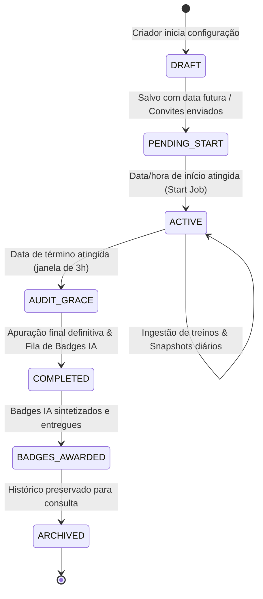
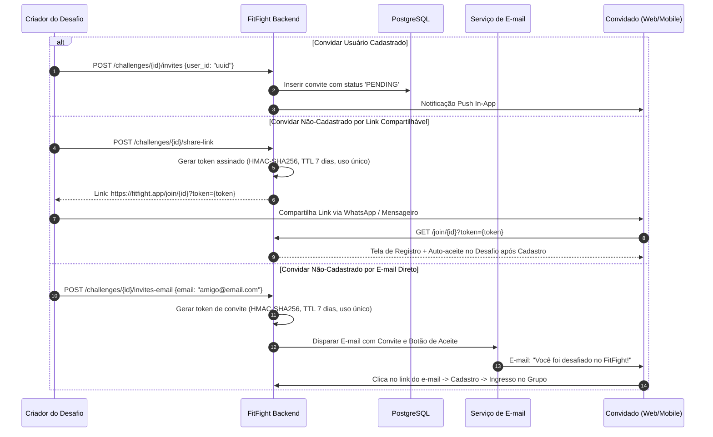

# Desafios em Grupo e Dinâmica Competitiva

[Voltar ao Índice Geral](index.md)

---

## 1. Visão Geral e Propósito

Os **Desafios em Grupo** constituem o pilar de engajamento social do FitFight. Amigos, colegas de trabalho e comunidades esportivas locais reúnem-se em competições fechadas ou públicas onde todos os participantes partem rigorosamente da mesma linha de largada ($0.0$ pontos relativos), disputando a liderança durante uma janela temporal predefinida.

---

## 2. Parâmetros e Ciclo de Vida do Desafio

### 2.1 Modelo de Dados e Parâmetros de Criação [ESTABELECIDO]
Qualquer usuário autenticado pode criar um desafio, configurando os seguintes parâmetros canônicos:

| Campo | Tipo / Restrição | Descrição e Regra de Validação | Classificação |
| :--- | :--- | :--- | :---: |
| `id` | `UUID` | Identificador único global do desafio. | [ESTABELECIDO] |
| `creator_id` | `UUID` | Usuário proprietário/administrador do desafio. | [ESTABELECIDO] |
| `title` | `String` | Título do desafio (ex: *"Desafio 30 Dias Seca Gordura"*). Limites: 3–255 caracteres [ESTABELECIDO]. | [ESTABELECIDO] |
| `description` | `Text` | Regras específicas e descrição motivacional. | [ESTABELECIDO] |
| `start_date` | `Timestamp with Timezone` | Início formal da competição. Deve ser data futura [ESTABELECIDO]. | [ESTABELECIDO] |
| `end_date` | `Timestamp with Timezone` | Fim formal posterior ao início. Duração mínima de **1 mês** [ESTABELECIDO]. | [ESTABELECIDO] |
| `is_public` | `Boolean` | `false` = Privado (somente convite); `true` = Público (visível na busca por geolocalização). | [ESTABELECIDO] |
| `max_participants` | `Integer` | Limite máximo de participantes (padrão: 50; configurável até 1.000) [ESTABELECIDO]. | [ESTABELECIDO] |
| `sport_filter` | `String(50)` | `ALL` (todas as atividades) ou restrito a um esporte (ex: apenas `Run` ou apenas `Ride`) [ESTABELECIDO]. | [ESTABELECIDO] |
| `apply_inactivity_penalty` | `Boolean` | Modo Hardcore opcional: aplica penalidade por bloco rolling de 24h sem atividade qualificada, com piso zero [ESTABELECIDO]. Padrão: `false` [ESTABELECIDO]. | [ESTABELECIDO] |

---

## 3. Dinâmica de Pontuação Relativa e Ranking

### 3.1 Inicialização com Zero Pontos Relativos ($P_{\text{desafio}} = 0.0$) [ESTABELECIDO]
Independentemente da pontuação global vitalícia acumulada pelo atleta ($P_{\text{global}}$), no instante em que o participante ingressa ou na largada do desafio, a pontuação no contexto do grupo é inicializada como:

$$P_{\text{desafio}}(u) = 0.00 \quad \forall u \in \text{Participantes}$$

### 3.2 Elegibilidade e Inclusão de Treinos [ESTABELECIDO]
Uma atividade física realizada pelo participante $u$ é elegível para somar pontos em um desafio $C$ se e somente se atender cumulativamente a todas as seguintes condições booleanas:

$$\text{Elegível}(A, C, u) = (A.\text{start\_date} \ge \max(C.\text{start\_date}, u.\text{joined\_at})) \land (A.\text{start\_date} \le C.\text{end\_date}) \land (C.\text{sport\_filter} == \text{'ALL'} \lor A.\text{tipo} == C.\text{sport\_filter})$$

- **Data de Ocorrência da Atividade**: Usar `start_date` UTC (início da atividade). `start_date_local` é horário de parede local e não deve ser convertido diretamente em UTC. Se a atividade começou antes de `end_date`, ela é computada integralmente no desafio.
- **Entrada Tardia (Late Join)**: O uso de $\max(C.\text{start\_date}, u.\text{joined\_at})$ garante formalmente que atividades realizadas antes do ingresso formal do usuário no grupo **nunca** sejam computadas retroativamente.

Quando uma atividade elegível $A$ é validada e processada, a pontuação é a soma das atividades elegíveis atualmente válidas:
$$P_{\text{desafio}}(u) = \sum_{A \in \text{atividades elegíveis válidas de }u} \text{Pontos}_{\text{atividade}}(A)$$

O acréscimo normal de uma atividade nova não reduz o placar. Essa monotonicidade não vale para alterações, exclusões ou revalidações da fonte: nesses casos recalcular a soma de atividades elegíveis válidas pode reduzir o placar. Como cada parcela é não negativa, o resultado recalculado não fica abaixo de zero. Penalidades de inatividade e bioimpedância continuam fora do modo padrão.

### 3.3 Algoritmo Determinístico de Desempate (Tie-Breaking) [ESTABELECIDO]
O ranking de participantes é ordenado de forma estritamente determinística, prevenindo oscilações e assegurando estabilidade mesmo sob ingestão assíncrona concorrente:

1. **Maior Pontuação Relativa**: $\text{descendente}(P_{\text{desafio}})$.
2. **Precedência Temporal no Esporte**: $\text{ascendente}(\text{timestamp}_{\text{início\_da\_última\_atividade\_pontuada}})$.
   - *Resolução de Ambiguidade*: Utiliza-se o timestamp de início da atividade esportiva (`occurred_at`), e **não** o horário em que o worker assíncrono processou a mensagem no PGMQ, evitando distorções decorrentes de atrasos de rede ou fila.
3. **Maior Tempo Total em Movimento Acumulado**: $\text{descendente}(\sum \text{moving\_time}_{\text{segundos}})$.
4. **Menor Quantidade de Dias Sem Atividade durante o Desafio**: $\text{ascendente}(\text{dias\_inativos})$.
5. **Identificador Imutável do Usuário**: $\text{ascendente}(u.\text{id})$ (garante ordem canônica e imutável para a API).

---

## 4. Snapshots Diários e Indicadores Direcionais ($\uparrow, \downarrow, \leftrightarrow$)

### 4.1 Mecanismo de Snapshot Diário [ESTABELECIDO]
Conforme especificado em `idea.md`: *"Each card with a table showing the ranking with an arrow up or down based on the user's gain or loss of points compared to the previous day."*

1. **Execução do Snapshot**: Diariamente, às **23:59:59 (UTC)** [ESTABELECIDO], um worker do sistema executa o job de snapshot diário para todos os desafios ativos (`status = ACTIVE`).
2. Para cada participante $u$, o sistema atualiza na tabela `challenge_participants`:
   $$\text{previous\_rank} \leftarrow \text{current\_rank}$$
3. Durante o dia seguinte, à medida que novas atividades são processadas, o `current_rank` é recalculado instantaneamente.
4. O indicador direcional exibido na interface cliente é derivado pela função canônica:

$$\text{Direção}(u) = \begin{cases} \uparrow \text{ (Subiu)}, & \text{se } \text{current\_rank}(u) < \text{previous\_rank}(u) \quad (\text{ex: era 5º e agora é 3º}) \\ \downarrow \text{ (Desceu)}, & \text{se } \text{current\_rank}(u) > \text{previous\_rank}(u) \quad (\text{ex: era 2º e agora é 4º}) \\ \leftrightarrow \text{ (Manteve)}, & \text{se } \text{current\_rank}(u) == \text{previous\_rank}(u) \end{cases}$$

*Caso Especial (Novo Entrante)*: Se o usuário ingressou no desafio durante o dia corrente e não possui `previous_rank` registrado, o sistema exibe o indicador neutro $\leftrightarrow$ com a tag *"Novo Participante"*.

---

## 5. Mecanismo de Convites e Onboarding de Competidores

O FitFight permite convidar tanto usuários já cadastrados na plataforma quanto amigos que ainda não possuem conta:

### 5.1 Convite Direto para Usuário Cadastrado [ESTABELECIDO]
- O criador busca o amigo por nome ou e-mail.
- O sistema cria o registro na tabela `challenge_invites` com status `PENDING` e dispara notificação push.
- O convidado pode aceitar (`POST /challenges/{id}/accept`) ou recusar (`POST /challenges/{id}/decline`).

### 5.2 Convite por Link e E-mail [ESTABELECIDO]
- O sistema gera uma URL de convite com token [ESTABELECIDO]:
  `https://fitfight.app/join/{challengeId}?token={token}`
- **Segurança [ESTABELECIDO]**: HMAC-SHA256 assina o `challengeId` e uma validade temporal de 7 dias. O token é de uso único. HMAC não cifra o conteúdo do token.
- **Fluxo por E-mail**: Quando o criador opta pelo convite por e-mail, o backend despacha uma mensagem transacional estilizada com resumo do desafio, prêmio/badge em disputa e botão de ação direta.
- Ao clicar no link (web ou deep link mobile), o convidado não registrado realiza o cadastro (Google, Strava ou e-mail/senha) e é imediatamente inserido no desafio com $P_{\text{desafio}} = 0.0$.

---

## 6. Regras de Borda, Desconexão e Integridade Competitiva

### 6.1 Critério Mínimo de Participantes para Badges Épicos [ESTABELECIDO]
Para coibir a prática de *badge farming* (criação de desafios individuais fictícios para desbloquear insígnias com avatar no trono sem competição real):
- Um desafio qualifica para geração de Badges Épicos de IA (`WEEKLY_LEADER`, `MONTHLY_LEADER`, `CHAMPION_THRONE`) se e somente se contar com **no mínimo 3 competidores humanos ativos** que tenham registrado pelo menos uma atividade física no período.
- Desafios solo (1 pessoa) ou em duplas concedem pontos normais e medalhas vetoriais simples de conclusão, mas **não** acionam a síntese de avatares com IA no trono.

### 6.2 Janela de Graça para Fechamento de Desafio (Audit Grace Period) [ESTABELECIDO]
- Ao atingir `end_date`, o status do desafio muda para `AUDIT_GRACE` por uma janela de **3 horas**.
- Esse intervalo permite que atividades realizadas pouco antes do fim da competição, mas sincronizadas com pequeno atraso pelo Strava, sejam recepcionadas e computadas.
- Transcorridas as 3 horas, o status passa para `COMPLETED`, o ranking final é congelado em definitivo e o job de apuração dispara os pedidos de geração de badges para a fila PGMQ.

### 6.3 Correções de Atividades no Strava e Integridade do Placar [ESTABELECIDO]
- Em desafio `ACTIVE` ou `AUDIT_GRACE`, para qualquer evento `update` o worker busca novamente a atividade na API do Strava e reavalia sua elegibilidade e pontuação; `delete` remove a parcela. O worker recalcula a soma atual e aplica a diferença no placar. Esses eventos podem reduzir pontuação e são correções da fonte, não acréscimo normal.
- Após `COMPLETED`, o ranking final fica congelado para preservar a apuração histórica e premiações; atualizações/exclusões ainda podem estornar pontos globais e devem ser auditadas, sem reescrever o resultado final.
- O webhook `update` não identifica todas as mudanças da atividade; nunca limitar o recálculo apenas a campos `type`, `gear_id` ou `distance` declarados no evento.
