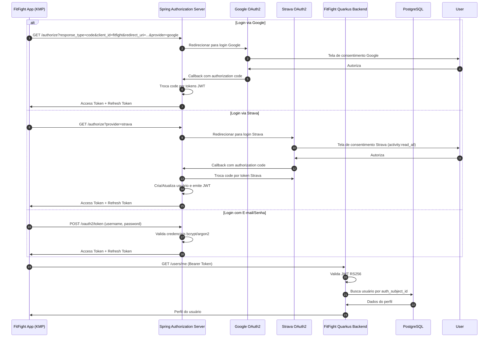
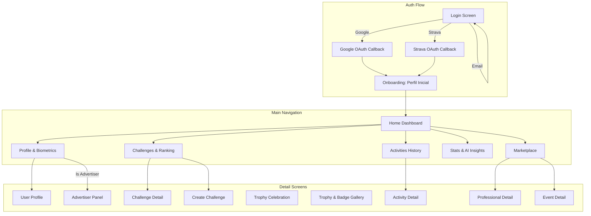

# Arquitetura Frontend Multiplataforma (KMP) e Autenticação OAuth2

[Voltar ao Índice Geral](index.md)

---

## 1. Visão Geral da Arquitetura Kotlin Multiplatform

O FitFight utiliza **Kotlin Multiplatform (KMP)** com **Jetpack Compose Multiplatform** para compartilhar a máxima quantidade de código entre Android, iOS e Web (via WebAssembly). A arquitetura segue o padrão **MVI (Model-View-Intent)** com repositórios compartilhados, ViewModels e lógica de negócio unificados.

```mermaid
graph TB
    subgraph Shared [Shared Module :shared]
        subgraph Data [Data Layer]
            Repos[Repositories]
            DTOs[DTOs & Data Classes]
            KtorClient[Ktor HTTP Client]
            Cache[DataStore / SQLDelight Cache]
        end
        subgraph Domain [Domain Layer]
            UseCases[Use Cases]
            Models[Domain Models]
        end
        subgraph UI_State [UI State Layer]
            ViewModels[ViewModels MVI]
            Intents[UI Intents]
            States[UI States]
        end
    end

    subgraph ComposeApp [Compose Multiplatform :composeApp]
        subgraph CommonUI [Common UI]
            Themes[Theme & Design System]
            Components[Reusable Components]
            Navigation[Navigation Graph]
        end
        subgraph Screens [Screens]
            Home[Home Screen]
            Profile[Profile Screen]
            Challenges[Challenges Screen]
            Activities[Activities Screen]
            Stats[Stats Screen]
            Marketplace[Marketplace Screen]
            Advertiser[Advertiser Panel]
        end
    end

    subgraph Android [Android App :androidApp]
        AndroidManifest[Android Manifest]
        Permissions[Permissions: GPS, etc.]
        AndroidCompose[Android Compose]
    end

    subgraph iOS [iOS App :iosApp]
        UIKit[Integration UIKit/SwiftUI]
        iOSPermissions[iOS Permissions]
        iOSCompose[iOS Compose]
    end

    subgraph Web [Web App :composeApp (Wasm)]
        WasmKWasm[Kotlin/Wasm Runtime]
        WebNav[Web Navigation]
    end

    Shared --> ComposeApp
    ComposeApp --> Android
    ComposeApp --> iOS
    ComposeApp --> Web

    Repos --> KtorClient
    ViewModels --> Repos
    Screens --> ViewModels
    Screens --> CommonUI
```

### 1.1 Estrutura de Módulos do Projeto KMP

| Módulo | Plataforma | Descrição |
| :--- | :--- | :--- |
| `:shared` | All | Lógica compartilhada: DTOs, repositórios, clientes HTTP Ktor, cache SQLDelight, Use Cases e ViewModels MVI |
| `:composeApp` | All | Interface declarativa Compose Multiplatform compartilhada entre Android, iOS e Web |
| `:androidApp` | Android | Aplicativo Android nativo, permissões, manifest e integração com sensores |
| `:iosApp` | iOS | Aplicativo iOS nativo, integração com SwiftUI/UIKit e permissões |
| `:composeApp` (Wasm) | Web | Compilação para WebAssembly via Kotlin/Wasm |

### 1.2 Tecnologias e Bibliotecas Principais

| Categoria | Biblioteca | Propósito |
| :--- | :--- | :--- |
| **UI** | Jetpack Compose Multiplatform | Interface declarativa compartilhada |
| **HTTP** | Ktor Client | Cliente HTTP assíncrono para API REST |
| **Serialization** | Kotlinx Serialization | Serialização JSON de DTOs |
| **Cache Local** | SQLDelight | Banco de dados relacional local com cache |
| **Preferences** | DataStore | Armazenamento de preferências e tokens |
| **DI** | Koin | Injeção de dependências leve |
| **Navigation** | Compose Navigation | Navegação entre telas |
| **Image Loading** | Coil | Carregamento e cache de imagens |
| **Coroutines** | Kotlin Coroutines | Programação assíncrona |
| **Testing** | Turbine + MockK | Testes de fluxo e ViewModels |

---

## 2. Arquitetura do Módulo Shared

O módulo `:shared` contém toda a lógica de negócio, comunicação com o backend e cache local, sendo completamente independente da plataforma de destino.

### 2.1 Camada de Dados (Data Layer)

#### 2.1.1 Cliente HTTP Ktor

```kotlin
// Exemplo de configuração do cliente Ktor
val httpClient = HttpClient(CIO) {
    install(ContentNegotiation) {
        json(Json {
            ignoreUnknownKeys = true
            prettyPrint = false
        })
    }
    install(Auth) {
        bearer {
            loadTokens {
                val tokens = tokenRepository.getTokens()
                if (tokens != null) {
                    Credentials(tokens.accessToken, tokens.refreshToken)
                } else {
                    null
                }
            }
            sendRefreshToken = false
        }
    }
    install(HttpTimeout) {
        requestTimeoutMillis = 30_000
        connectTimeoutMillis = 10_000
    }
}
```

#### 2.1.2 Repositórios

Cada repositório abstrai a comunicação com o backend e o cache local:

| Repositório | Responsabilidade |
| :--- | :--- |
| `UserRepository` | Perfil, busca geoespacial, bioimpedância |
| `ActivityRepository` | Lista de atividades, sincronização Strava |
| `ChallengeRepository` | Desafios, ranking, convites |
| `BadgeRepository` | Galeria de badges, compartilhamento |
| `TrophyRepository` | Troféus de vitória, galeria e compartilhamento |
| `MarketplaceRepository` | Profissionais, produtos, eventos, reviews |
| `AdRepository` | Anúncios contextuais, rastreamento de impressões |
| `AdvertiserRepository` | Painel do anunciante, campanhas, métricas |
| `TokenRepository` | Armazenamento e rotação de tokens JWT |
| `AIInsightRepository` | Consulta de insights via LangChain4j/DeepSeek |

#### 2.1.3 Cache Local com SQLDelight

O SQLDelight fornece cache relacional tipado para os dados mais acessados:

```sql
-- Exemplo de schema SQLDelight
CREATE TABLE cached_users (
    id TEXT NOT NULL PRIMARY KEY,
    name TEXT NOT NULL,
    email TEXT NOT NULL,
    favorite_sport TEXT NOT NULL,
    global_points REAL NOT NULL,
    avatar_face_url TEXT,
    cached_at INTEGER NOT NULL
);

CREATE TABLE cached_activities (
    id TEXT NOT NULL PRIMARY KEY,
    user_id TEXT NOT NULL,
    activity_type TEXT NOT NULL,
    duration_seconds INTEGER NOT NULL,
    calculated_points REAL NOT NULL,
    occurred_at INTEGER NOT NULL
);

CREATE TABLE cached_challenges (
    id TEXT NOT NULL PRIMARY KEY,
    title TEXT NOT NULL,
    status TEXT NOT NULL,
    start_date INTEGER NOT NULL,
    end_date INTEGER NOT NULL
);
```

**Estratégia de Cache**:
- **TTL (Time-To-Live)**: 5 minutos para dados de ranking, 30 minutos para perfil, 1 hora para marketplace.
- **Stale-While-Revalidate**: Exibir dados em cache enquanto busca versão atualizada no backend.
- **Invalidação**: Ao realizar uma operação de escrita (ex: registrar bioimpedância), invalidar o cache relacionado.

### 2.2 Camada de Domínio (Domain Layer)

Use Cases encapsulam as regras de negócio do cliente:

| Use Case | Descrição |
| :--- | :--- |
| `GetUserProfile` | Buscar perfil do usuário autenticado |
| `SearchAthletes` | Buscar atletas por nome, esporte e geolocalização |
| `RegisterBiometrics` | Registrar nova medição de bioimpedância |
| `GetActivities` | Listar atividades com filtros de data e tipo |
| `SyncStravaActivities` | Forçar sincronização manual com Strava |
| `CreateChallenge` | Criar novo desafio com convites |
| `GetChallengeRanking` | Obter ranking com indicadores direcionais |
| `GetBadgeGallery` | Obter galeria de badges do usuário |
| `GetTrophyGallery` | Obter galeria de troféus do usuário |
| `GetFullGallery` | Obter galeria completa (troféus + badges + marcos) |
| `ShareTrophy` | Compartilhar troféu via WhatsApp/Telegram/redes sociais |
| `LoadTrophyCelebration` | Carregar dados da tela de celebração do troféu |
| `GetMarketplaceListings` | Buscar profissionais, produtos ou eventos |
| `GetAdFeed` | Obter anúncios contextuais para o feed |
| `GetAIInsights` | Gerar insights de saúde via IA |

### 2.3 Camada de Estado UI (ViewModels MVI)

O padrão MVI (Model-View-Intent) garante um fluxo unidirecional de dados:

```kotlin
// Exemplo de ViewModel MVI
class HomeViewModel @Inject constructor(
    private val challengeRepository: ChallengeRepository,
    private val adRepository: AdRepository,
    private val userRepository: UserRepository
) : ViewModel() {

    private val _uiState = MutableStateFlow(HomeUiState.Initial)
    val uiState: StateFlow<HomeUiState> = _uiState.asStateFlow()

    fun onIntent(intent: HomeIntent) {
        when (intent) {
            is HomeIntent.LoadHome -> loadHome()
            is HomeIntent.Refresh -> refreshHome()
            is HomeIntent.SelectChallenge -> selectChallenge(intent.challengeId)
            is HomeIntent.AdImpression -> trackAdImpression(intent.adId)
        }
    }

    private fun loadHome() {
        viewModelScope.launch {
            _uiState.value = HomeUiState.Loading
            try {
                val user = userRepository.getProfile()
                val challenges = challengeRepository.getUserChallenges()
                val ads = adRepository.getFeedAds()
                _uiState.value = HomeUiState.Success(user, challenges, ads)
            } catch (e: Exception) {
                _uiState.value = HomeUiState.Error(e.message ?: "Unknown error")
            }
        }
    }
}

// Intents
sealed interface HomeIntent {
    data object LoadHome : HomeIntent
    data object Refresh : HomeIntent
    data class SelectChallenge(val challengeId: String) : HomeIntent
    data class AdImpression(val adId: String) : HomeIntent
}

// UI States
sealed interface HomeUiState {
    data object Initial : HomeUiState
    data object Loading : HomeUiState
    data class Success(
        val user: User,
        val challenges: List<ChallengeCard>,
        val ads: List<AdCard>
    ) : HomeUiState
    data class Error(val message: String) : HomeUiState
}
```

---

## 3. Autenticação OAuth2 com Spring Authorization Server

O fluxo de autenticação é totalmente delegado ao **Spring Authorization Server** independente, permitindo reutilização centralizada de identidade para futuros ecossistemas.

### 3.1 Fluxo de Autenticação Completo



### 3.2 Gerenciamento de Tokens no Cliente KMP

```kotlin
// Armazenamento seguro de tokens
class TokenRepository @Inject constructor(
    private val preferences: DataStore<Preferences>
) {
    private val accessTokenKey = stringPreferencesKey("access_token")
    private val refreshTokenKey = stringPreferencesKey("refresh_token")
    private val tokenExpiryKey = longPreferencesKey("token_expiry")

    suspend fun saveTokens(accessToken: String, refreshToken: String, expiresIn: Long) {
        preferences.edit { prefs ->
            prefs[accessTokenKey] = accessToken
            prefs[refreshTokenKey] = refreshToken
            prefs[tokenExpiryKey] = System.currentTimeMillis() + (expiresIn * 1000)
        }
    }

    suspend fun getTokens(): AuthTokens? {
        val prefs = preferences.data.first()
        val accessToken = prefs[accessTokenKey]
        val refreshToken = prefs[refreshTokenKey]
        val expiry = prefs[tokenExpiryKey] ?: 0

        return if (accessToken != null && refreshToken != null && expiry > System.currentTimeMillis()) {
            AuthTokens(accessToken, refreshToken)
        } else {
            null
        }
    }

    suspend fun clearTokens() {
        preferences.edit { prefs ->
            prefs.remove(accessTokenKey)
            prefs.remove(refreshTokenKey)
            prefs.remove(tokenExpiryKey)
        }
    }
}

// Refresh automático de token
class AuthInterceptor : HttpClientInterceptor {
    override suspend fun invoke(chain: HttpClientCallChain) {
        val response = chain.proceed(chain.request)
        if (response.status == HttpStatusCode.Unauthorized) {
            // Tenta refresh token
            val newTokens = tokenRepository.refreshToken()
            if (newTokens != null) {
                tokenRepository.saveTokens(newTokens.accessToken, newTokens.refreshToken, newTokens.expiresIn)
                // Reexecuta a requisição com o novo token
                // ...
            } else {
                // Redireciona para login
                navigationManager.navigateToLogin()
            }
        }
    }
}
```

### 3.3 Integração com Google e Strava OAuth2

#### Google OAuth2

| Parâmetro | Valor |
| :--- | :--- |
| **Provider** | `google` |
| **Scopes** | `openid`, `profile`, `email` |
| **Redirect URI** | `fitfight://auth/callback/google` (deep link) |
| **Token Endpoint** | `POST /oauth2/token` |

#### Strava OAuth2

| Parâmetro | Valor |
| :--- | :--- |
| **Provider** | `strava` |
| **Scopes** | `read`, `activity:read_all` |
| **Redirect URI** | `fitfight://auth/callback/strava` (deep link) |
| **Token Endpoint** | `POST /oauth2/token` |

**Nota**: O escopo `activity:read_all` é essencial para acessar atividades privadas do Strava. Sem ele, atividades marcadas como privadas são tratadas como não verificáveis.

### 3.4 Fluxo de Logout e Revogação

```kotlin
class AuthManager @Inject constructor(
    private val tokenRepository: TokenRepository,
    private val httpClient: HttpClient,
    private val springAuthUrl: String
) {
    suspend fun logout() {
        // Revoga refresh token no Spring Auth Server
        val refreshToken = tokenRepository.getTokens()?.refreshToken
        if (refreshToken != null) {
            try {
                httpClient.post("$springAuthUrl/oauth2/revoke") {
                    setBody("token=$refreshToken&token_type_hint=refresh_token")
                }
            } catch (e: Exception) {
                // Ignora erro de revogação; limpa tokens locais de qualquer forma
            }
        }
        // Limpa tokens locais
        tokenRepository.clearTokens()
        // Limpa cache SQLDelight
        databaseDriver.query("DELETE FROM cached_users").closeCursor()
        // Navega para tela de login
        navigationManager.navigateToLogin()
    }
}
```

---

## 4. Fluxos de Navegação e Telas Principais

A navegação é gerenciada pelo **Compose Navigation** com um grafo centralizado:



### 4.1 Navegação Compose

```kotlin
@Composable
fun FitFightApp(
    navController: NavHostController = rememberNavController()
) {
    NavHost(
        navController = navController,
        startDestination = "login"
    ) {
        // Auth Flow
        composable("login") { LoginScreen(navController) }
        composable("onboarding") { OnboardingScreen(navController) }
        composable("auth/callback/google") { GoogleCallbackScreen(navController) }
        composable("auth/callback/strava") { StravaCallbackScreen(navController) }

        // Main Navigation (Bottom Navigation Bar)
        composable("home") { HomeScreen(navController) }
        composable("profile") { ProfileScreen(navController) }
        composable("challenges") { ChallengesScreen(navController) }
        composable("activities") { ActivitiesScreen(navController) }
        composable("stats") { StatsScreen(navController) }
        composable("marketplace") { MarketplaceScreen(navController) }

        // Detail Screens
        composable("challenge/{challengeId}") { backStackEntry ->
            val challengeId = backStackEntry.arguments?.getString("challengeId")
            ChallengeDetailScreen(challengeId, navController)
        }
        composable("create_challenge") { CreateChallengeScreen(navController) }
        composable("activity/{activityId}") { backStackEntry ->
            val activityId = backStackEntry.arguments?.getString("activityId")
            ActivityDetailScreen(activityId, navController)
        }
        composable("user/{userId}") { backStackEntry ->
            val userId = backStackEntry.arguments?.getString("userId")
            UserProfileScreen(userId, navController)
        }
        composable("trophy/celebration/{trophyId}") { backStackEntry ->
            val trophyId = backStackEntry.arguments?.getString("trophyId")
            TrophyCelebrationScreen(trophyId, navController)
        }
        composable("gallery") {
            TrophyGalleryScreen(navController)
        }
        composable("marketplace/{category}/{id}") { backStackEntry ->
            val category = backStackEntry.arguments?.getString("category")
            val id = backStackEntry.arguments?.getString("id")
            MarketplaceDetailScreen(category, id, navController)
        }
        composable("advertiser_panel") { AdvertiserPanelScreen(navController) }
    }
}
```

---

## 5. Telas Principais e Componentes Visuais

### 5.1 Home Dashboard

A tela principal exibe a pontuação atual, gráfico de evolução e cards de desafios.

```kotlin
@Composable
fun HomeScreen(
    viewModel: HomeViewModel = koinViewModel(),
    navController: NavHostController
) {
    val uiState by viewModel.uiState.collectAsState()

    when (val state = uiState) {
        is HomeUiState.Loading -> LoadingIndicator()
        is HomeUiState.Error -> ErrorView(state.message, { viewModel.onIntent(HomeIntent.Refresh) })
        is HomeUiState.Success -> {
            Scaffold(
                topBar = {
                    TopAppBar(
                        title = { Text("FitFight") },
                        actions = {
                            IconButton(onClick = { navController.navigate("profile") }) {
                                Icon(Icons.Default.Person, contentDescription = "Profile")
                            }
                        }
                    )
                }
            ) { paddingValues ->
                LazyColumn(
                    contentPadding = paddingValues,
                    verticalArrangement = Arrangement.spacedBy(16.dp)
                ) {
                    // Pontuação Global
                    item {
                        PointsCard(
                            globalPoints = state.user.globalPoints,
                            trend = state.pointsTrend
                        )
                    }

                    // Gráfico de Evolução de Pontos
                    item {
                        PointsLineChart(
                            pointsHistory = state.pointsHistory,
                            modifier = Modifier.fillMaxWidth().height(200.dp)
                        )
                    }

                    // Cards de Desafios
                    items(state.challenges) { challenge ->
                        ChallengeCard(
                            challenge = challenge,
                            currentRank = challenge.currentRank,
                            previousRank = challenge.previousRank,
                            direction = when {
                                challenge.currentRank < challenge.previousRank -> RankDirection.UP
                                challenge.currentRank > challenge.previousRank -> RankDirection.DOWN
                                else -> RankDirection.SAME
                            },
                            onClick = { navController.navigate("challenge/${challenge.id}") }
                        )
                    }

                    // Anúncios Contextuais (intercalados)
                    items(state.ads) { ad ->
                        AdCard(
                            ad = ad,
                            onImpression = { viewModel.onIntent(HomeIntent.AdImpression(ad.id)) },
                            onClick = { /* Track click */ }
                        )
                    }
                }
            }
        }
        is HomeUiState.Initial -> {}
    }
}
```

#### Componentes da Home

| Componente | Descrição |
| :--- | :--- |
| `PointsCard` | Exibe pontuação global atual com indicador de tendência (seta ↑/↓) comparando com o dia anterior |
| `PointsLineChart` | Gráfico de linha mostrando ganhos e perdas de pontos ao longo do tempo |
| `ChallengeCard` | Card de desafio com mini ranking, posição atual e seta direcional comparando com o dia anterior |
| `AdCard` | Card publicitário nativo com tag "Patrocinado", imagem, título e botão CTA |

### 5.2 Perfil e Evolução Biométrica

Exibe dados pessoais, integrações, histórico de bioimpedância e galeria de badges.

```kotlin
@Composable
fun ProfileScreen(
    viewModel: ProfileViewModel = koinViewModel(),
    navController: NavHostController
) {
    val uiState by viewModel.uiState.collectAsState()

    if (uiState is ProfileUiState.Success) {
        val state = uiState as ProfileUiState.Success
        Column {
            // Header com foto e dados básicos
            ProfileHeader(
                name = state.user.name,
                email = state.user.email,
                avatarUrl = state.user.avatarFaceUrl,
                favoriteSport = state.user.favoriteSport,
                globalPoints = state.user.globalPoints
            )

            // Integrações Conectadas
            IntegrationsSection(
                stravaConnected = state.integrations.strava,
                googleConnected = state.integrations.google,
                onConnectStrava = { viewModel.connectStrava() },
                onDisconnectStrava = { viewModel.disconnectStrava() }
            )

            // Dados Biométricos
            BiometricsSection(
                weight = state.biometrics.weight,
                muscleMass = state.biometrics.muscleMass,
                bodyFatPercentage = state.biometrics.bodyFatPercentage,
                waterPercentage = state.biometrics.waterPercentage,
                onAddMeasurement = { viewModel.showBiometricsDialog = true }
            )

            // Gráfico de Evolução Biométrica
            BiometricsEvolutionChart(
                history = state.biometricsHistory,
                modifier = Modifier.fillMaxWidth().height(250.dp)
            )

            // Galeria de Troféus e Badges
            TrophyAndBadgeGallerySection(
                trophies = state.trophies,
                badges = state.badges,
                milestones = state.milestones,
                onGalleryClick = {
                    navController.navigate("gallery")
                },
                onBadgeClick = { badge ->
                    navController.navigate("badge/${badge.id}")
                }
            )

            // Se é anunciante, exibe link para painel
            if (state.isAdvertiser) {
                AdvertiserLink(onClick = { navController.navigate("advertiser_panel") })
            }

            // Botão de Logout
            LogoutButton(onClick = { viewModel.logout() })
        }
    }
}
```

### 5.3 Desafios e Ranking Comparativo

#### Lista de Desafios

```kotlin
@Composable
fun ChallengesScreen(
    viewModel: ChallengesViewModel = koinViewModel(),
    navController: NavHostController
) {
    val uiState by viewModel.uiState.collectAsState()

    Scaffold(
        topBar = {
            TopAppBar(
                title = { Text("Desafios") },
                actions = {
                    IconButton(onClick = { navController.navigate("create_challenge") }) {
                        Icon(Icons.Default.Add, contentDescription = "Create Challenge")
                    }
                }
            )
        },
        floatingActionButton = {
            FloatingActionButton(onClick = { navController.navigate("create_challenge") }) {
                Icon(Icons.Default.Add, contentDescription = "New Challenge")
            }
        }
    ) { paddingValues ->
        LazyColumn(contentPadding = paddingValues) {
            items((uiState as? ChallengesUiState.Success)?.challenges ?: emptyList()) { challenge ->
                ChallengeListItem(
                    title = challenge.title,
                    status = challenge.status,
                    participantsCount = challenge.participantsCount,
                    currentRank = challenge.currentRank,
                    previousRank = challenge.previousRank,
                    endDate = challenge.endDate,
                    onClick = { navController.navigate("challenge/${challenge.id}") }
                )
            }
        }
    }
}
```

#### Detalhe do Desafio com Ranking

```kotlin
@Composable
fun ChallengeDetailScreen(
    challengeId: String,
    navController: NavHostController
) {
    val viewModel: ChallengeDetailViewModel = koinViewModel()
    val uiState by viewModel.uiState.collectAsState()

    if (uiState is ChallengeDetailUiState.Success) {
        val state = uiState as ChallengeDetailUiState.Success
        Column {
            // Header do Desafio
            ChallengeHeader(
                title = state.challenge.title,
                description = state.challenge.description,
                status = state.challenge.status,
                startDate = state.challenge.startDate,
                endDate = state.challenge.endDate,
                participantsCount = state.challenge.participantsCount
            )

            // Progresso do Desafio
            ChallengeProgress(
                daysElapsed = state.daysElapsed,
                totalDays = state.totalDays,
                progress = state.progress
            )

            // Tabela de Ranking
            RankingTable(
                participants = state.participants,
                currentUserRank = state.currentUserRank
            ) { participant ->
                RankingRow(
                    rank = participant.currentRank,
                    previousRank = participant.previousRank,
                    name = participant.name,
                    points = participant.relativePoints,
                    direction = when {
                        participant.currentRank < participant.previousRank -> RankDirection.UP
                        participant.currentRank > participant.previousRank -> RankDirection.DOWN
                        else -> RankDirection.SAME
                    },
                    isCurrentUser = participant.isCurrentUser
                )
            }
        }
    }
}
```

#### Componente `RankingRow`

| Elemento | Descrição |
| :--- | :--- |
| **Posição** | Número da posição atual no ranking |
| **Seta Direcional** | ↑ (subiu), ↓ (desceu), ↔ (manteve) comparando com o dia anterior |
| **Nome** | Nome do participante |
| **Pontos** | Pontuação relativa no desafio |
| **Destaque** | Linha destacada se for o usuário autenticado |

### 5.4 Criação de Desafio

```kotlin
@Composable
fun CreateChallengeScreen(
    viewModel: CreateChallengeViewModel = koinViewModel(),
    navController: NavHostController
) {
    var title by remember { mutableStateOf("") }
    var description by remember { mutableStateOf("") }
    var startDate by remember { mutableStateOf(LocalDate.now().plusDays(1)) }
    var endDate by remember { mutableStateOf(LocalDate.now().plusDays(30)) }
    var isPublic by remember { mutableStateOf(false) }
    var maxParticipants by remember { mutableIntStateOf(50) }
    var sportFilter by remember { mutableStateOf("ALL") }
    var applyInactivityPenalty by remember { mutableStateOf(false) }

    Column {
        OutlinedTextField(
            value = title,
            onValueChange = { title = it },
            label = { Text("Título do Desafio") }
        )
        OutlinedTextField(
            value = description,
            onValueChange = { description = it },
            label = { Text("Descrição") },
            maxLines = 3
        )
        DatePicker(
            selectedDate = startDate,
            onDateSelected = { startDate = it },
            label = "Data de Início"
        )
        DatePicker(
            selectedDate = endDate,
            onDateSelected = { endDate = it },
            label = "Data de Fim"
        )
        Switch(
            checked = isPublic,
            onCheckedChange = { isPublic = it },
            modifier = Padding(12.dp),
            label = "Desafio Público"
        )
        SportSelector(
            selectedSport = sportFilter,
            onSportSelected = { sportFilter = it }
        )
        Switch(
            checked = applyInactivityPenalty,
            onCheckedChange = { applyInactivityPenalty = it },
            label = "Modo Hardcore (Penalidade de Inatividade)"
        )

        // Seção de Convites
        InviteSection(
            onAddUserInvite = { /* Buscar usuário */ },
            onAddEmailInvite = { /* Adicionar e-mail */ }
        )

        Button(
            onClick = {
                viewModel.createChallenge(
                    title = title,
                    description = description,
                    startDate = startDate,
                    endDate = endDate,
                    isPublic = isPublic,
                    maxParticipants = maxParticipants,
                    sportFilter = sportFilter,
                    applyInactivityPenalty = applyInactivityPenalty
                )
                navController.popBackStack()
            },
            enabled = title.isNotBlank() && endDate.isAfter(startDate)
        ) {
            Text("Criar Desafio")
        }
    }
}
```

### 5.5 Atividades e Filtros

```kotlin
@Composable
fun ActivitiesScreen(
    viewModel: ActivitiesViewModel = koinViewModel(),
    navController: NavHostController
) {
    val uiState by viewModel.uiState.collectAsState()

    Column {
        // Filtros
        ActivityFilters(
            selectedType = viewModel.selectedType,
            onTypeSelected = { viewModel.onTypeFilter(it) },
            dateRange = viewModel.dateRange,
            onDateRangeSelected = { viewModel.onDateFilter(it) }
        )

        // Lista de Atividades
        LazyColumn {
            items((uiState as? ActivitiesUiState.Success)?.activities ?: emptyList()) { activity ->
                ActivityCard(
                    type = activity.activityType,
                    duration = activity.durationSeconds,
                    distance = activity.distanceMeters,
                    points = activity.calculatedPoints,
                    occurredAt = activity.occurredAt,
                    isExternal = activity.isExternal,
                    onClick = { navController.navigate("activity/${activity.id}") }
                )
            }
        }
    }
}
```

### 5.6 Estatísticas e Insights IA

```kotlin
@Composable
fun StatsScreen(
    viewModel: StatsViewModel = koinViewModel(),
    navController: NavHostController
) {
    val uiState by viewModel.uiState.collectAsState()

    Column {
        // Gráficos de Progresso
        PointsEvolutionChart(
            data = (uiState as? StatsUiState.Success)?.pointsHistory ?: emptyList(),
            modifier = Modifier.fillMaxWidth().height(200.dp)
        )
        BiometricsEvolutionChart(
            data = (uiState as? StatsUiState.Success)?.biometricsHistory ?: emptyList(),
            modifier = Modifier.fillMaxWidth().height(200.dp)
        )
        ActivitySummaryChart(
            data = (uiState as? StatsUiState.Success)?.activitySummary ?: emptyList(),
            modifier = Modifier.fillMaxWidth().height(200.dp)
        )

        // Seção de Insights IA
        AIInsightsSection(
            insights = (uiState as? StatsUiState.Success)?.aiInsights,
            isLoading = (uiState as? StatsUiState.LoadingInsights) == true,
            onRefresh = { viewModel.refreshInsights() },
            onAskQuestion = { query -> viewModel.askInsight(query) }
        )
    }
}
```

#### Componente `AIInsightsSection`

| Elemento | Descrição |
| :--- | :--- |
| **Insight Automático** | Texto gerado pela IA com análise do histórico recente |
| **Campo de Pergunta** | Input para o usuário fazer perguntas específicas |
| **Indicador de Loading** | Spinner enquanto a IA processa (timeout de 3s) |
| **Fallback Heurístico** | Se a IA demorar > 3s, exibe resumo baseado em regras |
| **Fontes de Dados** | Indicador dos dados utilizados (biometria, atividades, etc.) |

### 5.7 Marketplace

```kotlin
@Composable
fun MarketplaceScreen(
    viewModel: MarketplaceViewModel = koinViewModel(),
    navController: NavHostController
) {
    val uiState by viewModel.uiState.collectAsState()
    var selectedTab by remember { mutableStateOf(MarketplaceTab.PROFESSIONAL) }

    Column {
        // Abas de Navegação
        TabRow(selectedTab = selectedTab) {
            MarketplaceTab.entries.forEach { tab ->
                Tab(
                    selected = selectedTab == tab,
                    onClick = { selectedTab = tab },
                    text = { Text(tab.label) }
                )
            }
        }

        // Filtros
        MarketplaceFilters(
            tab = selectedTab,
            onLocationChanged = { viewModel.onLocationFilter(it) },
            onPriceRangeChanged = { viewModel.onPriceFilter(it) },
            onRatingChanged = { viewModel.onRatingFilter(it) }
        )

        // Listagem
        LazyVerticalGrid(columns = GridCells.Fixed(2)) {
            items((uiState as? MarketplaceUiState.Success)?.listings ?: emptyList()) { listing ->
                MarketplaceCard(
                    listing = listing,
                    category = selectedTab,
                    onClick = {
                        navController.navigate("marketplace/${selectedTab.value}/${listing.id}")
                    }
                )
            }
        }
    }
}
```

### 5.8 Tela de Celebração do Troféu (Trophy Celebration)

Exibida quando o usuário vence um desafio, acessada via deep link da notificação push.

```kotlin
@Composable
fun TrophyCelebrationScreen(
    trophyId: String,
    navController: NavHostController,
    viewModel: TrophyCelebrationViewModel = koinViewModel()
) {
    val uiState by viewModel.uiState.collectAsState()
    var showConfetti by remember { mutableStateOf(true) }

    // Dispara confetti por 5 segundos ao entrar
    LaunchedEffect(trophyId) {
        viewModel.loadTrophy(trophyId)
        delay(5000)
        showConfetti = false
    }

    Box(modifier = Modifier.fillMaxSize()) {
        when (val state = uiState) {
            is TrophyCelebrationUiState.Loading -> {
                CircularProgressIndicator(modifier = Modifier.align(Alignment.Center))
            }
            is TrophyCelebrationUiState.Success -> {
                val trophy = state.trophy

                // Fundo gradiente dourado
                Box(
                    modifier = Modifier
                        .fillMaxSize()
                        .background(
                            Brush.verticalGradient(
                                colors = listOf(
                                    Color(0xFFFFD700).copy(alpha = 0.3f),
                                    Color(0xFFFFA500).copy(alpha = 0.1f),
                                    Color(0xFF000000)
                                )
                            )
                        )
                )

                // Conteúdo central
                Column(
                    horizontalAlignment = Alignment.CenterHorizontally,
                    modifier = Modifier
                        .fillMaxSize()
                        .wrapContentHeight(Alignment.Center)
                        .padding(24.dp)
                ) {
                    // Troféu animado
                    AnimatedVisibility(visible = true, enter = expandIn() + scaleIn()) {
                        Icon(
                            painter = painterResource("trophy_gold.svg"),
                            contentDescription = "Trophy",
                            modifier = Modifier
                                .size(200.dp)
                                .animateContentSize(),
                            tint = Color(0xFFFFD700)
                        )
                    }

                    Spacer(modifier = Modifier.height(24.dp))

                    // Texto comemorativo
                    Text(
                        text = "🏆 Parabéns!",
                        style = FitFightTypography.headlineLarge,
                        color = Color.White
                    )
                    Text(
                        text = "Você venceu o Desafio \"${trophy.challengeTitle}\"!",
                        style = FitFightTypography.headlineMedium,
                        color = Color.White.copy(alpha = 0.9f),
                        modifier = Modifier.padding(vertical = 8.dp)
                    )
                    Text(
                        text = "${trophy.finalPoints} pontos contra ${trophy.participantsCount} competidores",
                        style = FitFightTypography.bodyLarge,
                        color = Color.White.copy(alpha = 0.7f)
                    )

                    Spacer(modifier = Modifier.height(32.dp))

                    // Botão: Compartilhar Vitória
                    Button(
                        onClick = { viewModel.shareTrophy(trophy) },
                        modifier = Modifier.fillMaxWidth().height(56.dp),
                        colors = ButtonDefaults.buttonColors(containerColor = Color(0xFFFFD700))
                    ) {
                        Icon(Icons.Default.Share, contentDescription = null, tint = Color.Black)
                        Spacer(Modifier.width(8.dp))
                        Text("Compartilhar Vitória", color = Color.Black)
                    }

                    Spacer(modifier = Modifier.height(12.dp))

                    // Botão: Ver Galeria
                    OutlinedButton(
                        onClick = { navController.navigate("gallery") },
                        modifier = Modifier.fillMaxWidth().height(56.dp)
                    ) {
                        Icon(Icons.Default.Star, contentDescription = null)
                        Spacer(Modifier.width(8.dp))
                        Text("Ver Galeria")
                    }

                    Spacer(modifier = Modifier.height(12.dp))

                    // Botão: Fechar
                    TextButton(
                        onClick = { navController.popBackStack() },
                        modifier = Modifier.fillMaxWidth()
                    ) {
                        Text("Fechar", color = Color.White.copy(alpha = 0.6f))
                    }
                }

                // Confetti overlay
                if (showConfetti) {
                    ConfettiAnimation(
                        colors = listOf(Color(0xFFFFD700), Color(0xFF2E7D32), Color(0xFFFF6F00)),
                        modifier = Modifier.fillMaxSize()
                    )
                }
            }
            is TrophyCelebrationUiState.Error -> {
                ErrorView(state.message, { viewModel.retry() })
            }
        }
    }
}
```

#### Componentes da Celebração

| Componente | Descrição |
| :--- | :--- |
| `ConfettiAnimation` | Partículas coloridas (dourado, verde, laranja) caindo por ~5 segundos via `lottie-compose` |
| `TrophyIcon` | Troféu dourado SVG com animação de entrada (scale + rotation + bounce) |
| **Botão "Compartilhar Vitória"** | Abre share sheet nativo com imagem do troféu via WhatsApp/Telegram/redes sociais |
| **Botão "Ver Galeria"** | Navega para a galeria completa de troféus e badges |
| **Botão "Fechar"** | Retorna à tela principal |

### 5.9 Galeria de Troféus e Badges

Tela dedicada com 3 abas navegáveis exibindo todas as conquistas do usuário.

```kotlin
@Composable
fun TrophyGalleryScreen(
    navController: NavHostController,
    viewModel: TrophyGalleryViewModel = koinViewModel()
) {
    val uiState by viewModel.uiState.collectAsState()
    var selectedTab by remember { mutableStateOf(GalleryTab.TROPHIES) }

    Scaffold(
        topBar = {
            TopAppBar(
                title = { Text("Minhas Conquistas") },
                navigationIcon = {
                    IconButton(onClick = { navController.popBackStack() }) {
                        Icon(Icons.Default.ArrowBack, contentDescription = "Voltar")
                    }
                }
            )
        }
    ) { paddingValues ->
        Column(modifier = Modifier.padding(paddingValues)) {
            // Abas de navegação
            TabRow(selectedTab = selectedTab) {
                GalleryTab.entries.forEach { tab ->
                    Tab(
                        selected = selectedTab == tab,
                        onClick = { selectedTab = tab },
                        text = { Text(tab.label) },
                        icon = { Icon(tab.icon, contentDescription = null) }
                    )
                }
            }

            when (val state = uiState) {
                is GalleryUiState.Loading -> {
                    CircularProgressIndicator(modifier = Modifier.align(Alignment.CenterHorizontally))
                }
                is GalleryUiState.Success -> {
                    when (selectedTab) {
                        GalleryTab.TROPHIES -> {
                            TrophyGrid(trophies = state.trophies) { trophy ->
                                viewModel.shareTrophy(trophy)
                            }
                        }
                        GalleryTab.AI_BADGES -> {
                            BadgeGrid(badges = state.aiBadges) { badge ->
                                viewModel.shareBadge(badge)
                            }
                        }
                        GalleryTab.MILESTONES -> {
                            MilestonesList(milestones = state.milestones)
                        }
                    }
                }
                is GalleryUiState.Error -> {
                    ErrorView(state.message, { viewModel.refresh() })
                }
            }
        }
    }
}

enum class GalleryTab(val label: String, val icon: ImageVector) {
    TROPHIES("🏆 Troféus", Icons.Default.Autorenew),
    AI_BADGES("🎖️ Badges IA", Icons.Default.Star),
    MILESTONES("📊 Marcos", Icons.Default.Timeline)
}
```

#### Componentes da Galeria

| Componente | Descrição |
| :--- | :--- |
| `TrophyGrid` | Grid 2 colunas de troféus dourados com nome do desafio, pontuação e botão de compartilhar |
| `BadgeGrid` | Grid 2 colunas de badges IA com imagem hiper-realista e botão de compartilhar |
| `MilestonesList` | Lista horizontal scrollável de marcos; selos bloqueados com opacidade 40% e cadeado |
| **Share Action** | Ao clicar no ícone de compartilhar, abre share sheet nativo com imagem otimizada |

### 5.10 Painel do Anunciante

```kotlin
@Composable
fun AdvertiserPanelScreen(
    viewModel: AdvertiserPanelViewModel = koinViewModel(),
    navController: NavHostController
) {
    val uiState by viewModel.uiState.collectAsState()

    Column {
        // Métricas em Tempo Real
        MetricsDashboard(
            impressions = (uiState as? AdvertiserPanelUiState.Success)?.impressions ?: 0,
            clicks = (uiState as? AdvertiserPanelUiState.Success)?.clicks ?: 0,
            ctr = (uiState as? AdvertiserPanelUiState.Success)?.ctr ?: 0.0,
            budgetConsumed = (uiState as? AdvertiserPanelUiState.Success)?.budgetConsumed ?: 0.0,
            budgetTotal = (uiState as? AdvertiserPanelUiState.Success)?.budgetTotal ?: 0.0
        )

        // Gráfico de Pacing de Orçamento
        BudgetPacingChart(
            data = (uiState as? AdvertiserPanelUiState.Success)?.budgetHistory ?: emptyList(),
            modifier = Modifier.fillMaxWidth().height(200.dp)
        )

        // Lista de Campanhas
        LazyColumn {
            items((uiState as? AdvertiserPanelUiState.Success)?.campaigns ?: emptyList()) { campaign ->
                CampaignCard(
                    campaign = campaign,
                    onEdit = { /* Edit campaign */ },
                    onPause = { viewModel.pauseCampaign(campaign.id) },
                    onResume = { viewModel.resumeCampaign(campaign.id) }
                )
            }
        }

        // Botão para Criar Nova Campanha
        Button(onClick = { viewModel.createCampaign() }) {
            Text("Criar Nova Campanha")
        }
    }
}
```

---

## 6. Integração com Sensores e Geolocalização

### 6.1 Geolocalização Nativa

A busca de atletas próximos utiliza os sensores de geolocalização nativos de cada plataforma:

```kotlin
interface LocationProvider {
    suspend fun getCurrentLocation(): Location?
    fun getLocationUpdates(): Flow<Location>
}

// Implementação específica por plataforma
actual class LocationProvider actual constructor() {
    // Android: FusedLocationProviderClient
    // iOS: CoreLocation
    // Web: Geolocation API
}

expect class LocationProvider() : LocationProvider
```

#### Permissões por Plataforma

| Plataforma | Permissão | Descrição |
| :--- | :--- | :--- |
| **Android** | `ACCESS_FINE_LOCATION` | Localização precisa via GPS |
| **Android** | `ACCESS_COARSE_LOCATION` | Localização aproximada via rede |
| **iOS** | `NSLocationWhenInUseUsageDescription` | Localização durante uso do app |
| **iOS** | `NSLocationAlwaysAndWhenInUseUsageDescription` | Localização contínua (opcional) |
| **Web** | `Geolocation API` | Solicitação de permissão via navegador |

### 6.2 Atualização Automática da Localização

A localização do usuário é atualizada automaticamente ao abrir o app e armazenada no perfil para segmentação de anúncios e busca geoespacial:

```kotlin
class LocationSyncManager @Inject constructor(
    private val locationProvider: LocationProvider,
    private val userRepository: UserRepository
) {
    suspend fun syncLocation() {
        val location = locationProvider.getCurrentLocation()
        if (location != null) {
            userRepository.updateLocation(
                latitude = location.latitude,
                longitude = location.longitude
            )
        }
    }
}
```

---

## 7. Design System e Tema Visual

### 7.1 Cores do Tema

```kotlin
object FitFightColors {
    val Primary = Color(0xFF2E7D32)          // Verde esportivo
    val PrimaryVariant = Color(0xFF1B5E20)   // Verde escuro
    val Secondary = Color(0xFFFF6F00)        // Laranja energético
    val Background = Color(0xFFF5F5F5)       // Cinza claro
    val Surface = Color(0xFFFFFFFF)          // Branco
    val Error = Color(0xFFC62828)            // Vermelho
    val TextPrimary = Color(0xFF212121)      // Preto suave
    val TextSecondary = Color(0xFF757575)    // Cinza médio
    val RankUp = Color(0xFF2E7D32)           // Verde para subida no ranking
    val RankDown = Color(0xFFC62828)         // Vermelho para descida no ranking
    val RankSame = Color(0xFF757575)         // Cinza para posição mantida
}
```

### 7.2 Tipografia

```kotlin
val FitFightTypography = Typography(
    headlineLarge = TextStyle(
        fontFamily = FontFamily.Default,
        fontWeight = FontWeight.Bold,
        fontSize = 28.sp
    ),
    headlineMedium = TextStyle(
        fontFamily = FontFamily.Default,
        fontWeight = FontWeight.SemiBold,
        fontSize = 22.sp
    ),
    bodyLarge = TextStyle(
        fontFamily = FontFamily.Default,
        fontWeight = FontWeight.Normal,
        fontSize = 16.sp
    ),
    bodyMedium = TextStyle(
        fontFamily = FontFamily.Default,
        fontWeight = FontWeight.Normal,
        fontSize = 14.sp
    ),
    caption = TextStyle(
        fontFamily = FontFamily.Default,
        fontWeight = FontWeight.Normal,
        fontSize = 12.sp
    )
)
```

---

## 8. Compartilhamento Social Nativo

### 8.1 Integração com Share Sheet

```kotlin
class SocialShareManager @Inject constructor(
    private val platformContext: PlatformContext
) {
    suspend fun shareBadge(badge: Badge) {
        val imageUrl = badge.imageUrl
        val text = "🏆 Conquistei o badge ${badge.badgeType} no FitFight! Venha competir comigo!"

        when (platformContext) {
            PlatformContext.ANDROID -> {
                // Android Sharesheet
                val intent = Intent(Intent.ACTION_SEND).apply {
                    type = "image/*"
                    putExtra(Intent.EXTRA_TEXT, text)
                    // Image from URL
                }
                startActivity(Intent.createChooser(intent, "Compartilhar Badge"))
            }
            PlatformContext.IOS -> {
                // iOS UIActivityViewController
                shareViaUIActivityViewController(imageUrl, text)
            }
            PlatformContext.WEB -> {
                // Web Share API
                webShare(imageUrl, text)
            }
        }
    }
}
```

### 8.2 Formatos de Compartilhamento

| Plataforma | Formato | Dimensões |
| :--- | :--- | :--- |
| **Instagram Stories / TikTok** | Vertical 9:16 | 1080 × 1920 px |
| **WhatsApp** | Quadrado | 1080 × 1080 px |
| **Telegram** | Quadrado | 1080 × 1080 px |
| **Strava Feed** | Link + descrição | Via Share Sheet nativo |

---

## 9. Tratamento de Erros e Estados de Loading

### 9.1 Estados Globais

```kotlin
sealed interface UiState<out T> {
    data object Initial : UiState<Nothing>
    data object Loading : UiState<Nothing>
    data class Success<T>(val data: T) : UiState<T>
    data class Error(val message: String, val retry: (() -> Unit)? = null) : UiState<Nothing>
}
```

### 9.2 Componentes de Feedback

| Componente | Uso |
| :--- | :--- |
| `LoadingIndicator` | Spinner centralizado durante carregamento |
| `ErrorView` | Mensagem de erro com botão de retry |
| `EmptyStateView` | Estado vazio com ilustração e CTA |
| `Snackbar` | Feedback temporário de operações |
| `ProgressDialog` | Diálogo modal para operações longas (ex: geração de badge IA) |

---

## 10. Testes do Frontend KMP

### 10.1 Testes de ViewModel

```kotlin
@Test
fun `loadHome should emit Success state with challenges`() = runTest {
    val challengeRepo = mockk<ChallengeRepository> {
        every { getUserChallenges() } returns listOf(
            ChallengeCard("1", "Desafio Teste", "ACTIVE", 1, 2)
        )
    }
    val viewModel = HomeViewModel(mockk(), mockk(), challengeRepo)

    viewModel.uiState.test {
        viewModel.onIntent(HomeIntent.LoadHome)
        assertEquals(HomeUiState.Loading, awaitItem())
        assertTrue((awaitItem() is HomeUiState.Success))
    }
}
```

### 10.2 Testes de UI com Compose Preview

```kotlin
@Preview
@Composable
fun ChallengeCardPreview() {
    FitFightTheme {
        ChallengeCard(
            challenge = ChallengeCard("1", "Desafio Verão", "ACTIVE", 1, 2),
            currentRank = 1,
            previousRank = 2,
            direction = RankDirection.UP,
            onClick = { }
        )
    }
}
```

---

## 11. Quadro Consolidado

| Elemento / Decisão | Classificação | Detalhe |
| :--- | :---: | :--- |
| **Kotlin Multiplatform** | [ESTABELECIDO] | Android, iOS e Web via Wasm |
| **Compose Multiplatform** | [ESTABELECIDO] | UI declarativa compartilhada |
| **MVI Pattern** | [ESTABELECIDO] | Model-View-Intent para ViewModels |
| **Ktor HTTP Client** | [ESTABELECIDO] | Comunicação com backend Quarkus |
| **SQLDelight Cache** | [ESTABELECIDO] | Cache relacional local tipado |
| **Spring Authorization Server** | [ESTABELECIDO] | Autenticação JWT RS256 desacoplada |
| **Login Social Google/Strava** | [ESTABELECIDO] | OAuth2 via Spring Auth Server |
| **Login E-mail/Senha** | [ESTABELECIDO] | Autenticação clássica |
| **Telas Principais** | [ESTABELECIDO] | Home, Perfil, Desafios, Atividades, Stats, Marketplace |
| **Busca Geoespacial** | [ESTABELECIDO] | Prioriza usuários no raio local |
| **Compartilhamento Social** | [ESTABELECIDO] | Instagram, TikTok, WhatsApp, Telegram, Strava via Share Sheet |
| **Troféus de Vitória** | [ESTABELECIDO] | Animação de celebração com confetti, compartilhamento via WhatsApp/Telegram |
| **Galeria de Conquistas** | [ESTABELECIDO] | 3 abas: Troféus, Badges IA, Marcos (consistência e volume) |
| **TrophyCelebrationScreen** | [ESTABELECIDO] | Tela fullscreen com troféu animado, confetti e botões de ação |
| **TrophyGalleryScreen** | [ESTABELECIDO] | Tela dedicada com abas navegáveis e grids de conquistas |
| **Design System** | [ESTABELECIDO] | Cores e tipografia definidas |
| **TTL de Cache** | [ESTABELECIDO] | 5 min ranking, 30 min perfil, 1 hora marketplace |
| **Koin DI** | [ESTABELECIDO] | Injeção de dependências canônica |
| **DataStore Preferences** | [ESTABELECIDO] | Armazenamento de tokens canônico |
