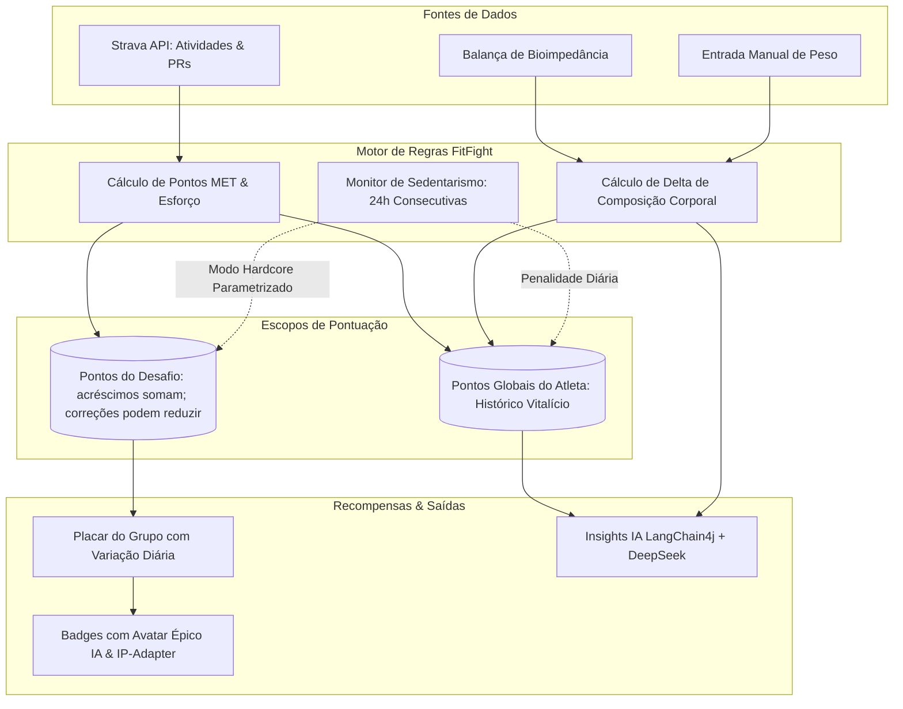

# FitFight — Documentação Canônica de Especificação Funcional e Regras de Negócio

## Sumário e Navegação

Esta documentação constitui a especificação canônica, formal e executável do **FitFight**, servindo como fonte única da verdade para engenheiros de software, arquitetos de dados e agentes autônomos de IA implementarem o sistema de ponta a ponta.

A documentação está estruturada nos seguintes módulos temáticos navegáveis:

1. [Motor de Gamificação e Pontuação Normalizada (MET)](gamification-scoring-engine.md)
   - Princípios do sistema de pontuação e taxonomia de pontos (Globais vs. Relativos de Desafio).
   - Pontuação inicial de fitness no cadastro ($P_{\text{inicial}}$) via integrações.
   - Fórmula matemática de atividade ponderada por MET, Fator Ambiente e Reserva Cardíaca.
   - Normalização pelo Baseline individual, com coeficientes estabelecidos; TMB não integra a fórmula.
   - Ingestão Strava em duas etapas, sem assinatura nos POSTs de evento; ciclo `create`, `update`, `delete`, `deauthorize` e escopo `activity:read_all` para atividades privadas.
   - Bonificação de PRs com distinção entre `best_efforts`, segmentos e KOM/CR; PR de rota não é fornecido pelo Strava.
   - Algoritmo de Bioimpedância e recomposição corporal: derivação do schema, baseline inicial, banda de ruído e partição completa de quadrantes.
   - Penalidade de inatividade física após 24h consecutivas, contador baseado em `elapsed_time` e reconciliação auditável de eventos tardios; Dia Civil/Rest Day como alternativa adicional [ESTABELECIDO].
   - Alerta formal sobre desbalanceamento de escalas (atividades vs. penalidades vs. bioimpedância vs. PRs).

2. [Desafios em Grupo e Dinâmica Competitiva](challenges-and-competitions.md)
   - Ciclo de vida completo do desafio (Criação, Convite, Vigência, Janela de Graça de Auditoria e Encerramento).
   - Pontuação zero na largada; acréscimos normais não reduzem o placar, mas correções/exclusões da fonte podem reduzir a soma recalculada.
   - Cálculo de ranking relativo zerado na largada ($P_{\text{desafio}} = 0.0$) e elegibilidade $\max(C.\text{start\_date}, u.\text{joined\_at})$.
   - Algoritmo determinístico de desempate baseado no timestamp de início da atividade esportiva (`occurred_at`).
   - Snapshots diários e indicadores direcionais de ranking ($\uparrow, \downarrow, \leftrightarrow$).
   - Convites por link/e-mail; HMAC-SHA256 com TTL de 7 dias e uso único [ESTABELECIDO].

3. [Insígnias Épicas, Troféus de Vitória, Conquistas e Compartilhamento Social](ai-badges-and-social.md)
   - **Troféus de Vitória Individual**: Concedidos ao vencer um desafio, com animação de celebração (confetti) e compartilhamento via WhatsApp/Telegram/redes sociais [ESTABELECIDO].
   - Categorias visuais de insígnias (Líder Semanal, Líder Mensal e Campeão no Trono) com elegibilidade estabelecida.
   - CHAMPION_THRONE: vencer no mínimo 5 desafios seguidos; quórum mínimo de 3 participantes [ESTABELECIDO].
   - Engenharia de Prompts canônica atendendo a todos os atributos cênicos de `idea.md` (medalha, trajes, trono, cetro, coroa, amigos ajoelhados).
   - Privacidade e LGPD/GDPR: termos de consentimento primário (avatar próprio) e secundário (amigos coadjuvantes).
   - Resiliência contra latência e fallback com badges vetoriais provisórios.
   - **Galeria completa com 3 abas**: Troféus, Badges IA e Marcos (consistência e volume) [ESTABELECIDO].
   - Contratos de compartilhamento nativo: Instagram, TikTok, WhatsApp, Telegram e Strava [ESTABELECIDO].

4. [Monetização, Marketplace e Faturamento com Stripe](monetization-and-marketplace.md)
   - Feed de anúncios contextuais nativos (algoritmo de distribuição não invasiva).
   - Segmentação esportiva e cálculo de raio métrico no PostGIS via conversão para `geography`.
   - Marketplace segmentado em 3 abas (Profissionais, Produtos, Eventos) com sistema de avaliações e reviews de atletas verificados.
   - Portal do Anunciante com painel de métricas analíticas em tempo real (Impressões, Cliques, CTR, consumo de orçamento).
   - Arquitetura de pagamentos via Stripe Checkout e Elements com webhooks idempotentes.

5. [Matriz de Casos de Uso, Tabelas de Decisão e Exemplos Executáveis](use-cases-and-decision-tables.md)
   - Matriz canônica completa de casos de uso (UC01 a UC11 com atores, pré-condições, fluxos e pós-condições).
   - Tabelas de decisão booleanas executáveis (Atividades, Bioimpedância completa, Sedentarismo).
   - Exemplos numéricos detalhados ponta a ponta com simulação de atletas reais e reconciliação de arredondamento (`HALF_UP`).
   - Quadro comparativo formal de resolução das contradições e decisões canônicas de arquitetura.

6. [Arquitetura de Backend Quarkus GraalVM e Modelagem de Dados PostgreSQL](backend-architecture-and-data-modeling.md)
   - Arquitetura do Monólito Reativo Modular com diagrama de camadas (Controllers, Services, Repositories, Models, AI, Utils).
   - Validação de entrada com Jakarta Bean Validation (Hibernate Validator): anotações `@Valid`, `@NotNull`, `@Size`, constraints customizadas e validação em cascata.
   - Tratamento de erros via extensão quarkus-http-problem: mapeamento automático para RFC 9457/7807 ProblemDetails.
   - Exceções de negócio lançadas como `HttpProblem` via `FitFightExceptions` com status, título e campos customizados.
   - `ProblemPostProcessor` para campos globais como `timestamp` em todas as respostas de erro.
   - Mensagens externalizadas em `messages.properties` com `MessagesBundle` para futura internacionalização (i18n).
   - Schema completo PostgreSQL 16 com 15 tabelas, índices espaciais PostGIS e filas PGMQ transacionais.
   - Migrações de banco versionadas com Liquibase via changelogs YAML aplicados no startup.
   - Contratos RESTful para todos os módulos: Auth, Users, Activities, Challenges, Troféus, Galeria, Marketplace, Ads, Webhooks e AI Insights.
   - Segurança JWT RS256, Rate Limiting Token Bucket, criptografia bcrypt/argon2 e privacidade LGPD/GDPR.
   - Configuração Quarkus para GraalVM, jobs agendados e diagrama de deploy no DigitalOcean.

7. [Arquitetura Frontend Multiplataforma (KMP) e Autenticação OAuth2](frontend-kmp-architecture-and-auth.md)
   - Arquitetura KMP com Compose Multiplatform compartilhando código entre Android, iOS e Web (Wasm).
   - Módulo shared com repositórios, ViewModels MVI, cache SQLDelight e cliente HTTP Ktor.
   - Fluxo de autenticação OAuth2 completo com Spring Authorization Server (Google, Strava, e-mail/senha).
   - Detalhamento de todas as telas: Home, Perfil, Desafios, Atividades, Stats com IA, Marketplace e Painel do Anunciante.
   - **Tela de Celebração do Troféu**: Animação fullscreen com troféu dourado, confetti e botões de ação [ESTABELECIDO].
   - **Galeria de Conquistas**: 3 abas (Troféus, Badges IA, Marcos) com grids e listas interativas [ESTABELECIDO].
   - Integração com geolocalização nativa, compartilhamento social (Instagram, TikTok, WhatsApp, Telegram, Strava) e design system.

8. [Pipelines de IA, Infraestrutura DigitalOcean e CI/CD](ai-pipelines-infrastructure-cicd.md)
   - Fluxo RAG dinâmico com LangChain4j e DeepSeek para insights de saúde na tela de estatísticas.
   - Fila assíncrona PGMQ para geração de avatares com IP-Adapter/FLUX e fallback vetorial provisório.
   - Infraestrutura como código com Terraform: Managed PostgreSQL 16, App Platform e DigitalOcean Spaces.
   - Pipelines CI/CD com GitHub Actions: compilação nativa GraalVM, testes com Testcontainers e deploy contínuo.
   - Estrutura de diretórios do repositório, migrações com Liquibase e monitoramento com health checks.

---

## Visão Geral do Sistema e Arquitetura de Gamificação

O **FitFight** transforma atividades físicas cotidianas e a evolução da composição corporal em uma competição gamificada justa, motivadora e sustentável. Diferente de aplicativos que medem apenas volume bruto de treino (favorecendo atletas de elite e desmotivando iniciantes), o FitFight utiliza o **Equivalente Metabólico da Tarefa (MET)** associado à **Frequência Cardíaca** e normalizado contra o **Baseline individual** de cada participante.

---

## Convenções Adotadas nesta Documentação

- **[ESTABELECIDO]**: Requisito, comportamento ou regra estrutural imutável, alinhada com a concepção original de `idea.md` e os requisitos centrais do projeto.
- **[PROPOSTO - REQUER VALIDAÇÃO DE PRODUTO]**: (Reservado — todos os itens pendentes foram consolidados como [ESTABELECIDO] em outubro de 2026.)
- **Precisão Numérica**: Todos os cálculos de pontuação utilizam tipos decimais de precisão fixa (`BigDecimal` no backend Kotlin com escala 2 e arredondamento `HALF_UP`), prevenindo discrepâncias por ponto flutuante.
- **180 Caracteres por Linha**: Todo código Kotlin respeita o limite de 180 caracteres por linha, evitando quebras desnecessárias para favorecer a leitura esquerda→direita.
