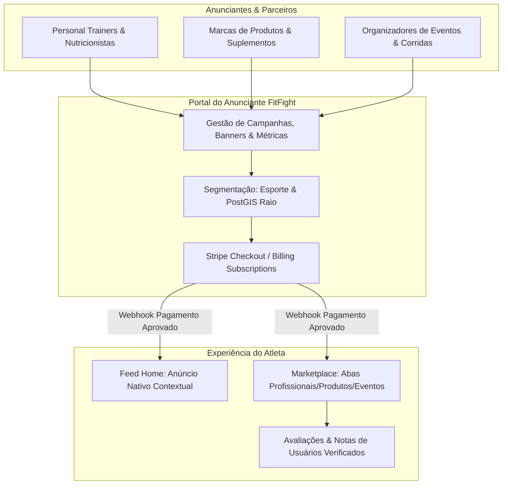
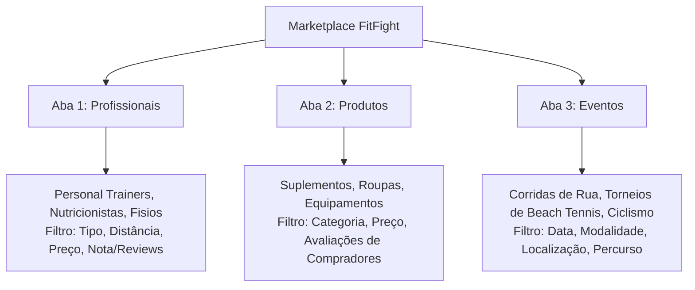
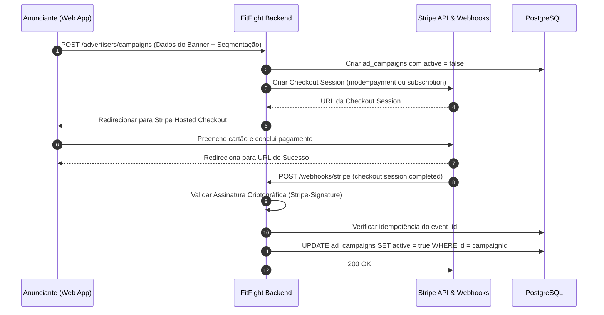

# Monetização, Marketplace e Faturamento com Stripe

[Voltar ao Índice Geral](index.md)

---

## 1. Visão Geral do Modelo de Negócio

O FitFight adota um modelo de **Uso Gratuito para Atletas** (*Free-to-Play Social Fitness*), garantindo acesso irrestrito a todas as funcionalidades de sincronização, gamificação e desafios de grupo. A sustentabilidade financeira e monetização da plataforma apoiam-se em dois pilares centrais:

1. **Feed de Anúncios Contextuais Nativos**: Inserções publicitárias não-intrusivas no feed da Home e telas de transição, segmentadas por esporte e proximidade geográfica.
2. **Marketplace Esportivo Especializado**: Plataforma comercial categorizada em três abas (**Profissionais**, **Produtos** e **Eventos**), onde empresas e treinadores pagam por visibilidade, listagem destacada e campanhas de conversão via **Stripe**.



---

## 2. Feed de Anúncios Contextuais Nativos

### 2.1 Política de Exibição Não-Invasiva [ESTABELECIDO]
Para preservar uma experiência de usuário fluida e agradável:
- **Frequência de Inserção (Ad Density)**: No feed principal da Home, exibe-se no máximo **1 anúncio a cada 5 cards de conteúdo orgânico** (atividades de amigos e cards de desafios) [ESTABELECIDO].
- **Identificação Visual**: Todo card publicitário exibe discretamente a tag *"Patrocinado"* no canto superior direito.
- **Formato Nativo**: O anúncio adota a mesma tipografia e cantos arredondados dos cards de atividades normais, contendo imagem contextual, chamada atrativa e botão de Ação Direta (CTA - *Call to Action*).

### 2.2 Algoritmo de Relevância e Segmentação Espacial [ESTABELECIDO]
A seleção de anúncios considera dois filtros determinísticos implementados no banco de dados espacial PostgreSQL / PostGIS:

1. **Afinidade Esportiva**:
   $$\text{Match}_{\text{esporte}} = (\text{campaign}.\text{target\_sport} \text{ IS NULL} \lor \text{campaign}.\text{target\_sport} == \text{'ALL'} \lor \text{campaign}.\text{target\_sport} == u.\text{favorite\_sport})$$

2. **Proximidade Geográfica via PostGIS (Conversão para Metros)**:
   *Resolução de Viabilidade Técnica*: Como o campo `location` em `users` e `ad_campaigns` é do tipo `GEOMETRY(Point, 4326)`, medições em metros exigem conversão explícita para o tipo `geography` no PostGIS para calcular distâncias geodésicas esféricas reais:
   ```sql
   WHERE (
       -- Caso A: Campanha nacional / online sem restrição de raio geográfico
       (campaign.target_location IS NULL OR campaign.max_radius_km IS NULL)
       OR
       -- Caso B: Campanha local com usuário posicionado dentro do raio métrico
       (u.location IS NOT NULL AND ST_DWithin(u.location::geography, campaign.target_location::geography, campaign.max_radius_km * 1000.0))
   )
   ```

3. **Fallbacks de Localização**:
   - Se o usuário não concedeu permissão de GPS (`u.location IS NULL`), o feed entrega apenas campanhas de abrangência nacional ou online (`campaign.target_location IS NULL`).
   - Se nenhuma campanha local qualificar para o usuário, o sistema exibe anúncios globais relevantes para sua modalidade esportiva preferida.

4. **Critério de Rotação e Prevenção de Fadiga**:
   Dentre as campanhas ativas que atendem aos filtros, o sistema prioriza aquela com menor taxa de frequência acumulada para o usuário no dia, rotacionando os anunciantes equitativamente.

---

## 3. Marketplace Esportivo em Três Abas [ESTABELECIDO]

O Marketplace é acessível na barra de navegação principal e organiza o ecossistema fitness em três seções navegáveis:



### 3.1 Aba 1 — Profissionais
- **Público**: Personal Trainers, Consultores Esportivos, Nutricionistas e Fisioterapeutas.
- **Card de Perfil**: Foto profissional, registro de classe (ex: CREF/CRN), especialidades esportivas, raio de atendimento presencial ou indicação de consultoria online.
- **Filtros Disponíveis**: Modalidade de treino, proximidade em km (PostGIS), preço/hora ou mensalidade e nota média de avaliações (1 a 5 estrelas).

### 3.2 Aba 2 — Produtos
- **Público**: Lojas de suplementação, vestuário técnico, calçados e equipamentos de treino.
- **Card de Produto**: Imagem do produto, preço promocional exclusivo FitFight, selo de cupom e link direto para o e-commerce parceiro.

### 3.3 Aba 3 — Eventos
- **Público**: Organizadores de corridas de rua, travessias aquáticas, granfondos de ciclismo e torneios de crossfit.
- **Card de Evento**: Data e horário, percursos disponíveis (ex: 5k, 10k, 21k), altimetria acumulada, lote de ingressos e botão de inscrição externa.

### 3.4 Sistema de Avaliações e Reviews de Usuários [ESTABELECIDO]
Conforme preconizado em `idea.md` (*"including reviews and ratings from other users"*):
- Cada profissional, produto ou evento do marketplace possui uma seção de avaliações comunitárias:
  - **Classificação**: Escala quantitativa de **1 a 5 estrelas** e comentário qualitativo em texto.
  - **Selo de Usuário Verificado**: Avaliações concedidas por atletas que comprovaram contratação ou compra no aplicativo recebem a etiqueta *"Atleta Verificado"*, conferindo credibilidade ao feedback.
  - **Moderação Comunitária**: Mecanismo de denúncia de avaliações ofensivas ou suspeitas de difamação/spam comercial, com moderação automática e manual.

---

## 4. Portal do Anunciante, Métricas e Faturamento via Stripe

### 4.1 Cadastro de Anunciante e Gestão de Campanhas [ESTABELECIDO]
Empresas e profissionais autônomos podem se registrar como anunciantes:
- **Dados Cadastrais**: Razão Social / Nome Profissional, Documento Fiscal (`tax_id`: CNPJ ou CPF), E-mail comercial e Telefone.
- **Conta Stripe Customer**: No primeiro acesso, o backend FitFight provisiona via API um `stripe_customer_id` associado ao anunciante.

### 4.2 Métricas do Painel [ESTABELECIDO]
Conforme previsto em `idea.md` e nos requisitos de produto (*"acompanharem impressões/cliques"*):
- O painel exibe em tempo real o desempenho de cada campanha publicitária:
  1. **Impressões (Ad Views)**: Uma impressão é válida quando **50% da área visível do anúncio permanece na tela por mais de 1 segundo contínuo** [ESTABELECIDO].
  2. **Cliques (Clicks / Tap Action)**: Contabilizado no momento em que o usuário clica no botão CTA direcionando para o site ou perfil do profissional.
  3. **CTR (Click-Through Rate)**: Calculado por $\text{CTR} = \frac{\text{Cliques}}{\text{Impressões}} \times 100\%$.
  4. **Pacing de Orçamento**: Gráfico demonstrando o consumo do saldo de impressões ao longo dos dias da campanha.

### 4.3 Modelos de Faturamento e Preços [ESTABELECIDO]

O FitFight disponibiliza duas modalidades comerciais:

1. **Campanha Avulsa por Impressões (CPM / Custo por Mil)**:
   - O anunciante adquire um pacote de impressões (ex: $10.000\text{ impressões}$ por $\text{R\$ } 150,00$) [ESTABELECIDO].
   - A cobrança é realizada pontualmente via **Stripe Checkout Session**.
   - A campanha permanece ativa até o esgotamento do saldo de impressões adquiridas.

2. **Assinatura Recorrente de Visibilidade Premium (Marketplace Pro)**:
   - Mensalidade recorrente (ex: $\text{R\$ } 99,00\text{/mês}$) [ESTABELECIDO] processada via **Stripe Billing / Subscriptions**.
   - Garante selo de *"Profissional Verificado"*, prioridade no topo das buscas do Marketplace e métricas analíticas detalhadas.

### 4.4 Fluxo de Pagamento e Webhooks Idempotentes do Stripe



### 4.5 Tratamento de Inadimplência e Ciclo de Vida da Campanha [ESTABELECIDO]
- Caso uma assinatura recorrente falhe (`invoice.payment_failed`), o Stripe dispara tentativas de retentativa inteligente (*Smart Retries*).
- Se a cobrança for definitivamente cancelada (`customer.subscription.deleted`), o webhook do FitFight altera imediatamente a campanha vinculada para `active = false`, removendo-a das consultas espaciais e do feed de anúncios.

